# JavaScript

## 一、基础

### 1. JavaScript 是什么

JavaScript 是一种运行在客户端（浏览器）的编程语言，实现人机交互效果。


### 2. JavaScript  作用

- 网页特效 (监听用户的一些行为让网页作出对应的反馈) 
- 表单验证 (针对表单数据的合法性进行判断)
- 数据交互 (获取后台的数据, 渲染到前端)
- 服务端编程 (node.js)


### 3. JavaScript的组成

-  ECMAScript：规定了js基础语法核心知识。比如：变量、分支语句、循环语句、对象等等。
- Web APIs：
  - DOM 操作文档，比如对页面元素进行移动、大小、添加删除等操作
  - BOM 操作浏览器，比如页面弹窗，检测窗口宽度、存储数据到浏览器等等


### 4. JavaScript 书写位置

> 目标：知道如何向页面添加 JavaScript

#### 4.1  内部 JavaScript

- 直接写在html文件里，用script标签包住
- 规范：script标签写在上面

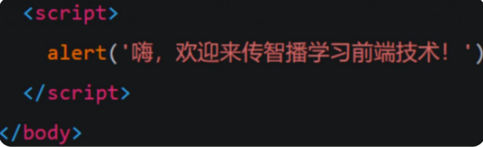

```
注意事项：
 - 我们将 <script> 放在HTML文件的底部附近的原因是浏览器会按照代码在文件中的顺序加载 HTML。
 - 如果先加载的 JavaScript 期望修改其下方的 HTML，那么它可能由于 HTML 尚未被加载而失效。
 - 因此，将 JavaScript 代码放在 HTML页面的底部附近通常是最好的策略。
```


#### 4.2 外部 JavaScript

- 代码写在以.js结尾的文件里
- 语法：通过script标签，引入到html页面中。

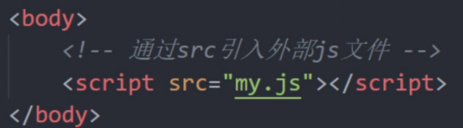

```
注意事项
 - script标签中间无需写代码，否则会被忽略！
 - 外部JavaScript会使代码更加有序，更易于复用，且没有了脚本的混合，HTML 也会更加易读，因此这是个好的习惯。
```


#### 4.3 内联 JavaScript

- 代码写在标签内部

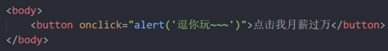


### 5. JavaScript 的注释

> 目标：会使用两种JavaScript注释方法

- 单行注释
  - 符号：//
  - 作用：//右边这一行的代码会被忽略
  - 快捷键：ctrl + /
- 块注释
  - 符号：/* */
  - 作用：在/* 和 */ 之间的所有内容都会被忽略
  - 快捷键：shift + alt + A


### 6. JavaScript的结束符

> 目标：了解JavaScript结束符

- 结束符
  - 作用： 使用英文的 ; 代表语句结束
  - 实际情况： 实际开发中，可写可不写, 浏览器(JavaScript 引擎) 可以自动推断语句的结束位置
  - 现状： 在实际开发中，越来越多的人主张，书写 JavaScript 代码时省略结束符
  - 约定：为了风格统一，结束符要么每句都写，要么每句都不写（按照团队要求.）

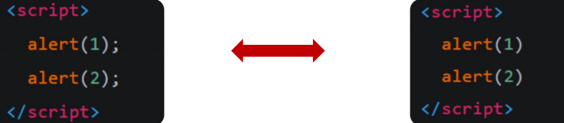


### 7. 输入和输出语法

什么是语法： 

- 人和计算机打交道的规则约定
- 我们要按照这个规则去写
- 比如： 你吃了吗？
- 我们程序员需要操控计算机，需要计算机能看懂

输出和输入也可理解为人和计算机的交互，用户通过键盘、鼠标等向计算机输入信息，计算机处理后再展示结果给用户，这便是一次输入和输出的过程。


#### 7.1 输出语法

语法1：

```javascript
document.write('要写出的内容')
```

- 作用：向body内输出内容
- 注意：如果输出的内容写的是标签，也会被解析成网页元素

语法2：

```javascript
alert('要出的内容')
```

- 作用：页面弹出警告对话框

语法3：

```javascript
console.log('控制台打印')
```

- 作用：控制台输出语法，程序员调试使用


#### 7.2 输入语法

语法：

```javascript
prompt('请输入您的名字：')
```

作用：显示一个对话框，对话框中包含一条文字信息，用来提示用户输入文字


#### 7.3 代码执行顺序

JavaScript 代码执行顺序：

- 按HTML文档流顺序执行JavaScript代码
- alert() 和 prompt() 它们会跳过页面渲染先被执行（目前作为了解，后期讲解详细执行过程）


### 8. 字面量

目标：能说出什么是字面量

在计算机科学中，字面量（literal）是在计算机中描述 事/物

比如：

- 我们工资是：1000 此时 1000 就是 数字字面量
- '黑马程序员' 字符串字面量
- 还有接下来我们学的 [] 数组字面量 {} 对象字面量 等等


## 二、变量

### 1. 变量是什么

> 问题1：用户输入的数据我们如何存储起来？
>
> 答案1：变量

变量：

- 白话：变量就是一个装东西的盒子。
- 通俗：变量是计算机中用来存储数据的“容器”，它可以让计算机变得有记忆。
- 注意：变量不是数据本身，它们仅仅是一个用于存储数值的容器。可以理解为是一个个用来装东西的纸箱子。


### 2. 变量基本使用

#### 2.1 声明变量

要想使用变量，首先需要创建变量（也称为声明变量或者定义变量）

语法：

```javascript
let 变量名
```

- 声明变量有两部分构成：声明关键字、变量名（标识）
- let 即关键字 (let: 允许、许可、让、要)，所谓关键字是系统提供的专门用来声明（定义）变量的词语


#### 2.2 变量赋值

定义了一个变量后，你就能够初始化它（赋值）。在变量名之后跟上一个“=”，然后是数值。

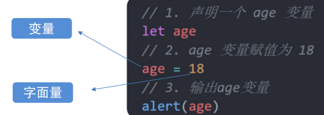

注意：是通过变量名来获得变量里面的数据

简单点，也可以声明变量的时候直接完成赋值操作,这种操作也称为 变量初始化。

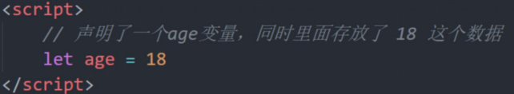


#### 2.3 更新变量

变量赋值后，还可以通过简单地给它一个不同的值来更新它。

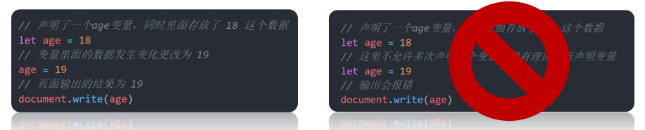

注意： let 不允许多次声明一个变量。


#### 2.4 声明多个变量

变量赋值后，还可以通过简单地给它一个不同的值来更新它。

语法：多个变量中间用逗号隔开。

```javascript
let age = 18, uname = 'pink'
```

说明：看上去代码长度更短，但并不推荐这样。为了更好的可读性，请一行只声明一个变量。

```javascript
//多行变量声明有点长，但更容易阅读 
let age = 18
let uname = 'pink'
```


### 3. 变量的本质

内存：计算机中存储数据的地方，相当于一个空间

变量本质：是程序在内存中申请的一块用来存放数据的小空间

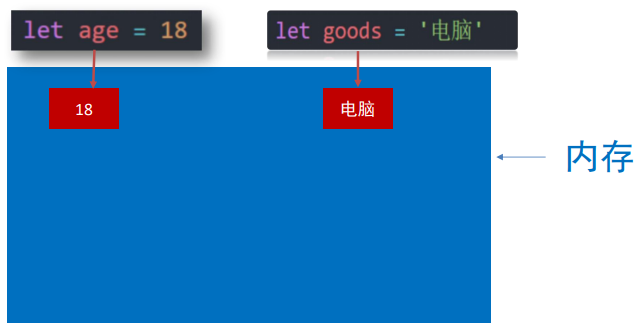


### 4. 变量命名规则与规范

- 规则：必须遵守，不遵守报错 (法律层面) 
  - 不能用关键字(有特殊含义的字符，JavaScript 内置的一些英语词汇。例如：let、var、if、for等)
  - 只能用下划线、字母、数字、$组成，且数字不能开头
  - 字母严格区分大小写，如 Age 和 age 是不同的变量
- 规范：建议，不遵守不会报错，但不符合业内通识 （道德层面）
  - 起名要有意义
  - 遵守小驼峰命名法(第一个单词首字母小写，后面每个单词首字母大写。例：userName)


### 5. let和var的区别

> 在较旧的JavaScript，使用关键字 var 来声明变量 ，而不是 let。 
>
> var 现在开发中一般不再使用它，只是我们可能再老版程序中看到它。 let 为了解决 var 的一些问题。

var 声明:

- 可以先使用 在声明 (不合理) 
- var 声明过的变量可以重复声明(不合理)
- 比如变量提升、全局变量、没有块级作用域等等

结论： var 就是个bug，别迷恋它了，以后声明变量我们统一使用 let


### 6. 数组

数组 (Array) —— 一种将 一组数据存储在单个变量名下 的优雅方式

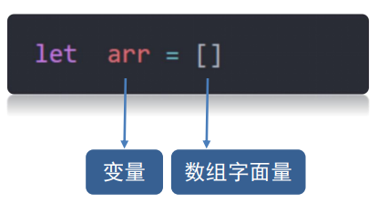


#### 6.1 声明语法

```javascript
let 数组名 = [数据1, 数据2, ..., 数据n]
```

- 数组是按顺序保存，所以每个数据都有自己的编号
- 计算机中的编号从0开始，所以小明的编号为0，小刚编号为1，以此类推 
- 在数组中，数据的编号也叫索引或下标
- 数组可以存储任意类型的数据


#### 6.2 取值语法

```javascript
数组名[下标]
```

- 通过下标取数据
- 取出来是什么类型的，就根据这种类型特点来访问


## 三、常量

### 1. 基本使用

- 概念：使用 const 声明的变量称为“常量”。
- 使用场景：当某个变量永远不会改变的时候，就可以使用 const 来声明，而不是let。
- 命名规范：和变量一致

常量使用：

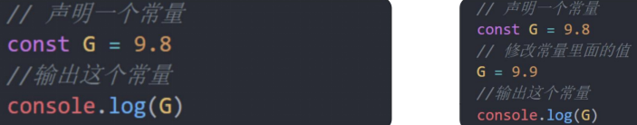

- 注意： 常量不允许重新赋值，声明的时候必须赋值（初始化）
- 小技巧：不需要重新赋值的数据使用const 


## 四、数据类型

计算机世界中的万事万物都是数据。

计算机程序可以处理大量的数据，为什么要给数据分类？

1. 更加充分和高效的利用内存
2. 也更加方便程序员的使用数据

JS 数据类型整体分为两大类：

- 基本数据类型
  - number 数字型
  - string 字符串型
  - boolean 布尔型
  - undefined 未定义型
  - null 空类型
- 引用数据类型
  - object 对象


### 1. 基本数据类型

#### 1.1 数字类型(Number)

即我们数学中学习到的数字，可以是整数、小数、正数、负数。

```javascript
let age = 18//整数 
letprice = 88.99//小数
```

JavaScript 中的正数、负数、小数等 统一称为 数字类型。

注意事项

- JS 是弱数据类型，变量到底属于那种类型，只有赋值之后，我们才能确认
- Java是强数据类型 例如 int a = 3 必须是整数


#### 1.2 字符串类型(string)

通过单引号（ ''） 、双引号（ ""）或反引号( ` ) 包裹的数据都叫字符串，单引号和双引号没有本质上的区别，推荐使用单引号。

```javascript
let uname = '小明' //使用单引号
let gender = "男" //使用双引号
let goods = '小米' //使用反引号
let te1 = '13681113456' //看上去是数字，但是引号包裹了就是字符串
let str = '' //这种情况叫空字符串 
```

注意事项：

1. 无论单引号或是双引号必须成对使用 
2. 单引号/双引号可以互相嵌套，但是不以自已嵌套自已（口诀：外双内单，或者外单内双)
3. 必要时可以使用转义符 \，输出单引号或双引号


##### 1.2.1 字符串拼接

场景： + 运算符 可以实现字符串的拼接。

口诀：数字相加，字符相连

```javascript
document.write('我叫' + '刘德华') //我叫刘德华
let uname = '刘德华'
let song = '忘情水'
document.write(uname + song) //刘德华忘情水
```


##### 1.2.2 模板字符串

使用场景

- 拼接字符串和变量
- 在没有它之前，要拼接变量比较麻烦

```javascript
document.write('大家好，我叫' + name + '，今年' + age + '岁')
```

语法

- `` (反引号)
- 在英文输入模式下按键盘的tab键上方那个键（1左边那个键） 
- 内容拼接变量时，用 ${ } 包住变量

```javascript
document.write(`大家好，我叫${name}，今年${age}岁`)
```


#### 1.3 布尔类型(boolean)

表示肯定或否定时在计算机中对应的是布尔类型数据。

它有两个固定的值 true 和 false，表示肯定的数据用 true（真），表示否定的数据用false（假）。

```javascript
//JavaScript好玩不？
let isCool = true 
console.log(isCool)
```


#### 1.4 未定义类型(undefined)

未定义是比较特殊的类型，只有一个值 undefined。

什么情况出现未定义类型？

只声明变量，不赋值的情况下，变量的默认值为 undefined，一般很少【直接】为某个变量赋值为undefined。

```javascript
let age // 声明变量但是未赋值
document.write(age) // 输出 undefined
```

工作中的使用场景：

我们开发中经常声明一个变量，等待传送过来的数据。

如果我们不知道这个数据是否传递过来，此时我们可以通过检测这个变量是不是undefined，就判断用户是否有数据传递过来


#### 1.5 null(空类型)

JavaScript 中的 null 仅仅是一个代表“无”、“空”或“值未知”的特殊值

```javascript
let obj = null
console.log(obj) // null
```

null 和 undefined 区别：

- undefined 表示没有赋值
- null 表示赋值了，但是内容为空

null 开发中的使用场景：

- 官方解释：把 null 作为尚未创建的对象
- 大白话： 将来有个变量里面存放的是一个对象，但是对象还没创建好，可以先给个null


### 2. 控制台输出语句和检测数据类型

#### 2.1  控制台输出语句

控制台输出语句：

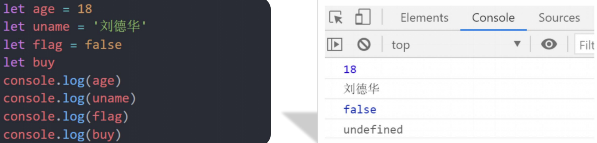

- 控制台语句经常用于测试结果来使用。 
- 可以看出数字型和布尔型颜色为蓝色，字符串和undefined颜色为灰色


#### 2.2 检测数据类型

typeof 运算符可以返回被检测的数据类型。它支持两种语法形式：

1. 作为运算符： typeof x (常用的写法)
2. 函数形式： typeof(x)

换言之，有括号和没有括号，得到的结果是一样的，所以我们直接使用运算符的写法。

```javascript
let age = 18
let uname = '刘德华'
let flag = false 
let buy
console.log(typeof age) // number
console.log(typeof uname) // string
console.log(typeof flag) // boolean
console.log(typeof buy) // undefined
```


### 3. 算数运算符

数字可以有很多操作，比如，乘法 * 、除法 / 、加法 + 、减法 - 等等，所以经常和算术运算符一起。

数学运算符也叫算术运算符，主要包括加、减、乘、除、取余（求模）。

- +：求和
- -：求差
- *：求积
- /：求商
- %：取模（取余数）


优先级：

JavaScript中 优先级越高越先被执行，优先级相同时以书从左向右执行。

-  乘、除、取余优先级相同
- 加、减优先级相同
- 乘、除、取余优先级大于加、减
- 使用 () 可以提升优先级


### 4. NaN

NaN 代表一个计算错误。它是一个不正确的或者一个未定义的数学操作所得到的结果

```javascript
console.log('老师' - 2) // NaN
```

NaN 是粘性的。任何对 NaN 的操作都会返回 NaN

```javascript
console.log(NaN + 2) // NaN
```


## 五、类型转换

### 1. 为什么要类型转换

JavaScript是弱数据类型： JavaScript也不知道变量到底属于那种数据类型，只有赋值了才清楚。

```javascript
// 坑：使用表单、prompt 获取过来的数据默认是字符串类型的，此时就不能直接简单的进行加法运算。
console.log('10000'+'2000') // 输出结果 100002000
```

此时需要转换变量的数据类型。

通俗来说，就是把一种数据类型的变量转换成我们需要的数据类型。


### 2. 隐式转换

某些运算符被执行时，系统内部自动将数据类型进行转换，这种转换称为隐式转换。

规则：

- \+ 号两边只要有一个是字符串，都会把另外一个转成字符串
- 除了+以外的算术运算符 比如 - * / 等都会把数据转成数字类型 

缺点：转换类型不明确，靠经验才能总结

小技巧：

- +号作为正号解析可以转换成数字型
- 任何数据和字符串相加结果都是字符串

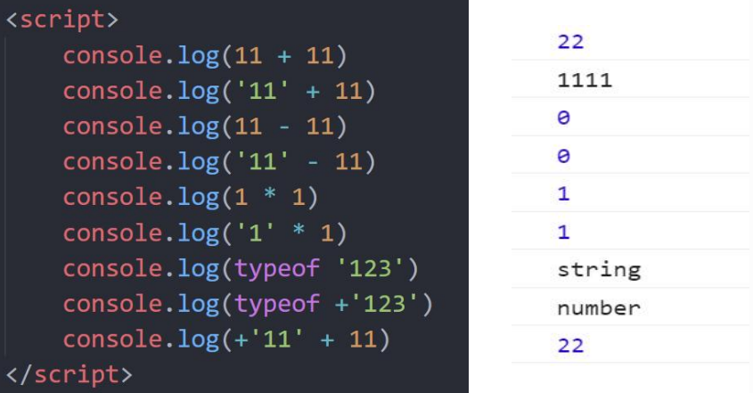


### 3. 显式转换

编写程序时过度依靠系统内部的隐式转换是不严禁的，因为隐式转换规律并不清晰，大多是靠经验总结的规律。为了避免因隐式转换带来的问题，通常根逻辑需要对数据进行显示转换。

概念： 自己写代码告诉系统该转成什么类型

转换为数字型：

- Number(数据)
  - 转成数字类型
  - 如果字符串内容里有非数字，转换失败时结果为 NaN(Not a Number)即不是一个数字
  - NaN也是number类型的数据，代表非数字
- parseInt(数据) 
  - 只保留整数
- parseFloat(数据)
  - 可以保留小数

转换为字符型：

- String(数据)
- 变量.toString(进制)


## 六、运算符

### 1. 赋值运算符

> 对变量进行赋值的运算符

已经学过的赋值运算符：= 将等号右边的值赋予给左边, 要求左边必须是一个容器

其他赋值运算符： 

- +=
- -=
- *=
- /=
- %=

使用这些运算符可以在对变量赋值时进行快速操作


### 2. 一元运算符

众多的 JavaScript 的运算符可以根据所需表达式的个数，分为一元运算符、二元运算符、三元运算符

二元运算符：

```javascript
let num = 10 + 20
```

一元运算符：

```javascript
let num = 1
++num
--num
```


### 3. 比较运算符

比较运算符

- \>：左边是否大于右边
- <：左边是否小于右边
- \>=：左边是否大于或等于右边
- <=：左边是否小于或等于右边
- ==：左右两边值是否相等
- ===：左右两边是否类型和值都相等
- !==：左右两边是否不全等
- 比较结果为boolean类型，即只会得到 true 或 false


注意：

1. 字符串比较，是比较的字符对应的ASCII码
2. NaN不等于任何值，包括它本身
3. 尽量不要比较小数，因为小数有精度问题
4. 不同类型之间比较会发生隐式转换
   - 最终把数据隐式转换转成number类型再比较。
   -  所以开发中，如果进行准确的比较我们更喜欢 === 或者 !==


### 4. 逻辑运算符

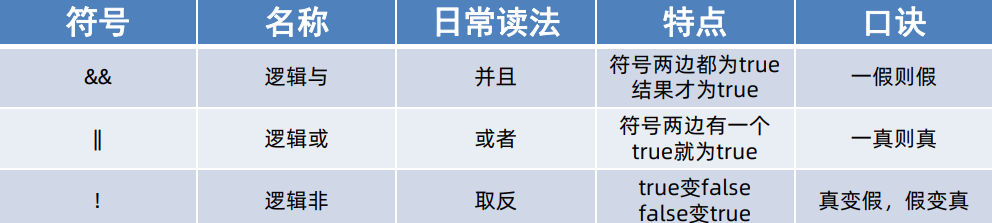


### 5. 运算符优先级

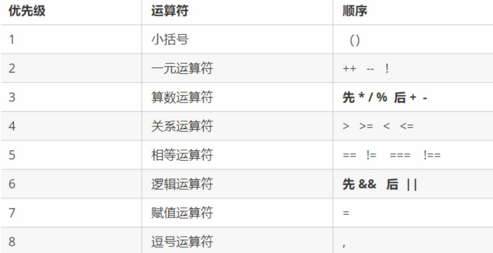

- 一元运算符里面的逻辑非优先级很高
- 逻辑与比逻辑或优先级高


## 七、语句

### 1. 表达式和语句

表达式：表达式是可以被求值的代码，JavaScript 引擎会将其计算出一个结果。

```
x = 7
3 + 4
num++
```

语句：语句是一段可以执行的代码。比如：prompt() 可以弹出一个输入框，还有 if语句 for 循环语句等等


### 2. 分支语句

#### 2.1  If分支语句

if语句有三种使用：单分支、双分支、多分支

1. 单分支使用语法：

```javascript
if(条件) {
	满足条件要执行的代码
}
```

- 括号内的条件为true时，进入大括号里执行代码
- 小括号内的结果若不是布尔类型时，会发生隐式转换转为布尔类型
- 如果大括号只有一个语句，大括号可以省略，但是，俺们不提倡这么做~


2. 双分支if语法：

```javascript
if(条件){
	满足条件要执行的代码
} else {
	不满足条件执行的代码
}
```


3. 多分支if语法：

```
if (条件1) {
	代码1
} else if (条件2) {
	代码2
} else if (条件3) {
	代码3
else {
	代码n
}
```


#### 2.2 三元运算符

使用场景： 其实是比 if 双分支 更简单的写法，可以使用 三元表达式

符号：? 与 : 配合使用

语法：

```javascript
条件 ? 满足条件执行的代码 : 不满足条件执行的代码
```


#### 2.3  switch 语句

```javascript
switch (数据) {
    case 值1:
    	代码1
        break
    case 值2:
    	代码2
        break
    default:
    	代码n
        break
}
```

释义：

- 找到跟小括号里数据全等的case值，并执行里面对应的代码
- 若没有全等 === 的则执行default里的代码
- 例：数据若跟值2全等，则执行代码2

注意事项

1. switch case语句一般用于等值判断,不适合于区间判断
2. switch case一般需要配合break关键字使用没有break会造成case穿透


### 3. 循环语句

#### 3.1 断点调试

作用：学习时可以帮助更好的理解代码运行，工作时可以更快找到bug

浏览器打开调试界面

1. 按F12打开开发者工具
2. 点到sources一栏
3. 选择代码文件

断点：在某句代码上加的标记就叫断点，当程序执行到这句有标记的代码时会暂停下来

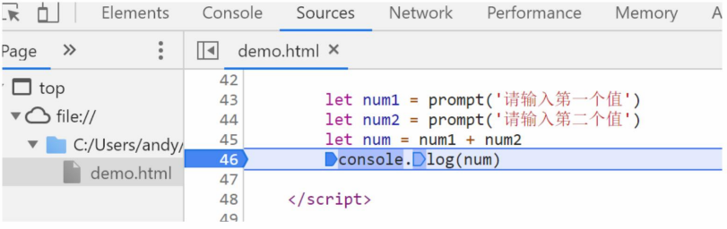


#### 3.2 while循环

循环：重复执行一些操作， while : 在…. 期间， 所以 while循环 就是在满足条件期间，重复执行某些代码。

比如我们运行相同的代码输出5次（输出5句 “我学的很棒”）

while 循环基本语法：

```javascript
while(循环条件) {
    要重复执行的代码(循环体)
}
```

释义：

1. 跟if语句很像，都要满足小括号里的条件为true才会进入 循环体 执行代码
2. while大括号里代码执行完毕后不会跳出，而是继续回到小括号里判断条件是否满足，若满足又执行大括号里的代码，然后再回到小括号判断条件，直到括号内条件不满足，即跳出

循环的本质就是以某个变量为起始值，然后不断产生变化量，慢慢靠近终止条件的过程。

所以，while循环需要具备三要素：

1. 变量起始值
2. 终止条件(没有终止条件，循环会一直执行，造成死循环)
3. 变量变化量(用自增或者自减)


## 八、循环for

### 1. for循环语法

作用：重复执行代码

好处：把声明起始值、循环条件、变化值写到一起，让人一目了然，它是最常使用的循环形式

```javascript
for (变量起始值; 终止条件; 变量变化量) {
	//循环体
}
```


### 2. 退出循环

- continue 退出本次循环，一般用于排除或者跳过某一个选项的时候, 可以使用continue
- break 退出整个for循环，一般用于结果已经得到, 后续的循环不需要的时候可以使用


### 3. 遍历数组 forEach 方法

forEach() 方法用于调用数组的每个元素，并将元素传递给回调函数

主要使用场景：遍历数组的每个元素

语法：

```javascript
被遍历的数组.forEach(function (当前数组元素, 当前元素索引号) {
	// 函数体
})
```

例如：

```javascript
const arr = ['pink', 'red', 'green']
arr.forEach(function (item, index) {
	console.log(`当前数组元素是:${item}`)//依次打印数组每一个元素
	console.log(`当前数组元素的索引是:${index}`)//依次打印数组每一个元素的索引
})
```

注意：
1. forEach 主要是遍历数组
2. 参数当前数组元素是必须要写的， 索引号可选。


## 九、数组

### 1. 数组是什么

数组：(Array)是一种可以按顺序保存数据的数据类型

为什么要数组？

- 思考：如果我想保存一个班里所有同学的姓名怎么办？
- 场景：如果有多个数据可以用数组保存起来，然后放到一个变量中，管理非常方便


### 2. 数组的基本使用

#### 2.1 声明语法

```javascript
let 数组名 = [数据1, 数据2, ..., 数据n]
let arr = new Array(数据1,数据2, ..., 数据n)
```

- 数组是按顺序保存，所以每个数据都有自己的编号
- 计算机中的编号从0开始，所以小明的编号为0，小刚编号为1，以此类推
- 在数组中，数据的编号也叫索引或下标
- 数组可以存储任意类型的数据


#### 2.2 取值语法

```
数组名[下标]
```

例如：

```javascript
let names = ['小明', '小刚', '小红', '小丽', '小米']
names[0] //小明 
names[1] //小刚
```

- 通过下标取数据
- 取出来是什么类型的，就根据这种类型特点来访问


### 3. 操作数组

数组本质是数据集合, 操作数据无非就是 增 删 改 查 语法：

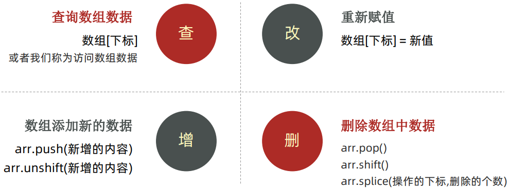


#### 3.1 增加

**数组.push()**：将一个或多个元素添加到数组的末尾，并返回该数组的新长度。

语法：

```javascript
arr.push(元素1, ..., 元素n)
```

例如：

```javascript
let arr = ['red', 'green']
arr.push('pink')
console.log(arr) // ['red', 'green', 'pink']

let arr =['red', 'green']
arr.push('pink','hotpink')
console.log（arr) // ['red', 'green', 'pink', 'hotpink']
```


**arr.unshift(新增的内容)**：将一个或多个元素添加到数组的开头，并返回该数组的新长度。

语法：

```javascript
arr.unshift(元素1, ..., 元素n)
```

例如：

```javascript
let arr =['red', 'green']
arr.unshift('pink')
console.log(arr) //['pink', 'red', 'green']

let arr =['red','green']
arr.unshift('pink','hotpink')
console.log（arr) // ['pink', 'hotpink', 'red', 'green']
```


#### 3.2 删除

**数组.pop()**：从数组中删除最后一个元素，并返回该元素的值

语法：

```javascript
arr.pop()
```

例如：

```javascript
let arr = ['red', 'green']
arr.pop()
console.log(arr) // ['red']
```


**数组.shift()**：从数组中删除第一个元素，并返回该元素的值

语法：

```javascript
arr.shift()
```

语法：

```javascript
let arr = ['red','green']
arr.shift()
console.log(arr) //['green']
```


**数组. splice()**：删除指定元素

语法：

```javascript
arr.splice(start, deleteCount)
arr.splice(起始位置, 删除几个元素)
```

- start 起始位置：指定修改的开始位置(从0计数)
- deleteCount
  - 表示要移除的数组元素的个数。
  - 可选的，如果省略则默认从指定的起始位置删除到最后。


## 十、函数

### 1. 为什么需要函数

**函数**：function，是被设计为执行特定任务的代码块

**说明**：

- 函数可以把具有相同或相似逻辑的代码“包裹”起来，通过函数调用执行这些被“包裹”的代码逻辑，这么做的优势是有利于精简代码方便复用。
- 比如我们前面使用的 alert() 、prompt() 和 console.log() 都是一些 js 函数，只不过已经封装好了，我们直接使用的


### 2. 函数使用

#### 2.1 声明

函数的声明语法：

```java
function 函数名() {
	函数体
}
```

例：

```javascript
function sayHi() {
	document.write('hai~~')
}
```


#### 2.2 命名规范

- 和变量命名基本一致
- 尽量小驼峰式命名法
- 前缀应该为动词
- 命名建议：常用动词约定

```javascript
function getName() {}
function addSquares() {}
```


#### 2.3 调用

```javascript
//函数调用，这些函数体内的代码逻辑会被执行
函数名()
```

注意：声明的函数必须调用才会真正被执行，使用 () 调用函数


### 3. 函数传参

声明语法

```javascript
function 函数名 (参数列表) {
    函数体
}

函数名(传递的参数列表)
```

参数列表

- 传入数据列表
- 声明这个函数需要传入几个数据
- 多个数据用逗号隔开


### 4. 函数返回值

当函数需要返回数据出去时，用return关键字

语法：

```javascript
return 数据
```

举例：

```javascript
function getSum(x, y) {
	return x + y
}
let num = getSum(10, 30)
document.write(num)
```

- 在函数体中使用 return 关键字能将内部的执行结果交给函数外部使用
- return 后面代码不会再被执行，会立即结束当前函数，所以 return 后面的数据不要换行写
- return函数可以没有 return，这种情况函数默认返回值为 undefined


### 5. 作用域

通常来说，一段程序代码中所用到的名字并不总是有效和可用的，而限定这个名字的可用性的代码范围就是这个名字的作用域。

作用域的使用提高了程序逻辑的局部性，增强了程序的可靠性，减少了名字冲突。

- 全局作用域：作用于所有代码执行的环境(整个 script 标签内部) 或者一个独立的 js 文件
- 局部作用域：作用于函数内的代码环境，就是 局部作用域。 因为跟函数有关系， 所以也称为函数作用域。

在JavaScript中，根据作用域的不同，变量可以分为：

- 全局变量：函数外部let的变量，全局变量在任何区域都可以访问和修改。
- 局部变量：函数内部let的变量，局部变量只能在当前函数内部访问和修改。


### 6. 匿名函数

函数可以分为：

- 具名函数 function fn() {}
- 匿名函数 function() {}

没有名字的函数, 无法直接使用。

使用方式：

- 函数表达式
- 立即执行函数


#### 6.1 表达式

将匿名函数赋值给一个变量，并且通过变量名称进行调用 我们将这个称为函数表达式。

语法：

```javascript
let fn = function() {
	函数体
}

fn() // 调用
```


#### 6.2 立即执行函数

场景介绍: 避免全局变量之间的污染

语法：

```javascript
// 方式1
(function () { console.log(11) })();

// 方式2
(function () { console.log(11) }()); 

// 不需要调用，立即执行
```

注意： 多个立即执行函数要用 ; 隔开，要不然会报错


## 十一、对象

### 1. 什么是对象 

- 对象（object）：JavaScript里的一种数据类型
- 可以理解为是一种无序的数据集合， 注意数组是有序的数据集合
- 用来描述某个事物，例如描述一个人
  - 人有姓名、年龄、性别等信息、还有吃饭睡觉打代码等功能
  - 如果用多个变量保存则比较散，用对象比较统一
- 比如描述 班主任 信息：
  - 静态特征 (姓名, 年龄, 身高, 性别, 爱好) => 可以使用数字, 字符串, 数组, 布尔类型等表示
  - 动态行为 (点名, 唱, 跳, rap) => 使用函数表示


### 2. 对象使用 

#### 2.1 对象声明语法

```
let 对象名 = {}
let 对象名 = new Object()
```


#### 2.2 对象由属性和方法组成

- 属性：信息或叫特征（名词）。 比如 手机尺寸、颜色、重量等…
- 方法：功能或叫行为（动词）。 比如 手机打电话、发短信、玩游戏…

```javascript
let对象名={
	属性名: 属性值,
    方法名: 函数
}
```


#### 2.3 属性

数据描述性的信息称为属性，如人的姓名、身高、年龄、性别等，一般是名词性的。

```javascript
let obj = {
	uname:'pink老师',
    age: 18,
	gender:'女'
}
```

- 属性都是成对出现的，包括属性名和值，它们之间使用英文 : 分隔
- 多个属性之间使用英文 , 分隔
- 属性就是依附在对象上的变量（外面是变量，对象内是属性）
- 属性名可以使用 " " 或 ' '，一般情况下省略，除非名称遇到特殊符号如空格、中横线等


##### 2.3.1 查找

- 声明对象，并添加了若干属性后，可以使用 . 获得对象中属性对应的值，我称之为属性访问。
- 语法：对象名.属性
- 简单理解就是获得对象里面的属性值。

```javascript
let person = {
    uname: 'pink老师',
    age: 18,
    gender:'女'
}

console.log(person.uname)
console.log(person.age)
console.log(person.gender)
```


##### 2.3.2 修改

 语法：对象名.属性 = 新值

```javascript
let person ={
    uname: 'pink老师'
    age: 18,
    gender: '女'
}
person.gender = '男'
console.log(person.gender)//修改了为男 
console.log(person)
```


##### 2.3.3 增加

语法：对象名.新属性 = 新值

```javascript
let person = {
	uname: 'pink老师',
    age: 18,
	gender: '女'
}
person.address = '武汉黑马'
console.log(person)
```


##### 2.3.4 删除

语法：delete 对象名.属性

```javascript
let person = {
	uname: 'pink老师',
	age: 18,
	gender:'女'
}
delete person.gender // 删除gender属性
console.log(person)
```


##### 2.3.5 查找另外写法

对于多词属性或则 - 等属性，点操作就不能用了。

我们可以采取： 对象[‘属性’] 方式， 单引号和双引号都阔以

```javascript
let person ={ 
    'user-name': 'pink老师',
    age: 18,
	gender: '女'
}
console.log(person.user-name) //NaN
console.log(person['user-name']）//pink老师
```

- 对象[‘属性’] 方式， 单引号和双引号都阔以
- 也可以用于其他正常属性。比如：person['age']
- []语法里面的值如果不添加引号 默认会当成变量解析

总结： 没有必要的时候直接使用点语法, 在需要解析变量的时候使用 [] 语法


#### 2.4 方法

数据行为性的信息称为方法，如跑步、唱歌等，一般是动词性的，其本质是函数。

```javascript
let person = {
    name: 'andy',
    sayHi: function() {
    	document.write('hi~~')
	}
}

person.sayHi()
```

1. 方法是由方法名和函数两部分构成，它们之间使用 : 分隔
2. 多个属性之间使用英文 , 分隔
3. 方法是依附在对象中的函数
4. 方法名可以使用 "" 或 ''，一般情况下省略，除非名称遇到特殊符号如空格、中横线等。


### 3. 遍历对象

for 遍历对象的问题：

- 对象没有像数组一样的length属性,所以无法确定长度
- 对象里面是无序的键值对, 没有规律. 不像数组里面有规律的下标

语法：

```javascript
let obj = {
    uname: 'andy',
    age: 18,
    sex: '男'
}
for (let k in obj) {
    console.log(k) //打印属性名
    console.log(obj[k]) //打印属性值
}
```

- 一般不用这种方式遍历数组、主要是用来遍历对象
- for in语法中的 k 是一个变量, 在循环的过程中依次代表对象的属性名
- 由于 k 是变量, 所以必须使用 [ ] 语法解析
- 一定记住：k 是获得对象的属性名， 对象名[k] 是获得 属性值


### 4. 内置对象

#### 4.1 Math

- 介绍：Math对象是JavaScript提供的一个 “数学” 对象
- 作用：提供了一系列做数学运算的方法
- Math对象包含的方法有：
  - random：生成0-1之间的随机数（包含0不包括1）
  - ceil：向上取整
  - floor：向下取整
  - max：找最大数
  - min：找最小数
  - pow：幂运算
  - abs：绝对值


## 十二、Web API 基本认知

### 1. 变量声明

1. 以后声明变量我们优先使用哪个？
   - 有了变量先给const，如果发现它后面是要被修改的，再改为let
2. 为什么const声明的对象可以修改里面的属性？
   - 因为对象是引用类型，里面存储的是地址，只要地址不变，就不会报错
   - 建议数组和对象使用 const 来声明
3. 什么时候使用let声明变量？
   - 如果基本数据类型的值或者引用类型的地址发生变化的时候，需要用let
   - 比如 一个变量进行加减运算，比如for循环中的i++


### 2. 作用和分类

作用: 就是使用 JS 去操作 html 和浏览器

分类：DOM (文档对象模型)、BOM（浏览器对象模型）

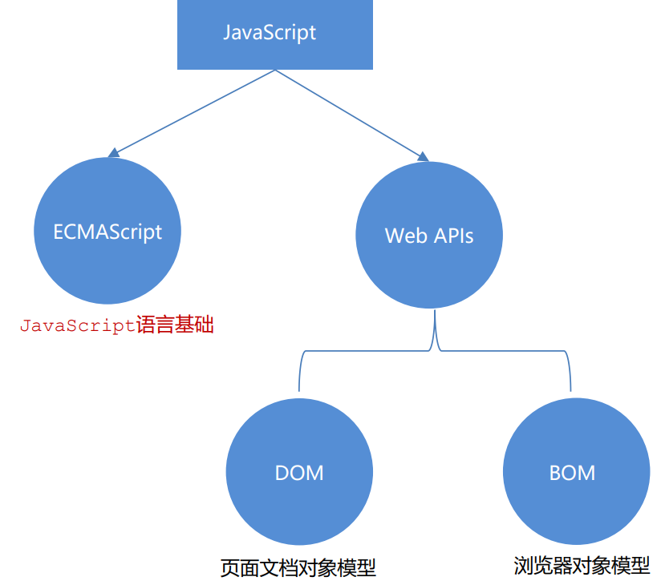


### 3. 什么是DOM

- DOM（Document Object Model——文档对象模型）是用来呈现以及与任意 HTML 或XML文档交互的API
- 白话文：DOM是浏览器提供的一套专门用来 操作网页内容 的功能
-  DOM作用：开发网页内容特效和实现用户交互

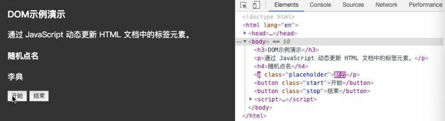


### 4. DOM树

DOM树是什么？

- 将 HTML 文档以树状结构直观的表现出来，我们称之为文档树或 DOM 树
- 描述网页内容关系的名词
- 作用：文档树直观的体现了标签与标签之间的关系

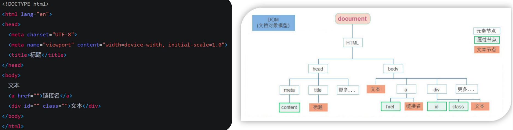


### 5. DOM对象

- DOM对象：浏览器根据html标签生成的 JS对象
  - 所有的标签属性都可以在这个对象上面找到
  - 修改这个对象的属性会自动映射到标签身上
- DOM的核心思想
  - 把网页内容当做对象来处理
- document 对象
  - 是 DOM 里提供的一个对象
  - 所以它提供的属性和方法都是用来访问和操作网页内容的
    - 例：document.write()
  - 网页所有内容都在document里面

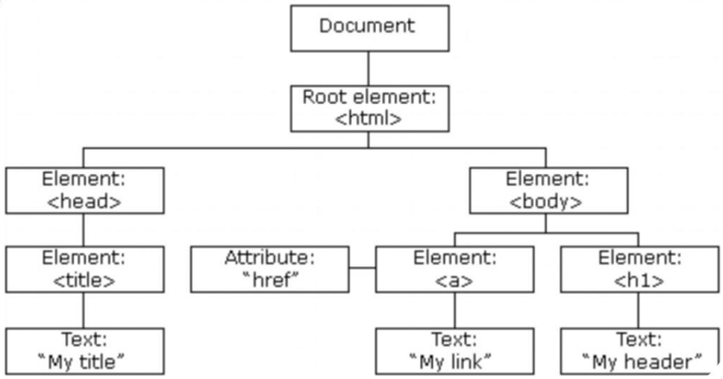


## 十三、Dom获取&属性操作

### 1. 获取DOM对象

#### 1.1 根据CSS选择器来获取DOM元素

> 查找元素DOM元素就是利用 JS 选择页面中标签元素

**选择匹配的第一个元素**

语法：document.querySelector('css选择器')

参数：包含一个或多个有效的CSS选择器 字符串

返回值： 

- CSS选择器匹配的第一个元素,一个 HTMLElement对象。
- 如果没有匹配到，则返回null。


**选择匹配的多个元素**

语法：document.querySelectorAll('css选择器')

参数: 包含一个或多个有效的CSS选择器 字符串 

返回值： CSS选择器匹配的NodeList 对象集合

例如：document.querySelectorAll('ul li')

得到的是一个伪数组：

- 有长度有索引号的数组
- 但是没有 pop() push() 等数组方法

想要得到里面的每一个对象，则需要遍历（for）的方式获得。


**其他获取DOM元素方法（了解）**

```javascript
// 根据id获取一个元素
document.getElementById('nav')

// 根据标签获取一类元素获取页面所有div 
document.getElementsByTagName('div')

// 根据类名获取元素获取页面所有类名为W的 
document.getElementsByClassName('w')
```


### 2. 操作元素内容

#### 2.1 对象.innerText 属性

-  将文本内容添加/更新到任意标签位置
- 显示纯文本，不解析标签

```javascript
const info = document.querySelector('.info') 

// 获取标签内部的文字
// console.log（info.innerText)
// 添加/修改标签内部文字内容
info.innerText= '嗨喽，俺是刘德华~'
```


#### 2.2 元素.innerHTML 属性

- 将文本内容添加/更新到任意标签位置
- 会解析标签，多标签建议使用模板字符

```javascript
const info = document.querySelector('.info') 

// 获取标签内部的文字
// console.log(info.innerHTML)
// 添加/修改标签内部文字内容
info.innerHTML = '嗨喽，俺是<strong>刘德华</strong>~'
```


### 3. 操作元素属性

#### 3.1 操作元素常用属性

- 还可以通过 JS 设置/修改标签元素属性，比如通过 src更换 图片
- 最常见的属性比如：href、title、src 等
- 语法：对象.属性=值

```javascript
// 1.获取元素
const pic = document.querySelector('img')

// 2.操作元素
pic.src = './images/b02.jpg'
pic.title = '刘德华黑马演唱会'
```


#### 3.2 操作元素样式属性

**通过 style 属性操作CSS**

语法：对象.style.样式属性 = 值

```javascript
const box = document.querySelector('.box') 
// 修改元素样式
box.style.width ='200px'
box.style.marginTop ='15px'
box.style.backgroundcolor ='pink
```

注意： 

1. 修改样式通过style属性引出
2. 如果属性有-连接符，需要转换为小驼峰命名法
3. 赋值的时候，需要的时候不要忘记加css单位


**操作类名(className) 操作CSS**

如果修改的样式比较多，直接通过style属性修改比较繁琐，我们可以通过借助于css类名的形式。

语法：元素.className = 'active'

注意：

1. 由于class是关键字, 所以使用className去代替 
2. className是使用新值换旧值, 如果需要添加一个类,需要保留之前的类名


**通过 classList 操作类控制CSS**

为了解决className 容易覆盖以前的类名，我们可以通过classList方式追加和删除类名

语法：

```javascript
// 追加一个类
元素.classList.add()'类名')
// 删除一个类
元素.classList.remove('类名')
// 切换一个类
元素.classList.toggle('类名')
```


#### 3.3 操作 表单元素 属性

表单很多情况，也需要修改属性，比如点击眼睛，可以看到密码，本质是把表单类型转换为文本框

正常的有属性有取值的 跟其他的标签属性没有任何区别

- 获取: DOM对象.属性名
-  设置: DOM对象.属性名 = 新值

```javascript
表单.value = '用户名'
表单.type = 'password'
```

 表单属性中添加就有效果,移除就没有效果,一律使用布尔值表示 如果为true 代表添加了该属性如果是false代表移除了该属性。比如： disabled、checked、selected


#### 3.4 自定义属性

标准属性: 标签天生自带的属性 比如class id title等, 可以直接使用点语法操作比如：disabled、checked、selected

自定义属性：

- 在html5中推出来了专门的data-自定义属性
- 在标签上一律以data-开头
- 在DOM对象上一律以dataset对象方式获取

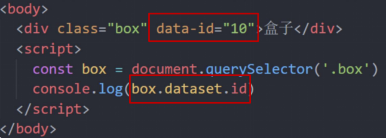


### 4. 定时器-间歇函数

#### 4.1 定时器函数介绍

网页中经常会需要一种功能：每隔一段时间需要自动执行一段代码，不需要我们手动去触发

例如：网页中的倒计时

要实现这种需求，需要定时器函数

定时器函数有两种，今天我先讲间歇函数


#### 4.2 定时器函数基本使用

 **开启定时器**

```javascript
setInterval(函数, 间隔时间)
```

- 作用：每隔一段时间调用这个函数
- 间隔时间单位是毫秒

举例：

```javascript
function repeat(){
	console.log('前端程序员，就是头发多咋滴~~')
}
// 每隔一秒调用repeat函数 
setInterval(repeat, 1000)
```

注意： 

1. 函数名字不需要加括号
2. 定时器返回的是一个id数字


**关闭定时器**

```javascript
let 变量名 = setInterval(函数, 间隔时间) 
clearInterval(变量名)
```

一般不会刚创建就停止，而是满足一定条件再停止，举例：

```javascript
let timer = setInterval(function(){
	console.log('hi~~')
},1000)
clearInterval(timer)
```

注意： 

1. 函数名字不需要加括号
2. 定时器返回的是一个id数字


## 十四、Dom事件基础

### 1. 事件监听

语法：

```javascript
元素对象.addEventListener('事件类型'，要执行的函数)
```

事件监听三要素：

- 事件源： 那个dom元素被事件触发了，要获取dom元素
- 事件类型： 用什么方式触发，比如鼠标单击 click、鼠标经过 mouseover 等
- 事件调用的函数： 要做什么事

举例：

```java
<button>按钮</button> 
<script>
	const btn = document.querySelector('.btn')
    // 修改元素样式
	btn.addEventListener('click', function(){
        alert('点击了~')
    })
</script>
```

注意：

1. 事件类型要加引号
2. 函数是点击之后再去执行，每次点击都会执行一次


**事件监听版本**

- DOM L0：事件源.on事件 = function() { }
- DOM L2：事件源.addEventListener(事件, 事件处理函数)

区别：on方式会被覆盖，addEventListener方式可绑定多次，拥有事件更多特性，推荐使用。

发展史：

- DOM L0：是 DOM 的发展的第一个版本； L：level
- DOM L1：DOM级别1 于1998年10月1日成为W3C推荐标准
- DOM L2：使用addEventListener注册事件
- DOM L3： DOM3级事件模块在DOM2级事件的基础上重新定义了这些事件，也添加了一些新事件类型


### 2. 事件类型

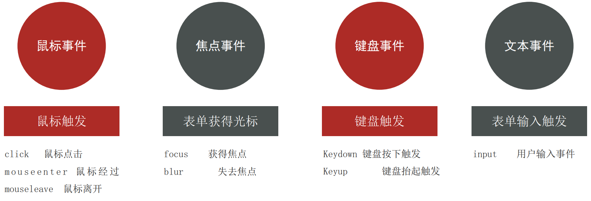


### 3. 事件对象

#### 3.1 获取事件对象

语法(如何获取)：

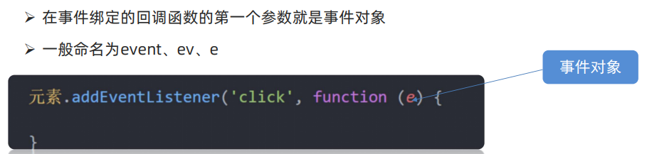


#### 3.2 事件对象常用属性

部分常用属性

-  type：获取当前的事件类型
- clientX / clientY：获取光标相对于浏览器可见窗口左上角的位置
- offsetX / offsetY：获取光标相对于当前DOM元素左上角的位置
- key：
  - 用户按下的键盘键的值
  - 现在不提倡使用keyCode


### 4. 环境对象

环境对象：指的是函数内部特殊的变量 this ，它代表着当前函数运行时所处的环境

作用：弄清楚this的指向，可以让我们代码更简洁

- 函数的调用方式不同，this 指代的对象也不同
- 【谁调用， this 就是谁】 是判断 this 指向的粗略规则
- 直接调用函数，其实相当于是 window.函数，所以 this 指代 window


### 5. 回调函数

如果将函数 A 做为参数传递给函数 B 时，我们称函数 A 为回调函数

简单理解： 当一个函数当做参数来传递给另外一个函数的时候，这个函数就是回调函数

常见的使用场景：

```javascript
function fn() {
	console.log('我是回调函数...')
}
//fn传递给了setInterval，fn就是回调函数 
setInterval(fn,1000)
```


## 十五、Dom事件进阶

### 1. 事件流

事件流指的是事件完整执行过程中的流动路径

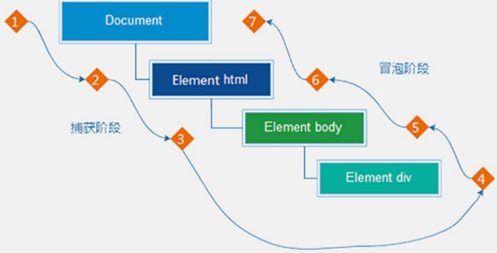

-  说明：假设页面里有个div，当触发事件时，会经历两个阶段，分别是捕获阶段、冒泡阶段
- 简单来说：捕获阶段是 从父到子 冒泡阶段是从子到父
- 实际工作都是使用事件冒泡为主


#### 1.1 事件捕获

事件捕获概念：从DOM的根元素开始去执行对应的事件(从外到里)

代码：

```javascript
DOM.addEventListener(事件类型, 事件处理函数, 是否使用捕获机制)
```

说明：

- addEventListener第三个参数传入 true 代表是捕获阶段触发（很少使用）
- 若传入false代表冒泡阶段触发，默认就是false
- 若是用 L0 事件监听，则只有冒泡阶段，没有捕获


#### 1.2 事件冒泡

当一个元素的事件被触发时，同样的事件将会在该元素的所有祖先元素中依次被触发。这一过程被称为事件冒泡

- 简单理解：当一个元素触发事件后，会依次向上调用所有父级元素的 同名事件
- 事件冒泡是默认存在的
-  L2事件监听第三个参数是 false，或者默认都是冒泡

```javascript
const father = document.querySelector('.father')
const son = document.querySelector('.son')
document.addEventListener('click', function(){
    alert（'我是爷爷')
})
fa.addEventListener('click', function (){ 
    alert('我是爸爸')
})
son.addEventListener('click', function(){
    alert('我是儿子')
})
```


#### 1.3 阻止冒泡

- 问题：因为默认就有冒泡模式的存在，所以容易导致事件影响到父级元素
- 需求：若想把事件就限制在当前元素内，就需要阻止事件冒泡
- 前提：阻止事件冒泡需要拿到事件对象
- 语法：事件对象.stopPropagation()
- 注意：此方法可以阻断事件流动传播，不光在冒泡阶段有效，捕获阶段也有效

举例：

```javascript
const father = document.querySelector('.father')
const son = document.querySelector('.son')
document.addEventListener('click', function(){
    alert（'我是爷爷')
})
fa.addEventListener('click', function (){ 
    alert('我是爸爸')
})
// 需要事件对象
son.addEventListener('click', function(){
    alert('我是儿子')
    // 阻止冒泡
    e.stopPropagation()
})
```


我们某些情况下需要阻止默认行为的发生，比如 阻止 链接的跳转，表单域跳转

语法：

```javascript
e.preventDefault()
```

举例：

```html
<form action="http://www.baidu.com"> 
    <input type="submit" value="提交">
</form> 

<script>
    const form = document.querySelector('form')
    form.addEventListener('click', function (e) { 
        // 阻止表单默认提交行为
    	e.preventDefault()
    })
</script>
```


#### 1.4 解绑事件

on事件方式，直接使用null覆盖偶就可以实现事件的解绑

语法：

```javascript
// 绑定事件
btn.onclick = function () {
	alert('点击了')
}
// 解绑事件
btn.onclick = null
```


addEventListener方式，必须使用：

removeEventListener(事件类型, 事件处理函数, [获取捕获或者冒泡阶段])

例如：

```javascript
function fn(){ 
    alert('点击了'）
}
// 绑定事件
btn.addEventListener('click', fn)
// 解绑事件
btn.removeEventListener('click', fn)
```

注意：匿名函数无法被解绑


#### 1.5 鼠标经过事件的区别

鼠标经过事件：

- mouseover 和 mouseout 会有冒泡效果
- mouseenter 和 mouseleave 没有冒泡效果 (推荐)


#### 1.6 两种注册事件的区别

- 传统on注册（L0）
  - 同一个对象,后面注册的事件会覆盖前面注册(同一个事件)
  - 直接使用null覆盖偶就可以实现事件的解绑
  - 都是冒泡阶段执行的
- 事件监听注册（L2）
  - 语法: addEventListener(事件类型, 事件处理函数, 是否使用捕获)
  - 后面注册的事件不会覆盖前面注册的事件(同一个事件)
  - 可以通过第三个参数去确定是在冒泡或者捕获阶段执行
  - 必须使用removeEventListener(事件类型, 事件处理函数, 获取捕获或者冒泡阶段)
  - 匿名函数无法被解绑


### 2. 事件委托

事件委托是利用事件流的特征解决一些开发需求的知识技巧

优点：减少注册次数，可以提高程序性能

 原理：

- 事件委托其实是利用事件冒泡的特点。
- 给父元素注册事件，当我们触发子元素的时候，会冒泡到父元素身上，从而触发父元素的事件

实现：

- 事件对象 .target .tagName 可以获得真正触发事件的元素
- ul.addEventListener('click' , function(){}) 执行父级点击事件

```javascript
const ul = document.querySelector('ul')
ul.addEventListener('click', function (e) {
    // console.dir(e.target)
	if (e.target.tagName === 'LI'）{
        this.style.color = 'pink'
    }
})
```


### 3. 其他事件

#### 3.1 页面加载事件

加载外部资源（如图片、外联CSS和JavaScript等）加载完毕时触发的事件

为什么要学？

- 有些时候需要等页面资源全部处理完了做一些事情
- 老代码喜欢把 script 写在 head 中，这时候直接找 dom 元素找不到

事件名：**load**

监听页面所有资源加载完毕：给 window 添加 load 事件

```javascript
// 页面加载事件
window.addEventListener('load', function () {
	// 执行的操作
})
```

注意：不光可以监听整个页面资源加载完毕，也可以针对某个资源绑定load事件

当初始的 HTML 文档被完全加载和解析完成之后，DOMContentLoaded 事件被触发，而无需等待样式表、图像等完全加载

事件名：**DOMContentLoaded**

监听页面DOM加载完毕：给 document 添加 DOMContentLoaded 事件

```javascript
window.addEventListener('DOMContentLoaded', function () {
	// 执行的操作
})
```


#### 3.2 元素滚动事件

 滚动条在滚动的时候持续触发的事件

为什么要学？ 

- 很多网页需要检测用户把页面滚动到某个区域后做一些处理， 比如固定导航栏，比如返回顶部

事件名：**scroll**

监听整个页面滚动：

```javascript
// 页面滚动事件，给 window 或 document 添加 scroll 事件
window.addEventListener('scroll', function () {
	// 执行的操作
})
```

 监听某个元素的内部滚动直接给某个元素加即可

使用场景：

- 我们想要页面滚动一段距离，比如100px，就让某些元素
- 显示隐藏，那我们怎么知道，页面滚动了100像素呢？


##### 3.2.1 页面滚动事件-获取位置

- scrollLeft 和 scrollTop（属性）
  - 获取被卷去的大小
  - 获取元素内容往左、往上滚出去看不到的距离
  - 这两个值是可读写的
- 尽量在scroll事件里面获取被卷去的距离

```javascript
div.addEventListener('scroll', function () {
	console.log(this.scrollTop)
})
```

开发中，我们经常检测页面滚动的距离，比如页面滚动100像素，就可以显示一个元素，或者固定一个元素

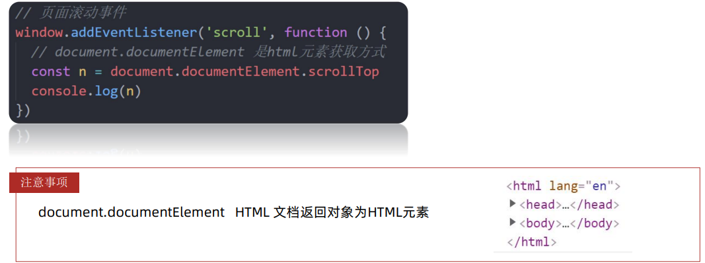


#####  3.2.2 页面滚动事件-滚动到指定的坐标

scrollTo() 方法可把内容滚动到指定的坐标

语法：元素.scrollTo(x, y)

例如：

```javascript
// 让页面滚动到y轴1000像素的位置
window.scrollTo(0, 1000）
```


#### 3.3 页面尺寸事件

会在窗口尺寸改变的时候触发事件：**resize**

```javascript
window.addEventListener('resize', function () {
	//执行的代码
})
```

检测屏幕宽度：

```javascript
window.addEventListener('resize', function () {
	let w = document.documentElement.clientwidth
    console.log(w)
})
```


##### 3.3.1 页面尺寸事件-获取元素宽高

获取宽高：

- 获取元素的可见部分宽高（不包含边框，margin，滚动条等）
- clientWidth和clientHeight

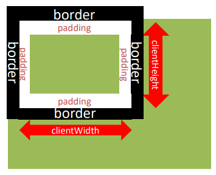


### 4. 元素尺寸与位置

使用场景：

- 前面案例滚动多少距离，都是我们自己算的，最好是页面滚动到某个元素，就可以做某些事。
- 简单说，就是通过js的方式，得到元素在页面中的位置
- 这样我们可以做，页面滚动到这个位置，就可以做某些操作，省去计算了


#### 4.1 元素尺寸于位置-尺寸

- 获取宽高：
  - 获取元素的自身宽高、包含元素自身设置的宽高、padding、border
  - offsetWidth和offsetHeight
  - 获取出来的是数值,方便计算
  - 注意: 获取的是可视宽高, 如果盒子是隐藏的,获取的结果是0
- 获取位置：
  - 获取元素距离自己定位父级元素的左、上距离
  - offsetLeft和offsetTop 注意是只读属性（获取元素距离自己定位父级元素的左、上距离）
  - element.getBoundingClientRect()：方法返回元素的大小及其相对于视口的位置内容

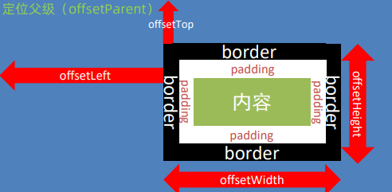


总结：

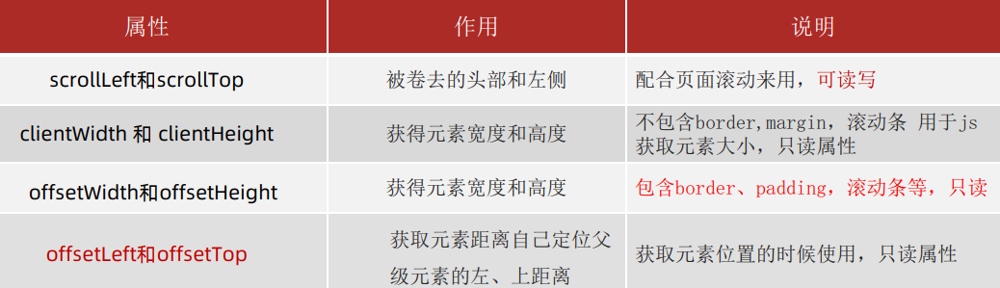


## 十六、DOM-节点操作

### 1. 日期对象

- 日期对象：用来表示时间的对象
- 作用：可以得到当前系统时间

#### 1.1 实例化

在代码中发现了 new 关键字时，一般将这个操作称为实例化

创建一个时间对象并获取时间

**获得当前时间**

```javascript
const date = new Date()
```

**获得指定时间**

```javascript
const date = new Date('2008-8-8')
console.log(date)
```


#### 1.2 日期对象方法

使用场景：因为日期对象返回的数据我们不能直接使用，所以需要转换为实际开发中常用的格式

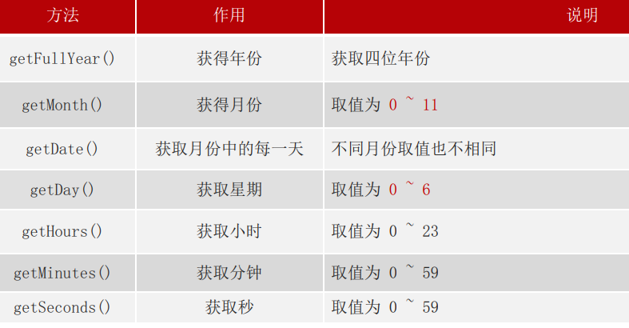


#### 1.3 时间戳

- 使用场景：如果计算倒计时效果，前面方法无法直接计算，需要借助于时间戳完成
- 什么是时间戳：是指1970年01月01日00时00分00秒起至现在的毫秒数，它是一种特殊的计量时间的方式
- 算法：
  - 将来的时间戳 - 现在的时间戳 = 剩余时间毫秒数
  - 剩余时间毫秒数 转换为 剩余时间的 年月日时分秒 就是 倒计时时间
  - 比如 将来时间戳 2000ms - 现在时间戳 1000ms = 1000ms
  - 1000ms 转换为就是 0小时0分1秒


三种方式获取时间戳：

1. 使用 getTime() 方法

   ```javascript
   const date = new Date()
   console.log(date.getTime())
   ```

2. 简写 +new Date()

   ```javascript
   console.log(+new Date())
   ```

3. 使用 Date.now()

   - 无需实例化
   - 但是只能得到当前的时间戳， 而前面两种可以返回指定时间的时间戳

   ```javascript
   console.log(Date.now())
   ```

   

### 2. 节点操作

#### 2.1 DOM 节点

- DOM节点
  - DOM树里每一个内容都称之为节点
- 节点类型
  - 元素节点
    - 所有的标签 比如 body、 div
    - html 是根节点
  - 属性节点
    - 所有的属性 比如 href
  - 文本节点
    - 所有的文本
  - 其他

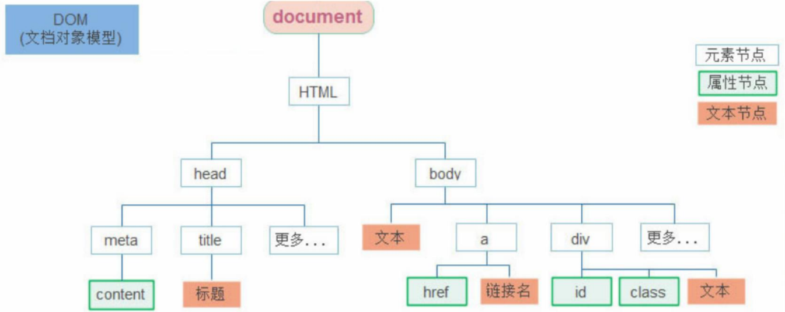


#### 2.2 查找节点

- 关闭二维码案例：
  - 点击关闭按钮， 关闭的是二维码的盒子， 还要获取erweima盒子
- 思考：
  - 关闭按钮 和 erweima 是什么关系呢？
  - 父子关系
  - 所以，我们完全可以这样做：
  - 点击关闭按钮， 直接关闭它的爸爸，就无需获取erweima元素了
- 节点关系：针对的找亲戚返回的都是对象
  - 父节点
  - 子节点
  - 兄弟节点

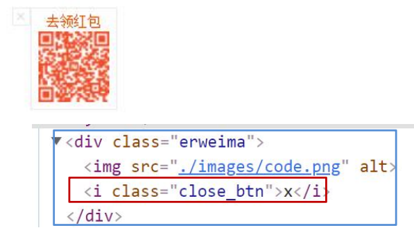


 **父节点查找**： 

- parentNode 属性
- 返回最近一级的父节点 找不到返回为null

```javascript
子元素.parentNode
```


**子节点查找**：

- childNodes
  - 获得所有子节点、包括文本节点（空格、换行）、注释节点等
- children 属性（重点）
  - 仅获得所有元素节点
  - 返回的还是一个伪数组

```javascript
父元素.children
```


**兄弟关系查找**：

1. 下一个兄弟节点：nextElementSibling 属性
2. 上一个兄弟节点：previousElementSibling 属性


#### 2.3 增加节点

- 很多情况下，我们需要在页面中增加元素
  - 比如，点击发布按钮，可以新增一条信息
- 一般情况下，我们新增节点，按照如下操作：
  - 创建一个新的节点
  - 把创建的新的节点放入到指定的元素内部

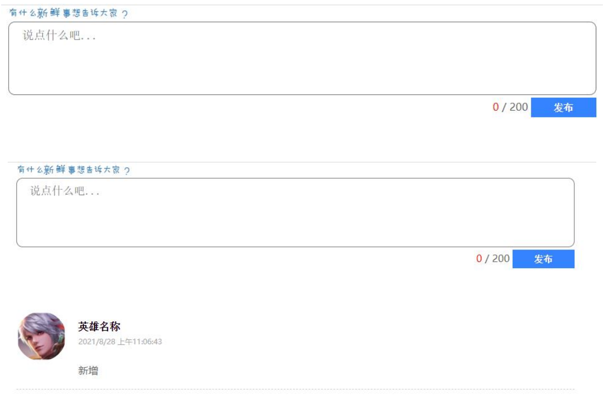


**创建节点**：

- 即创造出一个新的网页元素，再添加到网页内，一般先创建节点，然后插入节点
- 创建元素节点方法：

```javascript
// 创造一个新的元素节点
document.createElement（'标签名'）
```


**追加节点**：

- 要想在界面看到，还得插入到某个父元素中
- 插入到父元素的最后一个子元素:

```javascript
// 插入到这个父元素的最后
父元素.appendChild('要插入的元素')
```

- 插入到父元素中某个子元素的前面

```javascript
// 插入到某个子元素的前面
父元素.insertBefore('要插入的元素，在哪个元素前面')
```

特殊情况下，我们新增节点，按照如下操作：

- 复制一个原有的节点
- 把复制的节点放入到指定的元素内部

**克隆节点**：

```javascript
// 克隆一个已有的元素节点
元素.cloneNode(布尔值)
```

cloneNode会克隆出一个跟原标签一样的元素，括号内传入布尔值

- 若为true，则代表克隆时会包含后代节点一起克隆
- 若为false，则代表克隆时不包含后代节点
- 默认为false


#### 2.4 删除节点

若一个节点在页面中已不需要时，可以删除它

在 JavaScript 原生DOM操作中，要删除元素必须通过父元素删除

语法：

```javascript
父元素.removeChild(要删除的元素)
```

注：

- 如不存在父子关系则删除不成功
- 删除节点和隐藏节点（display:none） 有区别的： 隐藏节点还是存在的，但是删除，则从html中删除节点


### 3. M端事件

移动端也有自己独特的地方。比如触屏事件 touch（也称触摸事件），Android 和 IOS 都有。

- 触屏事件 touch（也称触摸事件），Android 和 IOS 都有。
- touch 对象代表一个触摸点。触摸点可能是一根手指，也可能是一根触摸笔。触屏事件可响应用户手指（或触控笔）对屏幕或者触控板操作。
- 常见的触屏事件如下：

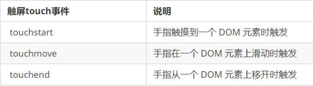


### 4. JS插件

插件: 就是别人写好的一些代码,我们只需要复制对应的代码,就可以直接实现对应的效果

学习插件的基本过程

- 熟悉官网,了解这个插件可以完成什么需求 https://www.swiper.com.cn/
- 看在线演示,找到符合自己需求的demo https://www.swiper.com.cn/demo/index.html
- 查看基本使用流程 https://www.swiper.com.cn/usage/index.html
- 查看APi文档,去配置自己的插件 https://www.swiper.com.cn/api/index.html
- 注意: 多个swiper同时使用的时候, 类名需要注意区分


## 十七、BOM-操作浏览器

### 1. Window对象

#### 1.1 BOM(浏览器对象模型)

BOM(Browser Object Model ) 是浏览器对象模型

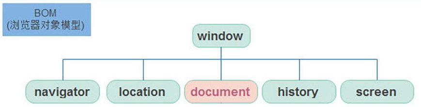

- window对象是一个全局对象，也可以说是JavaScript中的顶级对象
- 像document、alert()、console.log()这些都是window的属性，基本BOM的属性和方法都是window的。
- 所有通过var定义在全局作用域中的变量、函数都会变成window对象的属性和方法
- window对象下的属性和方法调用的时候可以省略window


#### 1.2 定时器-延时函数

JavaScript 内置的一个用来让代码延迟执行的函数，叫 setTimeout

**语法**：

```javascript
setTimeout(回调函数，等待的毫秒数)
```

setTimeout 仅仅只执行一次，所以可以理解为就是把一段代码延迟执行, 平时省略window

**清除延时函数**：

```javascript
let timer = setTimeout(回调函数，等待的毫秒数)
clearTimeout(timer)
```

注意点

- 延时器需要等待,所以后面的代码先执行
- 每一次调用延时器都会产生一个新的延时器，保证互不影响。

两种定时器对比：执行的次数

- 延时函数: 执行一次
- 间歇函数:每隔一段时间就执行一次,除非手动清除


#### 1.3 JS执行机制

JavaScript 语言的一大特点就是单线程，也就是说，同一个时间只能做一件事。

这是因为 Javascript 这门脚本语言诞生的使命所致——JavaScript 是为处理页面中用户的交互，以及操作DOM 而诞生的。比如我们对某个 DOM 元素进行添加和删除操作，不能同时进行。应该先进行添加，之后再删除。

单线程就意味着，所有任务需要排队，前一个任务结束，才会执行后一个任务。这样所导致的问题是：如果 JS 执行的时间过长，这样就会造成页面的渲染不连贯，导致页面渲染加载阻塞的感觉。


为了解决这个问题，利用多核 CPU 的计算能力，HTML5 提出 Web Worker 标准，允许JavaScript 脚本创建多个线程。于是，JS 中出现了同步和异步。

- 同步：前一个任务结束后再执行后一个任务，程序的执行顺序与任务的排列顺序是一致的、同步的。比如做饭的同步做法：我们要烧水煮饭，等水开了（10分钟之后），再去切菜，炒菜。
- 异步：你在做一件事情时，因为这件事情会花费很长时间，在做这件事的同时，你还可以去处理其他事情。比如做饭的异步做法，我们在烧水的同时，利用这10分钟，去切菜，炒菜。


同步任务：同步任务都在主线程上执行，形成一个执行栈。

异步任务：

- JS 的异步是通过回调函数实现的。
- 一般而言，异步任务有以下三种类型:
  1. 普通事件，如 click、resize 等
  2. 资源加载，如 load、error 等
  3. 定时器，包括 setInterval、setTimeout 等
- 异步任务相关添加到任务队列中（任务队列也称为消息队列）。


执行顺序：

1. 先执行执行栈中的同步任务。
2. 异步任务放入任务队列中。
3. 一旦执行栈中的所有同步任务执行完毕，系统就会按次序读取任务队列中的异步任务，于是被读取的异步任务结束等待状态，进入执行栈，开始执行。

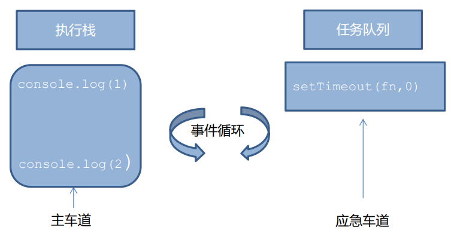

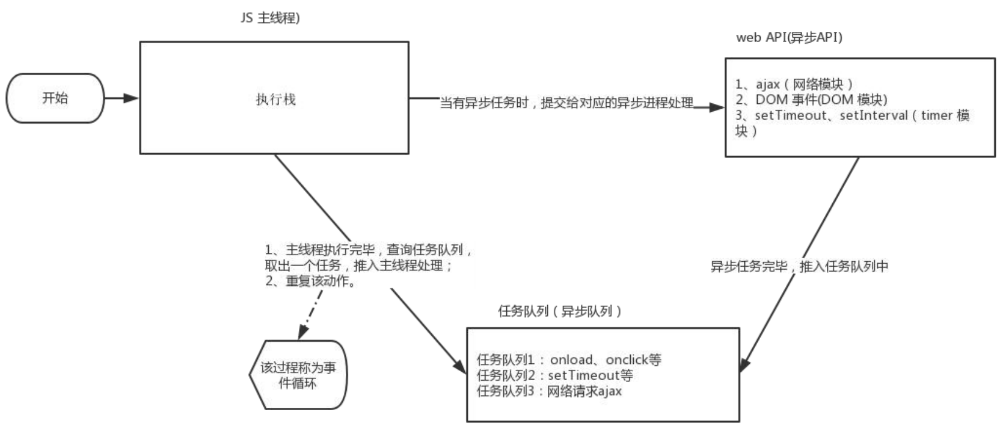

由于主线程不断的重复获得任务、执行任务、再获取任务、再执行，所以这种机制被称为事件循环（event loop） 。


#### 1.4 location对象

location 的数据类型是对象，它拆分并保存了 URL 地址的各个组成部分

常用属性和方法：

-  href 属性获取完整的 URL 地址，对其赋值时用于地址的跳转

  ```javascript
  // 可以得到当前文件URL地址 
  console.log(location.href)
  // 可以通过js方式跳转到目标地址
  location.href = 'http://www.itcast.cn'
  ```

  

- search 属性获取地址中携带的参数，符号 ？后面部分

  ```javascript
  console.log(location.search)
  ```

  

- hash 属性获取地址中的啥希值，符号 # 后面部分

  ```javascript
  console.log(location.hash)
  ```

  

- reload 方法用来刷新当前页面，传入参数 true 时表示强制刷新

  ```javascript
  <button> 点击刷新 </button> 
  
  <script>
      let btn = document.querySelector('button') 
  	btn.addEventListener('click', function () {
          location.reload(true)
          // 强制刷新类似ctrL + f5
      })
  </script>
  ```

  

#### 1.5 navigator对象

navigator的数据类型是对象，该对象下记录了浏览器自身的相关信息

常用属性和方法：

- 通过 userAgent 检测浏览器的版本及平台

  ```javascript
  // 检测 userAgent（浏览器信息）
  !(function () {
      const userAgent = navigator.userAgent
      
      // 验证是否为Android或iPhone
      const android = userAgent.match(/(Android);?[\s\/]+([\d.]+)?/)
      const iphone = userAgent.match(/(iPhone\sOS)\s([\d_]+)/)
      
      // 如果是Android或iPhone，则跳转至移动站点
      if (android || iphone) {
      	location.href = 'http://m.itcast.cn' 
      }
  })()
  ```

  


#### 1.6 histroy对象

history 的数据类型是对象，主要管理历史记录， 该对象与浏览器地址栏的操作相对应，如前进、后退、历史记录等 

常用属性和方法：

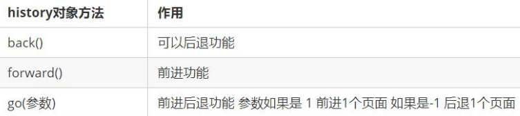

history 对象一般在实际开发中比较少用，但是会在一些 OA 办公系统中见到。


### 2. 本地存储

#### 2.1 本地存储介绍

- 以前我们页面写的数据一刷新页面就没有了，是不是？
- 随着互联网的快速发展，基于网页的应用越来越普遍，同时也变的越来越复杂，为了满足各种各样的需求，会经常性在本地存储大量的数据，HTML5规范提出了相关解决方案。
  1. 数据存储在用户浏览器中
  2. 设置、读取方便、甚至页面刷新不丢失数据
  3. 容量较大，sessionStorage和localStorage约 5M 左右
- 常见的使用场景：https://todomvc.com/examples/vanilla-es6/ 页面刷新数据不丢失


#### 2.2 本地存储分类

##### 2.2.1 localStorage

目标： 能够使用localStorage 把数据存储的浏览器中

作用: 可以将数据永久存储在本地(用户的电脑), 除非手动删除，否则关闭页面也会存在

特性：

- 可以多窗口（页面）共享（同一浏览器可以共享）
- 以键值对的形式存储使用

语法：

- 存储数据：localStorage.setItem(key, value)
- 获取数据：localStorage.getItem(key)
- 删除数据：localStorage.removeItem(key)

浏览器查看本地数据：

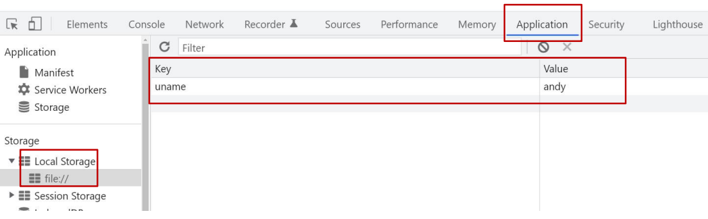


##### 2.2.2 sessionStorage

特性：

- 生命周期为关闭浏览器窗口
- 在同一个窗口(页面)下数据可以共享
- 以键值对的形式存储使用
- 用法跟localStorage 基本相同


#### 2.3 存储复杂数据类型

本地只能存储字符串,无法存储复杂数据类型.

解决：需要将复杂数据类型转换成JSON字符串,在存储到本地

语法：JSON.stringify(复杂数据类型)

```javascript
const goods = {
	name: '小米10' 
    price: 1999
}
localStorage.setItem('goods', JSON.stringify(goods))
```


问题：因为本地存储里面取出来的是字符串，不是对象，无法直接使用

解决：把取出来的字符串转换为对象

语法：JSON.parse(JSON字符串)

```javascript
const obj = JSON.parse(localStorage.getItem('goods'))
console.log(obj)
```


## 十七、正则表达式

### 1. 正则表达式

#### 1.1 介绍

正则表达式（Regular Expression）是用于匹配字符串中字符组合的模式。在 JavaScript中，正则表达式也是对象。

通常用来查找、替换那些符合正则表达式的文本，许多语言都支持正则表达式。

正则表达式在 JavaScript中的使用场景：

- 例如验证表单：用户名表单只能输入英文字母、数字或者下划线， 昵称输入框中可以输入中文。
- 过滤掉页面内容中的一些敏感词(替换)，或从字符串中获取我们想要的特定部分(提取)等。


#### 1.2 语法

如何查找下面文本中是否包含字符串 '前端'

```javascript
let str = 'IT培训，前端开发培训，web前端培训，软件测试培训，产品经理培训'
```

JavaScript 中定义正则表达式的语法有两种，我们先学习其中比较简单的方法：

**定义正则表达式语法**：

```javascript
const 变量名 = /表达式/
```

其中 / / 是正则表达式字面量

比如：

```javascript
const reg = /前端/
```


**判断是否有符合规则的字符串**：

test() 方法：用来查看正则表达式与指定的字符串是否匹配

语法：

```javascript
regObj.test(被检测的字符串)
```

比如：

```javascript
// 要检测的字符串
const str = 'IT培训，前端开发培训，IT培训课程，web前端培训，Java培训，人工智能培训'
// 1.定义正则表达式，检测规则
const reg = /前端/
// 2.检测方法
console.log(reg.test(str))// true
```

如果正则表达式与指定的字符串匹配 ，返回true，否则false


**检索（查找）符合规则的字符串**：

exec() 方法：在一个指定字符串中执行一个搜索匹配

语法：

```javascript
regObj.exec(被检测字符串)
```

比如：

```javascript
// 要检测的字符串
const str = 'IT培训，前端开发培训，IT培训课程，web前端培训，Java培训，人工智能培训'
// 1.定义正则表达式，检测规则
const reg = /前端/
// 2.检测方法
console.log(reg.exec(str))// 返回的是数组
```

如果匹配成功，exec() 方法返回一个数组，否则返回null


#### 1.3 元字符

普通字符：

- 大多数的字符仅能够描述它们本身，这些字符称作普通字符，例如所有的字母和数字。
- 也就是说普通字符只能够匹配字符串中与它们相同的字符。

元字符(特殊字符)

- 是一些具有特殊含义的字符，可以极大提高了灵活性和强大的匹配功能。
- 比如，规定用户只能输入英文26个英文字母，普通字符的话 abcdefghijklm…
- 但是换成元字符写法： [a-z]

为了方便记忆和学习，我们对众多的元字符进行了分类：

- 边界符（表示位置，开头和结尾，必须用什么开头，用什么结尾）
- 量词 （表示重复次数）
- 字符类 （比如 \d 表示 0~9）


##### 1.3.1 边界符

表示位置，开头和结尾，必须用什么开头，用什么结尾

正则表达式中的边界符（位置符）用来提示字符所处的位置，主要有两个字符

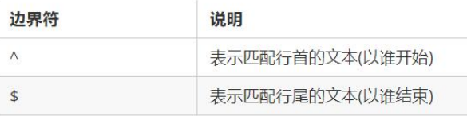

如果 ^ 和 $ 在一起，表示必须是精确匹配。

举例：

```javascript
console.log(/哈/.test('哈')) //true
console.log(/二哈/.test('二哈')) //true
console.log(/二哈/.test('很二哈哈')) //true 

// ^ 开头
console.log(/^二哈/.test('很二哈哈')) //false
console.log(/^二哈/.test('二哈很傻')) //true 

// $结尾
console.log(/^二哈$/.test('二哈很傻')) //false
console.log(/^二哈$/.test('二哈二哈')) //false
console.log(/^二哈$/.test('二哈')) //true
```


##### 1.3.2 量词

表示重复次数

量词用来 设定某个模式出现的次数

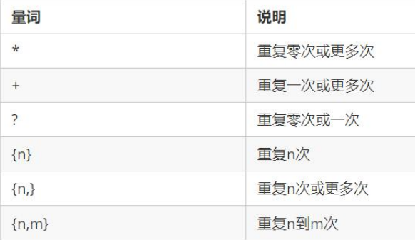

注意： 逗号左右两侧千万不要出现空格


##### 1.3.3 字符类

1. [ ] 匹配字符集合：
   - 后面的字符串只要包含 abc 中任意一个字符，都返回 true 。
2. [ ] 里面加上 - 连字符：
   - 使用连字符 - 表示一个范围。
   - 比如：[a-z] 表示 a 到 z 26个英文字母都可以。
3. [ ] 里面加上 ^ 取反符号：
   - 比如：[ ^a-z ]匹配除了小写字母以外的字符
4. . 匹配除换行符之外的任何单个字符


#### 1.4 修饰符

修饰符约束正则执行的某些细节行为，如是否区分大小写、是否支持多行匹配等

语法：

```javascript
/表达式/修饰符
```

举例：

```javascript
console.log(/a/i.test('a')) //true
console.log(/a/i.test('A')) //true
```

- i 是单词 ignore 的缩写，正则匹配时字母不区分大小写


**替换 replace 替换**

语法：

```javascript
字符串.replace(/正则表达式/，'替换的文本)
```


## 十八、作用域&解构&箭头函数

### 1. 作用域

> 作用域（scope）规定了变量能够被访问的“范围”，离开了这个“范围”变量便不能被访问。

作用域分为：

- 局部作用域
- 全局作用域


#### 1.1 局部作用域

局部作用域分为函数作用域和块作用域。


##### 1.1.1 函数作用域

在函数内部声明的变量只能在函数内部被访问，外部无法直接访问。

```javascript
<script>
    function getSum() {
    	// 函数内部是函数作用域属于局部变量
    	const num = 10
    }
    console.log(num) //此处报错 函数外部不能使用局部作用域变量 
</script>
```

总结：

1. 函数内部声明的变量，在函数外部无法被访问
2. 函数的参数也是函数内部的局部变量
3. 不同函数内部声明的变量无法互相访问
4. 函数执行完毕后，函数内部的变量实际被清空了


##### 1.1.2 块作用域

在 JavaScript 中使用 { } 包裹的代码称为代码块，代码块内部声明的变量外部将【有可能】无法被访问。

```javascript
for(let t = 1; t <= 6; t++）{ 
    // t 只能在该代码块中被访问
	console.log(t)//正常
}
// 超出了t的作用域
console.log(t)//报错
```

总结：
1. let 声明的变量会产生块作用域，var 不会产生块作用域
2. const 声明的常量也会产生块作用域
3. 不同代码块之间的变量无法互相访问
4. 推荐使用 let 或 const


#### 1.2 全局作用域

script 标签 和 .js 文件 的【最外层】就是所谓的全局作用域，在此声明的变量在函数内部也可以被访问。

全局作用域中声明的变量，任何其它作用域都可以被访问。

```javascript
<script>
    // 全局作用域
    // 全局作用域下声明了num变量
    const num =10
	function fn () {
    	// 函数内部可以使用全局作用域的变量
    	console.log(num)
    }
	// 此处全局作用域 
</script>
```

注意：
1. 为 window 对象动态添加的属性默认也是全局的，不推荐！
2. 函数中未使用任何关键字声明的变量为全局变量，不推荐！！！
3. 尽可能少的声明全局变量，防止全局变量被污染


#### 1.3 作用域链

作用域链本质上是底层的变量查找机制。

- 在函数被执行时，会优先查找当前函数作用域中查找变量
- 如果当前作用域查找不到则会依次逐级查找父级作用域直到全局作用域

```javascript
<script>
    // 全局作用域
    let a = 1 
	let b = 2
    // 局部作用域 
    function f(){ 
        let a = 1 
        // 局部作用域
    	function g () {
			a=2
    		console.log(a)
        }
        g() // 调用g
    }
    f() // 调用f
</script>
```

总结：

1. 嵌套关系的作用域串联起来形成了作用域链
2. 相同作用域链中按着从小到大的规则查找变量
3. 子作用域能够访问父作用域，父级作用域无法访问子级作用域


#### 1.4 JS垃圾回收机制

##### 1.4.1 什么是垃圾回收机制

垃圾回收机制(Garbage Collection) 简称 GC 

JS中内存的分配和回收都是自动完成的，内存在不使用的时候会被垃圾回收器自动回收。

正因为垃圾回收器的存在，许多人认为JS不用太关心内存管理的问题 

但如果不了解JS的内存管理机制，我们同样非常容易成内存泄漏（内存无法被回收）的情况

不再用到的内存，没有及时释放，就叫做内存泄漏


##### 1.4.2 内存的声明周期

JS环境中分配的内存, 一般有如下生命周期：

1. 内存分配：当我们声明变量、函数、对象的时候，系统会自动为他们分配内存
2. 内存使用：即读写内存，也就是使用变量、函数等
3. 内存回收：使用完毕，由垃圾回收自动回收不再使用的内存
4. 说明：
   - 全局变量一般不会回收(关闭页面回收)
   - 一般情况下局部变量的值, 不用了, 会被自动回收掉

```javascript
// 为变量分配内存 
const i = 11
const str = 'pink老师'
// 为对象分配内存 
const person = {
	age: 18,
	uname: 'pink老师'
}
// 为函数分配内存
function sum(a, b){ 
    return a + b
}
```


##### 1.4.3 垃圾回收的算法说明

堆栈空间分配区别：

1. 栈（操作系统）: 由操作系统自动分配释放函数的参数值、局部变量等，基本数据类型放到栈里面。
2. 堆（操作系统）: 一般由程序员分配释放，若程序员不释放，由垃圾回收机制回收。复杂数据类型放到堆里面。

下面介绍两种常见的浏览器垃圾回收算法: 引用计数法 和 标记清除法

**引用计数**：

IE采用的引用计数算法, 定义“内存不再使用”，就是看一个对象是否有指向它的引用，没有引用了就回收对象

算法：
1. 跟踪记录被引用的次数
2. 如果被引用了一次，那么就记录次数1,多次引用会累加 ++
3. 如果减少一个引用就减1 --
4. 如果引用次数是0 ，则释放内存

**标记清除法**：

现代的浏览器已经不再使用引用计数算法了。

现代浏览器通用的大多是基于标记清除算法的某些改进算法，总体思想都是一致的。

核心：
1. 标记清除算法将“不再使用的对象”定义为“无法达到的对象”。
2. 就是从根部（在JS中就是全局对象）出发定时扫描内存中的对象。 凡是能从根部到达的对象，都是还需要使用的。
3. 那些无法由根部出发触及到的对象被标记为不再使用，稍后进行回收。


#### 1.5 闭包

概念：一个函数对周围状态的引用捆绑在一起，内层函数中访问到其外层函数的作用域

简单理解：闭包 =  内层函数 + 外层函数的变量 

先看个简单的代码：

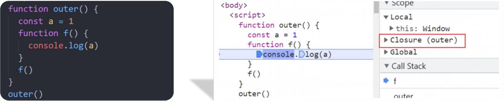

闭包作用：

- 封闭数据，实现数据私有，外部也可以访问函数内部的变量
-  闭包很有用，因为它允许将函数与其所操作的某些数据（环境）关联起来

闭包应用：实现数据的私有

比如，我们要做个统计函数调用次数，函数调用一次，就++

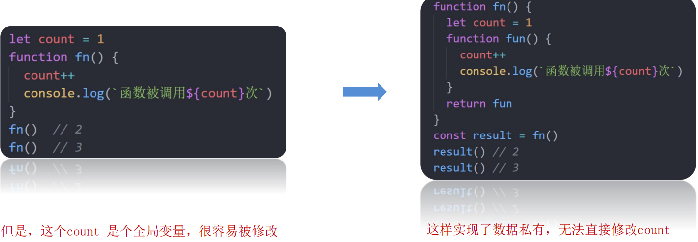

闭包可能引起的问题？

- 内存泄漏


#### 1.6 变量提升

变量提升是 JavaScript 中比较“奇怪”的现象，它允许在变量声明之前即被访问（仅存在于var声明变量）

```javascript
<script>
	//访问变量str
	console.log(str + 'world!')
	// 声明变量str 
	var str = 'hello'
</script>
```

注意：
1. 变量在未声明即被访问时会报语法错误
2. 变量在var声明之前即被访问，变量的值为 undefined
3. let/const 声明的变量不存在变量提升
4. 变量提升出现在相同作用域当中
5. 实际开发中推荐先声明再访问变量

说明： JS初学者经常花很多时间才能习惯变量提升，还经常出现一些意想不到的bug，正因为如此，ES6 引入了块级作用域，用let 或者 const声明变量，让代码写法更加规范和人性化。


### 2. 函数进阶

#### 2.1 函数提升

函数提升与变量提升比较类似，是指函数在声明之前即可被调用。

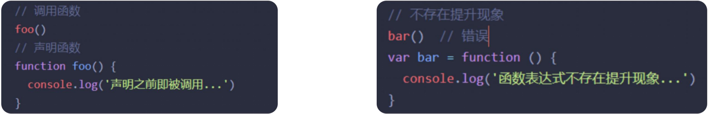

总结：
1. 函数提升能够使函数的声明调用更灵活
2. 函数表达式不存在提升的现象
3. 函数提升出现在相同作用域当中


#### 2.2 函数参数

产品需求： 写一个求和函数

不管用户传入几个实参，都要把和求出来

```javascript
getSum(2, 3)
getSum(1, 2, 3)
getSum(1, 2, 3, 4, 5, 6)
```

形参我改咋写？


##### 2.2.1 动态参数

arguments 是函数内部内置的伪数组变量，它包含了调用函数时传入的所有实参

```javascript
// 求生函数，计算所有参数的和
function sum () {
	// console.log(arguments) 
    let s = 0
	for (let i = 0; i < arguments.length; i++）{
        s += arguments[i]
    }
	console.log(s)
}
//调用求和函数
sum(5, 10) //两个参数 
sum(1, 2, 4) //两个参数
```

总结：
1. arguments 是一个伪数组，只存在于函数中
1. arguments 的作用是动态获取函数的实参
1. 可以通过for循环依次得到传递过来的实参


##### 2.2.2 剩余参数

剩余参数允许我们将一个不定数量的参数表示为一个数组

```javascript
function getSum(...other){
	// other 得到[1,2,3] 
    console.log(other)
}
getSum(1, 2, 3)
```

1. ... 是语法符号，置于最末函数形参之前，用于获取多余的实参
2. 借助 ... 获取的剩余实参，是个真数组


#### 2.3 箭头函数

目的：引入箭头函数的目的是更简短的函数写法并且不绑定this，箭头函数的语法比函数表达式更简洁

使用场景：箭头函数更适用于那些本来需要匿名函数的地方


##### 2.3.1 基本语法

语法1：基本写法

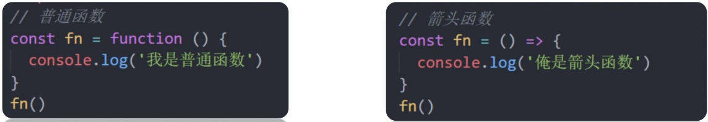


语法2：只有一个参数可以省略小括号

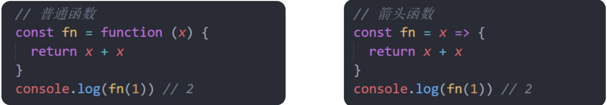


语法3：如果函数体只有一行代码，可以写到一行上，并且无需写 return 直接返回值

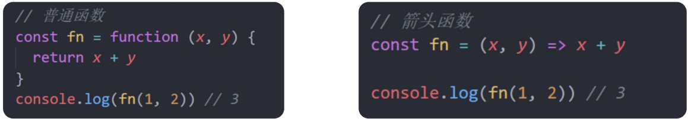

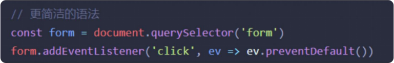


语法4：加括号的函数体返回对象字面量表达式

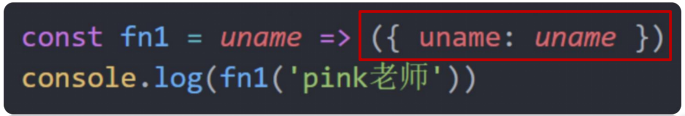


##### 2.3.2 箭头函数参数

1. 普通函数有arguments 动态参数
2. 箭头函数没有 arguments 动态参数，但是有 剩余参数 ..args

```javascript
const getSum = (...args) => {
    let sum =0
	for (let i = 0; i < args.length; i++) {
		sum += args[i]
    }
	return sum //注意函数体有多行代码需要return
}
console.log(getSum(1,2,3)) // 6
```


##### 2.3.3 箭头函数this

在箭头函数出现之前，每一个新函数根据它是被如何调用的来定义这个函数的this值，非常令人讨厌。

箭头函数不会创建自己的this,它只会从自己的作用域链的上一层沿用this。

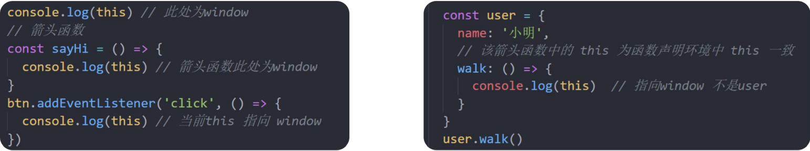

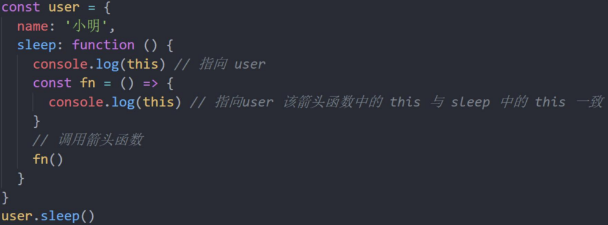

在开发中【使用箭头函数前需要考虑函数中 this 的值】，事件回调函数使用箭头函数时，this 为全局的window，因此**DOM事件回调函数为了简便，还是不太推荐使用箭头函数**

```javascript
<script>
    //DOM节点
    const btn = document.querySelector('.btn')

	//箭头函数 此时 this 指向了 window
    btn.addEventListener('click', () => {
    	console.log(this)
    })
        
    //普通函数此时 this 指向了 DoM对象
    btn.addEventListener('click', function () {
    	console.log(this) 
    })
</script>
```


### 3. 解构赋值

解构赋值是一种快速为变量赋值的简洁语法，本质上仍然是为变量赋值。

分为：

- 数组解构
- 对象解构


#### 3.1 数组解构

数组解构是将数组的单元值快速批量赋值给一系列变量的简洁语法。

基本语法：

1. 赋值运算符 = 左侧的 [] 用于批量声明变量，右侧数组的单元值将被赋值给左侧的变量
2. 变量的顺序对应数组单元值的位置依次进行赋值操作

```javascript
// 普通的数组
const arr = [1, 2, 3]

//批量声明变量 a b c
// 同时将数组单元值 1 2 3，依次赋值给变量 a b c
const [a, b, c] = [1, 2, 3]
console.log(a) //1 
console.log(b) //2 
console.log(c) //3
```


基本语法：典型应用交互2个变量

```javascript
let a = 1 
let b = 3;
[b, a] = [a, b]
console.log(a) // 3 
console.log(b) // 1
```

注意： js 前面必须加分号情况

```javascript
// 1.立即执行函数
(function t() {})(); 
// 或者
;(function t() {})()
```

```javascript
// 2.数组解构
// 数组开头的，特别是前面有语句的一定注意加分号
;[b, a] = [a, b]
```


**变量多 单元值少的情况**：变量的数量大于单元值数量时，多余的变量将被赋值为undefined

```javascript
//变量多，单元值少
const [a, b, c, d] = ['小米', '苹果', '华为'］
console.log(a) // 小米 console.log(b）// 苹果 console.log(c）// 华为
console.log(d) // undefined
```

**变量少 单元值多的情况**：

```javascript
// 变量少，单元值多
const[a,b,c] =［'小米'，'苹果', '华为', '格力'］
console.log(a) //小米 
console.log(b) //苹果 
console.log(c) //华为
```

**利用剩余参数解决变量少 单元值多的情况**：

```javascript
// 利用剩余参数变量少，单元值多
const[a, b, ...tel] = ['小米', '苹果', '华为', '格力', 'vivo']
console.log(a) //小米 
console.log(b) //苹果
console.log(tel) //['华为', '格力', 'vivo']
```

**防止有undefined传递单元值的情况，可以设置默认值**：

```javascript
const[a = '手机', b = '华为'] = ['小米']
console.log(a) // 小米 
console.log(b) // 华为
```

**按需导入，忽略某些返回值**：

```javascript
// 按需导入，忽略某些值
const [a, , c, d] = ['小米', '苹果', '华为', '格力']
console.log(a) //小米 
console.log(c) //华为 
console.log(d) //格力
```

**支持多维数组的结构**：

```javascript
const[a, [b, c]] = ['苹果', ['小米', '华为']]
console.log(a) //苹果 
console.log(b) //小米 
console.log(c) //华为
```


#### 3.2 对象解构

对象解构是将对象属性和方法快速批量赋值给一系列变量的简洁语法

基本语法：
1. 赋值运算符 = 左侧的 {} 用于批量声明变量，右侧对象的属性值将被赋值给左侧的变量
2. 对象属性的值将被赋值给与属性名相同的变量
3. 注意解构的变量名不要和外面的变量名冲突否则报错
4. 对象中找不到与变量名一致的属性时变量值为 undefined

```javascript
<script>
    // 普通对象
    const user = {
        name: '小明',
        age: 18
    };
    //批量声明变量 name age
	//同时将数组单元值 小明 18 依次赋值给变量 name age
    const {name, age} = user
    
    console.log(name) //小明 
	console.log(age) //18 
</script>

```


**可以从一个对象中提取变量并同时修改新的变量名**

```javascript
// 普通对象
const user = {
    name: '小明',
	age: 18
};
// 把原来的name变量重新命名为uname
const { name: uname, age } = user
console.log(uname) //小明 
console.log(age) //18
```


**数组对象解构**：

```javascript
const pig = [
    {
        name: '佩奇',
        age: 6
    }
]

const [{ name, age }] = pig
console.log(name, age)
```


**多级对象解构**：

```javascript
const pig = {
    name: '佩奇',
    family: {
        mother: '猪妈妈',
        father: '猪爸爸',
        sister: '乔治'
    },
    age: 6
}

const { name, family:{mother, father, sister} } = pig
console.log(name) //佩奇
console.log(mother) //猪妈妈 
console.log(father) //猪爸爸
console.log(sister) //乔治
```


## 十九、构造函数&数据常用函数

### 1 创建对象三种方式

#### 1.1 对象字面量

**利用对象字面量创建对象**

```javascript
const o = {
    name: '佩奇'
}
```


#### 1.2 new Object 

**利用 new Object 创建对象**

```javascript
const o = new Object({ name: '佩奇' })
console.log(o) //{name: '佩奇'}
```


#### 1.3 构造函数

构造函数 ：是一种特殊的函数，主要用来初始化对象

使用场景：常规的 {...} 语法允许创建一个对象。比如我们创建了佩奇的对象，继续创建乔治的对象还需要重新写一 遍，此时可以通过构造函数来快速创建多个类似的对象。

```javascript
function Pig(name, age, gender) {
    this.name = name
    this.age = age
    this.gener = gender
}
// 创建佩奇对象
const Peppa = new Pig('佩奇', 6, '女')
// 创建乔治对象
const George = new Pig('乔治', 3, '男')
// 创建猪妈妈对象
const Mum = newPig('猪妈妈', 30, '女')
// 创建猪爸爸对象
const Dad = newPig('猪爸爸', 32, '男'）
```

注意：

1. 它们的命名以大写字母开头。
2. 它们只能由 "new" 操作符来执行。


### 2. 实例成员&静态成员

**实例成员**：通过构造函数创建的对象称为实例对象，实例对象中的属性和方法称为实例成员。

```javascript
//构造函数
function Person() {
    //构造函数内部的this就是实例对象
    //实例对象中动态添加属性 
    this.name = '小明'
    //实例对象动态添加方法
    this.sayHi = function () { 
        console.log("大家好~")
	}
}
// 实例化，p1是实例对象
// p1 实际就是 构造函数内部的this
const p1 = new Person() 
console.log(p1)
console.log(p1.name)//访问实例属性 
p1.sayHi() //调用实例方法
```

说明：
1. 实例对象的属性和方法即为实例成员
2. 为构造函数传入参数，动态创建结构相同但值不同的对象
3. 构造函数创建的实例对象彼此独立互不影响。


**静态成员**：构造函数的属性和方法被称为静态成员

说明：
1. 构造函数的属性和方法被称为静态成员
2. 一般公共特征的属性或方法静态成员设置为静态成员
3. 静态成员方法中的 this 指向构造函数本身

```javascript
//构造函数
function Person (name, age) {
	//省略实例成员
}

//静态属性
Person.eyes = 2 
Person.arms = 2
// 静态方法
Person.walk = function () {
	console.log('^_^人都会走路...')
    // this 指向 Person
	console.log(this.eyes)
}
```


### 3. 内置构造函数

其实字符串、数值、布尔、等基本类型也都有专门的构造函数，这些我们称为包装类型。

JS中几乎所有的数据都可以基于构成函数创建。


#### 3.1 Object

Object 是内置的构造函数，用于创建普通对象。

```javascript
// 通过构造函数创建普通对象
const user = new object({name: '小明',age: 15})
```

推荐使用字面量方式声明对象，而不是 Object 构造函数


学习三个常用静态方法（静态方法就是只有构造函数Object可以调用的）

**作用**：Object.keys 静态方法获取对象中所有属性（键）

语法：

```javascript
const o = { name: '佩奇', age: 6 }
// 获得对象的所有键，并且返回是一个数组 
const arr = Object.keys(o)
console.log(arr) // ['name', 'age']
```


**作用**：Object.values 静态方法获取对象中所有属性值

语法：

```javascript
const o = { name: '佩奇', age: 6 } 
// 获得对象的所有值，并且返回是一个数组 
const arr = Object.values(o)
console.log(arr) //['佩奇', 6]
```


**作用**：Object. assign 静态方法常用于对象拷贝

语法：

```javascript
// 拷贝对象把o拷贝给obj
const o = { name: '佩奇', age:6 } 
const obj = {}
Object.assign(obj, o)
console.log(obj) // {name: '佩奇', age: 6}
```


#### 3.2 Array

Array 是内置的构造函数，用于创建数组

```javascript
const arr = new Array(3, 5)
console.log(arr) // [3,5]
```

创建数组建议使用字面量创建，不用 Array构造函数创建


数组常见实例方法-核心方法


#### 3.3 String

在 JavaScript 中的字符串、数值、布尔具有对象的使用特征，如具有属性和方法

```javascript
//字符串类型
const str = 'hello world!'
//统计字符的长度(字符数量）
console.log(str.length)

//数值类型
const price = 12.345
//保留两位小数 
price.toFixed(2)
```

之所以具有对象特征的原因是字符串、数值、布尔类型数据是 JavaScript 底层使用 Object 构造函数“包装”来的，被 称为包装类型。


常见实例方法

1. 实例属性 length 用来获取字符串的度长(重点)
2. 实例方法 split('分隔符') 用来将字符串拆分成数组(重点)
3. 实例方法 substring(需要截取的第一个字符的索引[,结束的索引号]) 用于字符串截取(重点)
4. 实例方法 startsWith(检测字符串[, 检测位置索引号])检测是否以某字符开头(重点)
5. 实例方法 includes(搜索的字符串[,检测位置索引号]) 判断一个字符串是否包含在另一个字符串中，根据情况返回 true或false[重点)
6. 实例方法 toUpperCase 用于将字母转换成大写
7. 实例方法 toLowerCase 用于将就转换成小写
8. 实例方法 indexOf 检测是否包含某字符 
9. 实例方法endsWith检测是否以某字符结尾
10. 实例方法replace用于替换字符串，支持正则匹配
11. 实例方法match用于查找字符串，支持正则匹配


#### 3.4 Number

Number 是内置的构造函数，用于创建数值

常用方法：

1. toFixed() 设置保留小数位的长度


## 二十、深入面向对象

### 1. 编程思想

在面向对象程序开发思想中，每一个对象都是功能中心，具有明确分工。

面向对象编程具有灵活、代码可复用、容易维护和开发的优点，更适合多人合作的大型软件项目。

面向对象的特性

- 封装性
- 继承性
- 多态性


### 2. 构造函数

封装是面向对象思想中比较重要的一部分，js面向对象可以通过构造函数实现的封装。

同样的将变量和函数组合到了一起并能通过 this 实现数据的共享，所不同的是借助构造函数创建出来的实例对象之间是彼此不影响的

```javascript
function Star(uname,age) {
    this.uname = uname
    this.age = age
    this.sing = function () {
        console.log('我会唱歌')
    }
}
// 实例对像，获得了构造函数中封装的所有逻辑
const ldh = new Star('刘德华', 18)
const zxy = new Star（'张学友', 19）
```

总结：

1. 构造函数体现了面向对象的封装特性 
2. 构造函数实例创建的对象彼此独立、互不影响

封装是面向对象思想中比较重要的一部分，js面向对象可以通过构造函数实现的封装。

前面我们学过的构造函数方法很好用，但是 存在浪费内存的问题


### 3. 原型

- 构造函数通过原型分配的函数是所有对象所 共享的。
- JavaScript 规定，每一个构造函数都有一个 prototype 属性，指向另一个对象，所以我们也称为原型对象
- 这个对象可以挂载函数，对象实例化不会多次创建原型上函数，节约内存
- 我们可以把那些不变的方法，直接定义在 prototype 对象上，这样所有对象的实例就可以共享这些方法。
- 构造函数和原型对象中的this 都指向 实例化的对象


```javascript
function Star(uname,age) {
	this.uname = uname
    this.age = age
}

console.log(Star.prototype)//返回一个对象称为原型对象
Star.prototype.sing = function () { 
    console.log('我会唱歌')
}
const ldh = new Star('刘德华', 18) 
const zxy = new Star('张学友', 19)
console.log(ldh.sing === zxy.sing)//结果是true说明俩函数一样，共享
```


#### 3.1 原型- this指向

构造函数和原型对象中的this 都指向 实例化的对象

```javascript
let that
function Person(name) {
	this.name = name
    that = this
}
const o = new Person() 
console.log(that === o) //true
```

```javascript
let that
function Person(name) {
    this.name = name
}
Person.prototype.sing = function () {
    that = this
}
const o = new Person()
o.sing()
console.log(that === o) //true
```


#### 3.2 constructor 属性

在哪里？ 每个原型对象里面都有个constructor 属性（constructor 构造函数）

作用：该属性指向该原型对象的构造函数， 简单理解，就是指向我的爸爸，我是有爸爸的孩子


使用场景：如果有多个对象的方法，我们可以给原型对象采取对象形式赋值。但是这样就会覆盖构造函数原型对象原来的内容，这样修改后的原型对象 constructor 就不再指向当前构造函数了 此时，我们可以在修改后的原型对象中，添加一个 constructor 指向原来的构造函数。

```javascript
function Star(name) {
	this.name = name
}
Star.prototype = {
	sing: function() { console.log('唱歌') }, 
    dance: function() { console.log('跳舞') }
}
console.log(Star.prototype.constructor) // 指向 object
```

```javascript
function Star(name) {
    this.name = name
}
Star.prototype = {
	//手动利用constructor指回Star构造函数 
    constructor: Star,
	sing: function () { console.log('唱歌') }, 
    dance: function () { console.log('跳舞') }
}
console.log(Star.prototype.constructor)// 指向 Star
```


#### 3.3 对象原型

对象都会有一个属性 __proto__ 指向构造函数的 prototype 原型对象，之所以我们对象可以使用构造函数 prototype 原型对象的属性和方法，就是因为对象有 __proto__ 原型的存在。


注意：

-  __ proto __ 是JS非标准属性
- [[prototype]]和__ proto __意义相同
- 用来表明当前实例对象指向哪个原型对象prototype
- __ proto __对象原型里面也有一个 constructor属性，指向创建该实例对象的构造函数


#### 3.4 原型继承

继承是面向对象编程的另一个特征，通过继承进一步提升代码封装的程度，JavaScript 中大多是借助原型对象实现继承 的特性。

龙生龙、凤生凤、老鼠的儿子会打洞描述的正是继承的含义。


**封装-抽取公共部分**：把男人和女人公共的部分抽取出来放到人类里面

- 把男人女人公共的属性和方法抽取出来 People
- 然后赋值给Man的原型对象，可以共享这些属性和方法
- 注意让constructor指回Man这个构造函数

```javascript
// 人类公共的属性和方法 
const People = {
    head: 1,
    eyes: 2, 
    legs: 2,
    say: function () {},
    eat: function () {}
}

// 男人
function Man() {
}

// 把公共的属性和方法给原型，这样就可以共享了 
Man.prototype = People
// 注意让原型里面的constructor从新指回Man找自已的爸爸 
Man.prototype.constructor = Man
const pink = new Man() 
console.log(pink)
```


问题： 如果我们给男人添加了一个吸烟的方法，发现女人自动也添加这个方法

男人和女人都同时使用了同一个对象，根据引用类型的特点，他们指向同一个对象，修改一个就会都影响

需求：男人和女人不要使用同一个对象，但是不同对象里面包含相同的属性和方法

答案：构造函数，new 每次都会创建一个新的对象。

```javascript
function Man () {
}

// 用 new person 替换刚才的固定对象
Man.prototype = new Person()
// 注意让原型里面的constructor重新指向Man
Man.prototype.constructor = Man 
const pink = new Man()
Man.prototype.smoking = function () { }
console.log(pink)

// 女人
function Woman() {
	this.baby = function () { }
}
// 用 new Person() 替换刚才的固定对象
Woman.prototype = new Person()
// 注意让原型里面的constructor重新指回Man
Woman.prototype.constructor = Woman
const red = new Woman() 
console.log(red)
```


#### 3.5 原型链

基于原型对象的继承使得不同构造函数的原型对象关联在一起，并且这种关联的关系是一种链状的结构，我们将原型对 象的链状结构关系称为原型链


- ① 当访问一个对象的属性（包括方法）时，首先查找这个对象自身有没有该属性。
- ② 如果没有就查找它的原型（也就是 __proto__指向的 prototype 原型对象）
- ③ 如果还没有就查找原型对象的原型（Object的原型对象）
- ④ 依此类推一直找到 Object 为止（null）
- ⑤ __proto__对象原型的意义就在于为对象成员查找机制提供一个方向，或者说一条路线
- ⑥ 可以使用 instanceof 运算符用于检测构造函数的 prototype 属性是否出现在某个实例对象的原型链上


## 二十一、高阶技巧

### 1. 深浅拷贝

开发中我们经常需要复制一个对象。如果直接用赋值会有下面问题：

```javascript
// 一个pink对象 
const pink = {
	name: 'pink老师',
    age: 18
const red = pink
console.log(red) // {name: 'pink老师', age: 18} 
red.name = 'red老师'
console.log(red) // {name: 'red老师', age: 18}
//但是pink对象里面的name值也发生了变化
console.log(pink) // {name: 'red老师', age: 18}
```


#### 1.1 浅拷贝

浅拷贝：拷贝的是地址

常见方法：
1. 拷贝对象：Object.assgin() / 展开运算符 {...obj} 拷贝对象
2. 拷贝数组：Array.prototype.concat() 或者 [...arr]

```javascript
const obj = { 
    uname: 'pink'
}
const o = { ...obj }
console.log(o) // {uname: 'pink'} 
o.uname = 'red'
console.log(o) // {uname: 'red'}
console.log(obj) // {uname: 'pink'}
```

问题：如果是简单数据类型拷贝值，引用数据类型拷贝的是地址 (简单理解： 如果是单层对象，没问题，如果有多层就有问题)

```javascript
// 一个pink对象
const pink = {
	name: 'pink老师'
	age: 18, 
    famliy: {
		mother: 'pink妈妈'
	}
}
const red = {}
Object.assign(red, pink)
console.log(red) // {name：‘pink老师'，age:18}
red.name = 'red老师'
// 更改对象里面的famiLy还是会有影响 
red.famliy.mother = 'red妈妈'
```


#### 1.2 深拷贝

深拷贝：拷贝的是对象，不是地址

常见方法：
1. 通过递归实现深拷贝
2. lodash/cloneDeep
3. 通过JSON.stringify()实现

**js库lodash里面cloneDeep内部实现了深拷贝**

```javascript
const obj = {
	uname: 'pink',
    age: 18,
	hobby: ['篮球', '足球'], 
    family: {
		baby: '小pink'
    }
}
//语法: _·cLoneDeep（要被克隆的对象)
const o = _.cloneDeep(obj)
console.log(o)
o.family.baby = '老pink'
console.log(obj)
```

**通过JSON.stringify()实现**

```javascript
const obj = { 
	uname: 'pink',
	age: 18,
	hobby: ['篮球', '足球'], 
    family: {
		baby: '小pink'
    }
}
const o = JSON.parse(JSON.stringify(obj)) 
console.log(o)
o.family.baby = '老pink'
console.log(obj)
```


### 2. 异常处理

#### 2.1 throw 抛异常

异常处理是指预估代码执行过程中可能发生的错误，然后最大程度的避免错误的发生导致整个程序无法继续运行

```javascript
function counter(x,y) { 
    if (!x || !y) {
        // throw '参数不能为空！'
        throw new Error('参数不能为空！')
    }
	return x + y 
}
counter()
```

总结：
1. throw 抛出异常信息，程序也会终止执行
2. throw 后面跟的是错误提示信息
3. Error 对象配合 throw 使用，能够设置更详细的错误信息


#### 2.2 try /catch 捕获异常

我们可以通过try / catch 捕获错误信息（浏览器提供的错误信息） try 试试 catch 拦住 finally 最后

```javascript
function foo() { 
    try {
        //查找DOM节点
        const p = document.querySelector('.p')
        p.style.color = 'red'
    } catch (error) {
    	// try 代码段中执行有错误时，会执行catch代码段
        // 查看错误信息
        console.log(error.message)
        // 终止代码继续执行 
        return
    }
    finally {
    	alert('执行')
    }
    console.log（'如果出现错误，我的语句不会执行'） 
}
foo()
```


#### 2.3 debugger

在JavaScript中，*debugger*语句是一种用于启动调试器的命令，类似于在代码中设置断点。当执行到*debugger*语句时，如果浏览器的调试工具已经打开，代码执行将会暂停，这允许开发者检查、修改变量的值，或者单步执行代码。


### 3. 处理this

this 是 JavaScript 最具“魅惑”的知识点，不同的应用场合 this 的取值可能会有意想不到的结果，在此我们对以往学习 过的关于【 this 默认的取值】情况进行归纳和总结。

目标： 了解函数中 this 在不同场景下的默认值，知道动态指定函数 this 值的方法


#### 3.1 this指向

##### 3.1.1 this指向-普通函数

普通函数的调用方式决定了 this 的值，即【谁调用 this 的值指向谁】

```javascript
//普通函数
function sayHi() { 
    console.log(this)
}
// 函数表达式
const sayHello = function () { 
    console.log(this)
}
//函数的调用方式决定了 this的值
sayHi() // window 
window.sayHi()
```

```javascript
// 普通对象
const user = { 
    name: '小明',
	walk: function () { 
        console.log(this)
    }
}
//动态为user 添加方法 
user.sayHi = sayHi
uesr.sayHello = sayHello
//函数调用方式，决定了this的值 
user.sayHi()
user.sayHello()
```


##### 3.1.2 this指向-箭头函数

箭头函数中的 this 与普通函数完全不同，也不受调用方式的影响，事实上箭头函数中并不存在 this ！

1. 箭头函数会默认帮我们绑定外层 this 的值，所以在箭头函数中 this 的值和外层的 this 是一样的
2. 箭头函数中的this引用的就是最近作用域中的this
3. 向外层作用域中，一层一层查找this，直到有this的定义

```javascript
console.log(this) // 此处为 window
//箭头函数
const sayHi = function() {
    // 该箭头函数中的 this为函数声明环境中 this一致
	console.log(this)
}
```

```javascript
// 普通对象
const user = { 
    name:'小明',
	//该箭头函数中的this为函数声明环境中this一致 
    walk: () => {
		console.log(this)
    }
}
```

**注意情况1：**

在开发中【使用箭头函数前需要考虑函数中 this 的值】，事件回调函数使用箭头函数时，this 为全局的 window

因此DOM事件回调函数如果里面需要DOM对象的this，则不推荐使用箭头函数

```javascript
// DOM节点
const btn = document.querySelector('.btn')
//箭头函数 此时 this 指向了window
btn.addEventListener('click', () => {
	console.log(this) 
})
//普通函数 此时this 指向了 DoM 对象
btn.addEventListener('click', function () {
	console.log(this) 
})
```

**注意情况2**：

同样由于箭头函数 this 的原因，基于原型的面向对象也不推荐采用箭头函数

```javascript
function Person() {
}
// 原型对像上添加了箭头函数
Person.prototype.walk = () => { 
    console.log('人都要走路...'') 
    console.log(this); // window
}
const p1 = new Person()
p1.walk()
```

总结：
1. 函数内不存在this，沿用上一级的
  - 不适用：构造函数，原型函数，dom事件函数等等
  - 适用：需要使用上层this的地方
2. 使用正确的话，它会在很多地方带来方便，后面我们会大量使用慢慢体会


#### 3.2 改变this

JavaScript 中还允许指定函数中 this 的指向，有 3 个方法可以动态指定普通函数中 this 的指向

- call()
- apply()
- bind()


**call()** –了解：使用 call 方法调用函数，同时指定被调用函数中 this 的值

语法：fun.call(thisArg, arg1, arg2, ...) 

-  thisArg：在 fun 函数运行时指定的 this 值
- arg1，arg2：传递的其他参数
- 返回值就是函数的返回值，因为它就是调用函数


**apply()**-理解：使用 apply 方法调用函数，同时指定被调用函数中 this 的值

语法：fun.apply(thisArg, [argsArray])

- thisArg：在fun函数运行时指定的 this 值
- argsArray：传递的值，必须包含在数组里面
- 返回值就是函数的返回值，因为它就是调用函数
- 因此 apply 主要跟数组有关系，比如使用 Math.max() 求数组的最大值


**bind()**-重点：bind() 方法不会调用函数。但是能改变函数内部this 指向

语法：fun.bind(thisArg, arg1, arg2, ...)

- thisArg：在 fun 函数运行时指定的 this 值
- arg1，arg2：传递的其他参数
- 返回由指定的 this 值和初始化参数改造的 原函数拷贝 （新函数）
- 因此当我们只是想改变 this 指向，并且不想调用这个函数的时候，可以使用 bind，比如改变定时器内部的this指向.


总结：

- 相同点:
  - 都可以改变函数内部的this指向.
- 区别点:
  - call 和 apply 会调用函数, 并且改变函数内部this指向.
  - call 和 apply 传递的参数不一样, call 传递参数 aru1, aru2..形式 apply 必须数组形式[arg]
  - bind 不会调用函数, 可以改变函数内部this指向.
- 主要应用场景:
  - call 调用函数并且可以传递参数
  - apply 经常跟数组有关系. 比如借助于数学对象实现数组最大值最小值
  - bind 不调用函数,但是还想改变this指向. 比如改变定时器内部的this指向.


### 4. 性能优化

#### 4.1 防抖

所谓防抖，就是指触发事件后在 n 秒内函数只能执行一次，如果在 n 秒内又触发了事件，则会重新计算函数执行时间

假设输入就可以发送请求，但是不能每次输入都去发送请求，输入比较快发送请求会比较多

我们设定一个时间，假如300ms， 当输入第一个字符时候，300ms后发送请求，但是在200ms的时候又输入了一个字符， 则需要再等300ms 后发送请求


#### 4.2 节流

所谓节流，就是指连续触发事件但是在 n 秒中只执行一次函数

只有等到了上一个人做完核酸，整个动作完成了， 第二个人才能排队跟上

开发使用场景 – 小米轮播图点击效果 、 鼠标移动、页面尺寸缩放resize、滚动条滚动 就可以加节流

假如一张轮播图完成切换需要300ms， 不加节流效果，快速点击，则嗖嗖嗖的切换

加上节流效果， 不管快速点击多少次， 300ms时间内，只能切换一张图片。


