# Python

## 一、你好Python

### 1. Python的安装

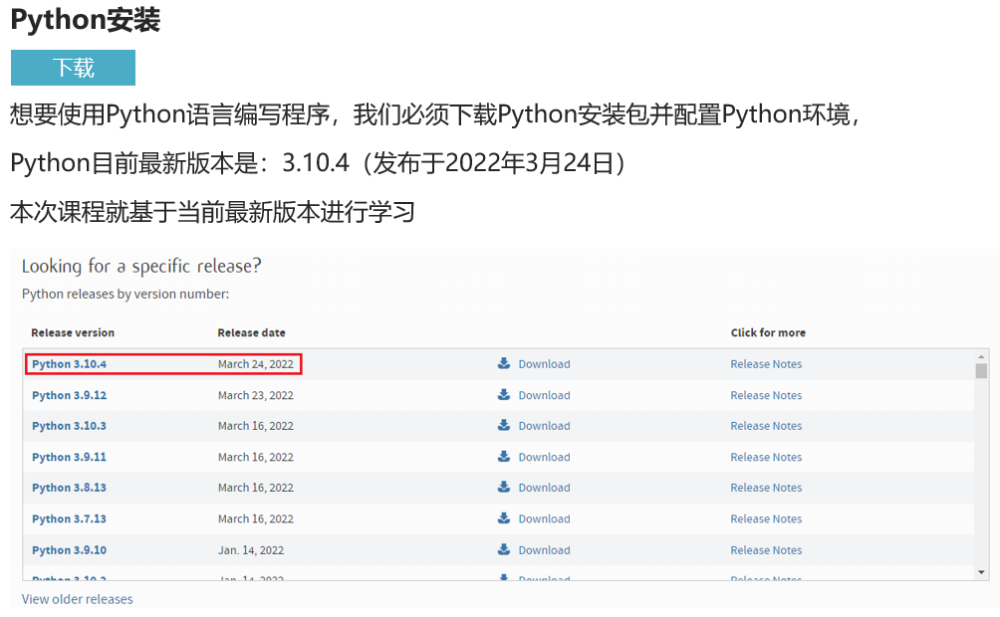

下载最新版Python：https://www.python.org/downloads

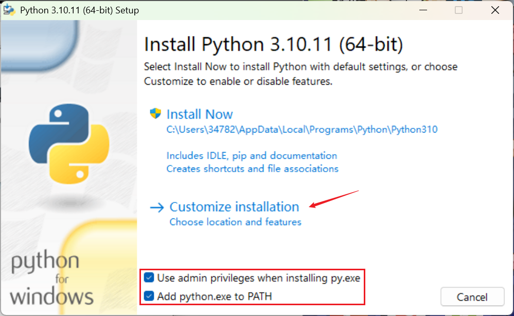

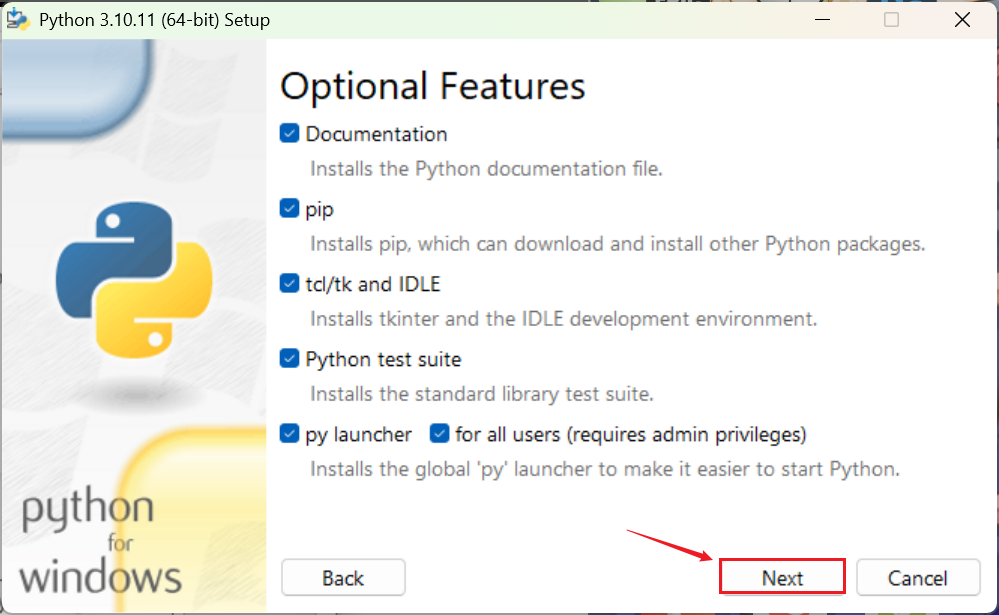

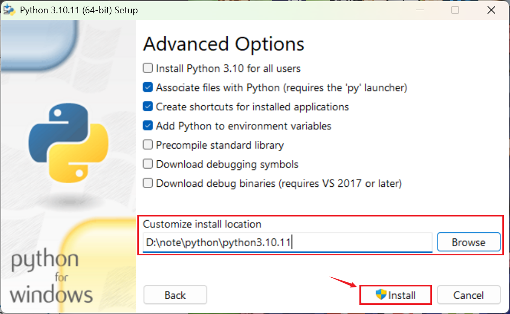

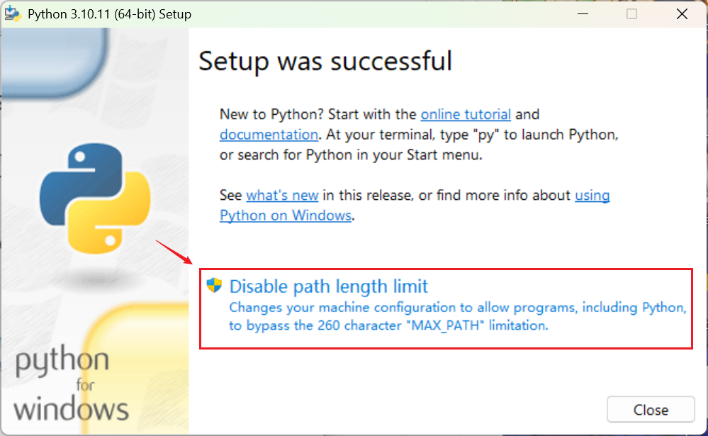

cmd打开输入python，查看是否安装成功


### 2. 第一个Python程序

打开CMD（命令提示符）程序，输入python并回车

然后，在里面输入代码回车即可立即执行

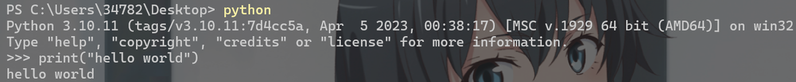


### 3. Python解释器

首先，一个基本原理是：计算机只认识二进制，即：0和1


其实很简单，计算机是不会认识Python代码的。但是Python有解释器程序，如下图


安装Python环境，本质上，就是在电脑中，安装：**Python解释器程序**

代码，随时可以写，但能不能运行，就要看电脑里面有没有解释器程序了。


Python解释器，是一个计算机程序，用来翻译Python代码，并提交给计算机执行。

所以，它的功能很简单，就2点：

1. 翻译代码

2. 提交给计算机运行


### 4. Python开发环境

Python程序的开发有许多种方式，一般我们常见的有：

- Python解释器环境内，执行单行代码
- 使用Python解释器程序，执行Python代码文件
- 使用第三方IDE（集成开发工具），如PyCharm软件，开发Python程序


#### 4.1 安装和配置PyCharm工具

下载地址：https://www.jetbrains.com/pycharm/download/#section=windows

破解：https://www.quanxiaoha.com/pycharm-pojie/pycharm-pojie-202521.html


## 二、Python基础语法

### 1. 字面量

字面量：在代码中，被**写下来**的的固定的**值**，称之为字面量

Python中常用的有**6**种值(数据)的类型

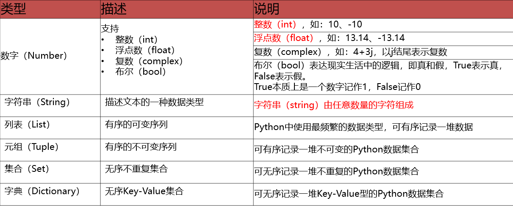


### 2. 注释

**注释**：在程序代码中对程序代码进行解释说明的文字。

**作用**：注释不是程序，**不能被执行**，只是对程序代码进行解释说明，让别人可以看懂程序代码的作用，能够大大增强程序的可读性。


**注释的分类**

- 单行注释：以 #开头，#右边 的所有文字当作说明，而不是真正要执行的程序，起辅助说明作用

  ```python
  #你好，世界
  ```

- 多行注释： 以 一对三个双引号 引起来，来解释说明一段代码的作用使用方法

  ```python
  """
  	轻音少女
  	星际牛仔
  	两杆大烟枪
  """
  ```

  

### 3. 变量

**变量**：**在程序运行时**，能储存计算结果或能表示值的抽象概念。

简单的说，变量就是在程序运行时，记录数据用的

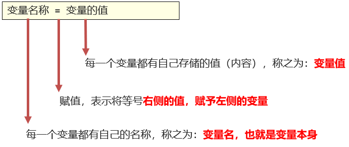

```python
money = 50
money -= 10

print(money)

money = money - 5

print(money)
```


### 4. 数据类型

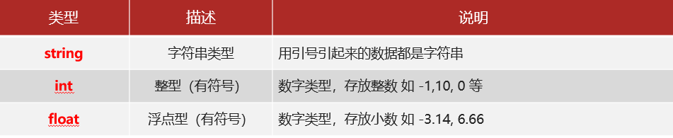

我们可以通过type()语句来得到数据的类型：

```python
# 在print语句中，直接输出类型信息
i = 1
j = "hello"

print(type(i))
print(type(j))


# 用变量存储type()的结果（返回值）
string_type = type("轻音少女")
int_type = type(18)

print(string_type)
print(int_type)
```


**变量有类型吗？**

我们通过type(变量)可以输出类型，这是查看变量的类型还是数据的类型？

查看的是：变量存储的数据的类型。因为，变量无类型，但是它存储的数据有。


#### 4.1 字符串类型的不同定义方式

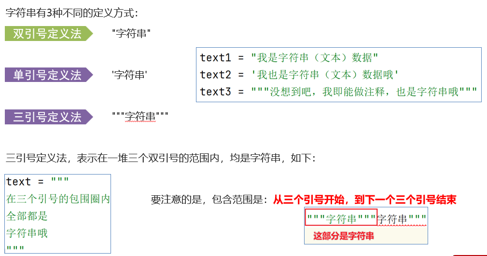


### 5. 数据类型转换

#### 5.1 为什么要转换类型

数据类型之间，在特定的场景下，是可以相互转换的，如字符串转数字、数字转字符串等

那么，我们为什么要转换它们呢？

数据类型转换，将会是我们以后经常使用的功能。

- 从文件中读取的数字，默认是字符串，我们需要转换成数字类型
- 后续学习的input()语句，默认结果是字符串，若需要数字也需要转换
- 将数字转换成字符串用以写出到外部系统


#### 5.2 常见的转换语句

| 语句(函数) | 说明                  |
| ---------- | --------------------- |
| int(x)     | 将x转换为一个整数     |
| float(x)   | 将x转换为一个浮点数   |
| str(x)     | 将对象 x 转换为字符串 |

同前面学习的type()语句一样，这三个语句，都是带有结果的（返回值）

我们可以用print直接输出或用变量存储结果值


#### 5.3 类型转换注意事项

类型转换不是万能的，毕竟强扭的瓜不会甜，我们需要注意：

1. 任何类型，都可以通过str()，转换成字符串
2. 字符串内必须真的是数字，才可以将字符串转换为数字


### 6. 标识符

在Python程序中，我们可以给很多东西起名字，比如：

- 变量的名字
- 方法的名字
- 类的名字,等等

这些名字，我们把它统一的称之为标识符，用来做内容的标识。

所以，标识符：是用户在编程的时候所使用的一系列名字，用于给变量、类、方法等命名。


#### 6.1 标识符命名规则

Python中，标识符命名的规则主要有3类：

- 内容限定
- 大小写敏感
- 不可使用关键字


##### (1) 内容限定

标识符命名中，只允许出现：这四类元素，其余任何内容都不被允许。

- 英文
- 中文
- 数字
- 下划线（_）


##### (2) 大小写敏感

以定义变量为例：
Andy = “安迪1”
andy = “安迪2”

字母a的大写和小写，是完全能够区分的。


##### (3) 不可使用关键字

Python中有一系列单词，称之为关键字

关键字在Python中都有特定用途

我们不可以使用它们作为标识符

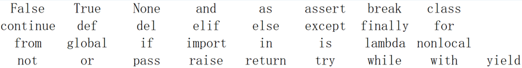


#### 6.2 变量命名规范

我们目前只接触到了：变量。所以，目前学习：变量的命名规范。

- 见名知意
- 下划线命名法
- 英文字母全小写


##### (1) 见名知意

变量的命名要做到：

- 明了：尽量做到，看到名字，就知道是什么意思
- 简洁：尽量在确保“明了”的前提下，减少名字的长度


##### (2) 下划线命名法

多个单词组合变量名，要使用下划线做分隔。

```python
#错误示范
firstnumber = 1
studentnickname = "小明"

#正确示范
first_number = 1
student_nickname = "小明"
```


##### (3) 英文字母全小写

命名变量中的英文字母，应全部小写：

```python
#错误示范
Name = "张三"
Age = 11

#正确示范
name = "张三"
age = 11
```


### 7. 运算符

#### 7.1 算术运算符

| 运算符 | 描述   | 实例                                                         |
| ------ | ------ | ------------------------------------------------------------ |
| +      | 加     | 两个对象相加 a + b 输出结果 30                               |
| -      | 减     | 得到负数或是一个数减去另一个数 a - b 输出结果 -10            |
| *      | 乘     | 两个数相乘或是返回一个被重复若干次的字符串 a * b 输出结果 200 |
| /      | 除     | b / a 输出结果 2                                             |
| //     | 取整除 | 返回商的整数部分 9//2 输出结果 4 , 9.0//2.0 输出结果 4.0     |
| %      | 取余   | 返回除法的余数 b % a 输出结果 0                              |
| **     | 指数   | a**b 为10的20次方， 输出结果 100000000000000000000           |


#### 7.2 赋值运算符

| 运算符 | 描述       | 实例                                                         |
| ------ | ---------- | ------------------------------------------------------------ |
| =      | 赋值运算符 | 把 = 号右边的结果 赋给 左边的变量，如 num = 1 + 2 * 3，结果num的值为7 |

**复合赋值运算符**

| 运算符 | 描述             | 实例                       |
| ------ | ---------------- | -------------------------- |
| +=     | 加法赋值运算符   | c += a 等效于 c = c + a    |
| -=     | 减法赋值运算符   | c -= a 等效于 c = c - a    |
| *=     | 乘法赋值运算符   | c *= a 等效于 c = c * a    |
| /=     | 除法赋值运算符   | c /= a 等效于 c = c / a    |
| %=     | 取模赋值运算符   | c %= a 等效于 c = c % a    |
| **=    | 幂赋值运算符     | c ** = a 等效于 c = c ** a |
| //=    | 取整除赋值运算符 | c //= a 等效于 c = c // a  |


### 8. 字符串扩展

#### 8.1 字符串的三种定义方式

```python
#字符串在Python中有多种定义形式：

# 1.单引号定义法
name = '轻音少女'

# 2.双引号定义法
name = "轻音少女"

# 3.三引号定义法
name = """轻音少女"""
```

三引号定义法，和多行注释的写法一样，同样支持换行操作。

使用变量接收它，它就是字符串

不使用变量接收它，就可以作为多行注释使用。


#### 8.2 字符串的引号嵌套

思考：如果我想要定义的字符串本身，是包含：单引号、双引号自身呢？如何写？

- 单引号定义法，可以内含双引号
- 双引号定义法，可以内含单引号
- 可以使用转移字符（\）来将引号解除效用，变成普通字符串


#### 8.3 字符串拼接

如果我们有两个字符串（文本）字面量，可以将其拼接成一个字符串，通过+号即可完成，如：

```python
print("放学后茶会" + "呆唯本人")
```

**注意事项**：无法和非字符串类型进行拼接


#### 8.4 字符串格式化

我们会发现，这个拼接字符串也不好用啊

1. 变量过多，拼接起来实在是太麻烦了
2. 字符串无法和数字或其它类型完成拼接。


**所以，有没有其它方式，即方便又支持拼接其它类型呢？**

这个方式，就是字符串的格式化

我们可以通过如下语法，完成字符串和变量的快速拼接。

```python
name = "呆唯本人"
message = "放学后茶会 %s" % name
print(message)
```

其中的，%s 

- %  表示：我要占位
- s   表示：将变量变成字符串放入占位的地方

所以，综合起来的意思就是：我先占个位置，等一会有个变量过来，我把它变成字符串放到占位的位置


**那，数字类型呢？可以不可以占位？**

那必须可以，我们来尝试如下代码：

```python
name = "呆唯本人"
age = 18
message = "放学后茶会%s，年龄：%s" % (name, age)
print(message)
```


数字类型，也太没有地位了吧，竟然要被转成字符串拼接。

有没有体面一点的方式，让数字以其原本的面貌拼接进去呢？

Python中，其实支持非常多的数据类型占位

最常用的是如下三类

| 格式符号 | 转化                             |
| -------- | -------------------------------- |
| %s       | 将内容转换成字符串，放入占位位置 |
| %d       | 将内容转换成整数，放入占位位置   |
| %f       | 将内容转换成浮点型，放入占位位置 |


#### 8.5 格式化的精度控制

如下代码，完成字符串、整数、浮点数，三种不同类型变量的占位

```java
name = "呆唯本人"
age = 18
price = 19.99
message = "放学后茶会%s，年龄：%d，价格：%f" % (name, age, price)
print(message)
```

结果：浮点数19.99，变成了19.990000输出


我们可以使用辅助符号"m.n"来控制数据的宽度和精度

- m，控制宽度，要求是数字（很少使用）,设置的宽度小于数字自身，不生效
- .n，控制小数点精度，要求是数字，会进行小数的四舍五入

示例：

- %5d：表示将整数的宽度控制在5位。
  如数字11，被设置为5d，就会变成：[空格] [空格] [空格]11，用三个空格补足宽度。
- %5.2f：表示将宽度控制为5，将小数点精度设置为2。
  小数点和小数部分也算入宽度计算。如，对11.345设置了%7.2f 后，结果是：[空格] [空格]11.35。2个空格补足宽度，小数部分限制2位精度后，四舍五入为 .35
- %.2f：表示不限制宽度，只设置小数点精度为2。
  如11.345设置%.2f后，结果是11.35


**总结**：

1. 精度控制的语法是：

   m.n的形式控制，如%5d、%5.2f、%.2f

   m和.n均可省略

2. 如果m比数字本身宽度还小，m不生效

3. .n会对小数部分做精度限制，会对小数部分做四舍五入


#### 8.6 字符串格式化方式2

目前通过%符号占位已经很方便了，还能进行精度控制。

可是追求效率和优雅的Python，是否有更加优雅的方式解决问题呢？

通过语法：f"内容{变量}"的格式来快速格式化

```python
name = "呆唯本人"
age = 18
price = 19.99
message = f"放学后茶会{name}，年龄：{age}，价格：{price}"
print(message)
```

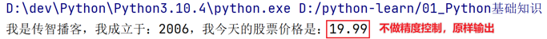

这种方式：

- 不理会类型
- 不做精度控制


#### 8.7 对表达式进行格式化

刚刚的演示，都是基于变量的。

可是，我想更加优雅些，少写点代码，直接对“表达式”进行格式化是否可行呢？

那么，我们先了解一下什么是表达式。

**表达式：一条具有明确执行结果的代码语句**

如：**1 + 1.5 * 2**，就是表达式，因为有具体的结果，结果是一个数字

又或者，常见的变量定义：

**name = “张三”   age = 11 + 11**

等号右侧的都是表达式呢，因为它们有具体的结果，结果赋值给了等号左侧的变量。


那么，对于字符串格式化，能否直接格式化一个表达式呢？

可以，上代码：

```python
print("1*1的结果是：%d" % (1 * 1))
print(f"1*1的结果是：{1 * 1}")
print("字符串在python中的类型是：%s" % type('字符串'))
```

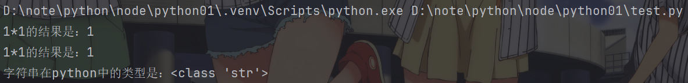

在无需使用变量进行数据存储的时候，可以直接格式化表达式，简化代码哦


### 9. 数据输入

#### 9.1 获取键盘输入

试想一下，我们经常遇到过程序需要我们输入信息的场景。

比如：银行取钱

如何在Python中做到读取键盘输入的内容呢？

这里就要请出input语句了


#### 9.2 input语句(函数)

我们前面学习过print语句（函数），可以完成将内容（字面量、变量等）输出到屏幕上。

在Python中，与之对应的还有一个input语句，用来获取键盘输入。

- 数据输出：print
- 数据输入：input

使用上也非常简单：

- 使用input()语句可以从键盘获取输入
- 使用一个变量接收（存储）input语句获取的键盘输入数据即可

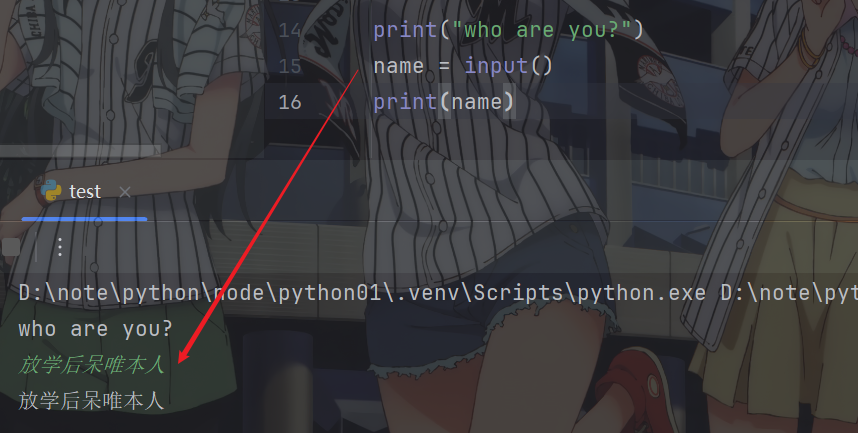

那么，让我们通过前面学习过的**type()**语句

来验证一下输入内容的数据类型吧。

可以看到，无论键盘输入何种类型的数据

**最终的结果都是：字符串类型的数据**


## 三、Pthon判断语句

**为什么学习判断语句**

判断在程序中广泛应用，如果没有它，这些功能都难以实现。

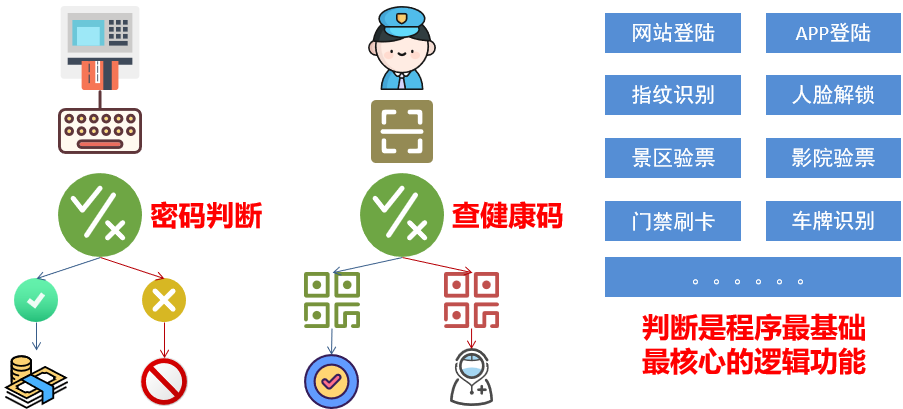


### 1. 布尔类型和比较运算符

进行判断，只有2个结果：

- 是
- 否


布尔类型的字面量：

- True 表示真（是、肯定）
- False 表示假 （否、否定）


定义变量存储布尔类型数据：`变量名称 = 布尔类型字面量`

布尔类型的数据，不仅可以通过定义得到，也可以通过比较运算符进行内容比较得到。

```python
result = 10 > 5
print(f"10 > 5 的结果是：{result}，类型是：{type(result)}")
```

结果

```
10 > 5 的结果是：True，类型是：<class 'bool'>
```


#### 1.1 比较运算符

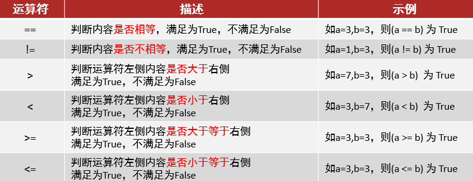


### 2. if语句的基本格式

**生活中的判断**

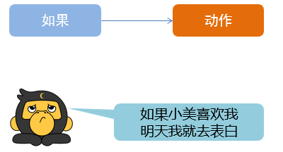


**程序中的判断**

if 要判断的条件:

​	条件成立时，要做的事情

```python
#定义变量
age = 30

#进行判断
if age >= 18:
    print("我已经是阿姨了")
```

if语句的注意事项：

- 判断条件的结果一定要是布尔类型
- 不要忘记判断条件后的： 引号
- 归属于if语句的代码块，需在前方填充4个空格缩进


### 3. if else 语句

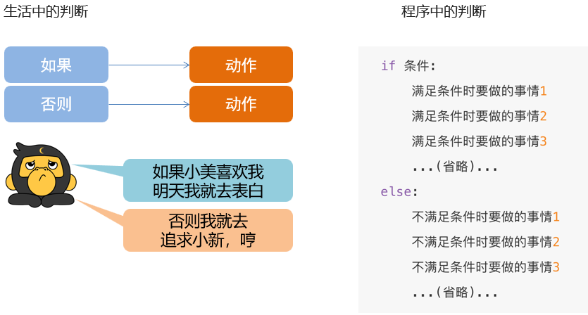

```python
print("欢迎来到儿童游乐园，儿童免费，成人收费")
age = int(input("请输入你的年龄："))
if age >= 18:
    print("您已成年，游玩需要补票10元。")
else:
    print("您未成年。可以免费游玩。")

print("祝您游玩愉快")
```

if else语句的注意事项：

- else不需要判断条件，当if的条件不满足时，else执行
- else的代码块，同样要4个空格作为缩进


### 4. if elif else 语句

某些场景下，判断条件不止一个，可能有多个。

if elif else 语句可以实现

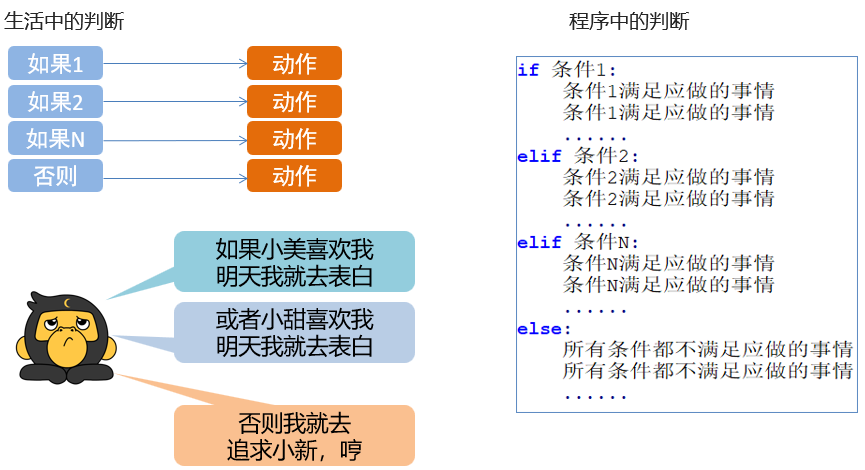

```python
print("欢迎来到动物园")
height = int(input("请输入你的身高(cm)："))
vip_level = int(input("请输入你的vip级别(1~5)："))
if height < 120:
    print("你的身高小于120cm，可以免费游玩。")
elif vip_level > 3:
    print("您的vip级别大于3，可以免费游玩。")
else:
    print("不好意思，所有条件都不满足，需要购票10元")
print("祝您游玩愉快")
```

使用if elif else的注意点有：

- elif可以写多个
- 判断是互斥且有序的，上一个满足后面的就不会判断了
- 可以在条件判断中，直接写input语句，节省代码量


## 四、Python循环语句

循环在程序中同判断一样，也是广泛存在的，是非常多功能实现的基础：


### 1. while循环的基础语法

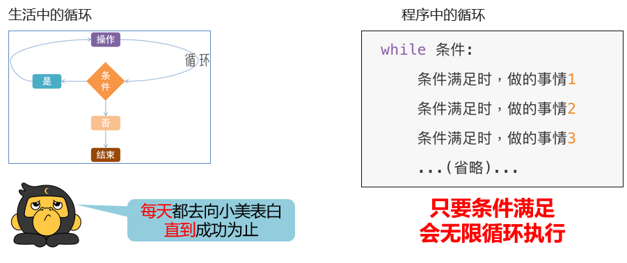

```python
print("绯红之王的死亡次数")
i = 0
while i < 10:
    print(f"绯红之王死了{i}次")
    i += 1
print("绯红之王去往了天堂")
```

1. while的条件需得到布尔类型，True表示继续循环，False表示结束循环
2. 需要设置循环终止的条件，如i += 1配合 i < 100，就能确保100次后停止，否则将无限循环
3. 空格缩进和if判断一样，都需要设置


#### 1.1 补充知识-print输出不换行

默认print语句输出内容会自动换行，如下：

```python
print("hello")
print("world")
```

输出

```
hello
world
```


输出不换行功能，实现方式如下：

```python
print("hello", end='')
print("world", end='')
```

输出

```
helloworld
```

在print语句中，加上 end='' 即可输出不换行了


#### 1.2 补充知识-制表符\t

在字符串中，有一个特殊符号：\t，效果等同于在键盘上按下：tab键。

它可以让我们的多行字符串进行对齐。

没使用前：

```python
print("hello world")
print("ict best")
```

输出

```
hello world
ict best
```


使用后

```python
print("hello\tworld")
print("ict\t\tbest")
```

输出

```
hello	world
ict		best
```


### 2. for循环

#### 2.1 基础语法

除了while循环语句外，Python同样提供了for循环语句。

两者能完成的功能基本差不多，但仍有一些区别：

- while循环的循环条件是自定义的，**自行控制循环条件**
- for循环是一种”**轮询**”机制，是对一批内容进行”**逐个处理**”

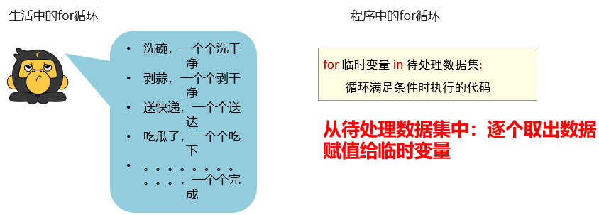


**遍历字符串**

```python
#定义字符串name
name = "轻音少女"

#for循环处理字符串
for i in name:
    print(i)
```

输出

```
轻
音
少
女
```

可以看出，for循环是将字符串的内容：**依次取出**

所以，for循环也被称之为：**遍历循环**


**for循环注意点**

- 同while循环不同，for循环是无法定义循环条件的。只能从被处理的数据集中，依次取出内容进行处理。
- 所以，理论上讲，Python的for循环无法构建无限循环（被处理的数据集不可能无限大）


#### 2.2 range语句

> for 临时变量 in 待处理数据集(可迭代对象): 
>         循环满足条件时执行的代码

语法中的：待处理数据集，严格来说，称之为：**可迭代类型**

可迭代类型指，**其内容可以一个个依次取出的一种类型**，包括：

- 字符串
- 列表
- 元组


for循环语句，本质上是遍历：可迭代对象。

尽管除字符串外，其它可迭代类型目前没学习到，但不妨碍我们通过学习range语句，获得一个简单的数字序列（可迭代类型的一种）。


语法1：`range(num)`

获取一个从0开始，到num结束的数字序列（不含num本身）

如range(5)取得的数据是：[0, 1, 2, 3, 4]


语法2：`range(num1, num2)`

获得一个从num1开始，到num2结束的数字序列（不含num2本身）

如，range(5, 10)取得的数据是：[5, 6, 7, 8, 9]


语法3：`range(num1, num2, step)`

获得一个从num1开始，到num2结束的数字序列（不含num2本身）

数字之间的步长，以step为准（step默认为1）

如，range(5, 10, 2)取得的数据是：[5, 7, 9]


#### 2.3 变量作用域

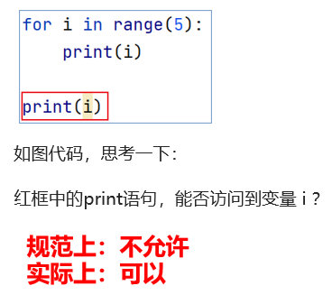

> for 临时变量 in 待处理数据集:
> 		循环满足条件时执行的代码

回看for循环的语法，我们会发现，将从数据集（序列）中取出的数据赋值给：临时变量。

为什么是临时的呢？

临时变量，在**编程规范**上，作用范围（作用域），只限定在for循环内部

如果在for循环外部访问临时变量：

- 实际上是可以访问到的
- 在编程规范上，是不允许、不建议这么做的


如果实在需要在循环外访问循环内的临时变量，可以在循环外预先定义

```python
i = 0
for i in range(5):
    print(i)
print(i)
```

如图，每一次循环的时候，都会将取出的值赋予 i 变量。

- 由于 i 变量是在循环之前（外）定义的
- 在循环外访问 i 变量是合理的、允许的


### 3. 循环中断

思考：无论是while循环或是for循环，都是重复性的执行特定操作。

在这个重复的过程中，会出现一些其它情况让我们不得不：

- 暂时跳过某次循环，直接进行下一次
- 提前退出循环，不在继续

对于这种场景，Python提供continue和break关键字

用以对循环进行**临时跳过**和**直接结束**


#### 3.2 continue

continue关键字用于：中断本次循环，直接进入下一次循环

continue可以用于：  for循环和while循环，效果一致

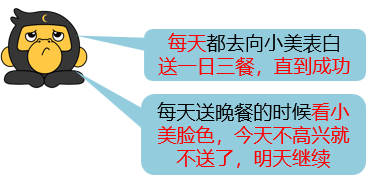

让我们通过代码来模拟一下追求小美的过程。(以for循环为例，while循环效果一样）

通过input输入语句，来决定今天小美的心情(0表示好心情，1表示坏心情）

```python
for i in range(1, 101):
    print(f"追求小美的第{i}天，坚持...")
    print("给小美送早饭，比心")
    print("给小美送早饭，比心")
    if input(f"今天小美的心情好像(0好心情，1坏心情)") == '1':
        print("小美心情不好，晚饭不送了，撤退.....")
        print()
        continue
    print("给小美送晚饭，送小美回家并表白")
    print()
```

continue关键字只可以控制：**它所在的循环临时中断**


#### 3.1 break

break关键字用于：**直接结束所在循环**

break可以用于：**for循环和while循环，效果一致**

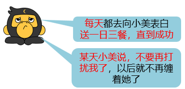

让我们通过代码来模拟一下追求小美的过程。(以for循环为例，while循环效果一样）

通过input输入语句，来决定今天小美的心情(0表示好心情，1表示坏心情）

```python
for i in range(1, 101):
    print(f"追求小美的第{i}天，坚持...")
    print("给小美送早饭，比心")
    print("给小美送早饭，比心")
    if input("如果你是小美，请告诉我，你是否明确拒绝(0再观察观察，1不合适拒绝)") == '1':
        print("小美拒绝我了，以后不追求小美了。")
        break
    print("给小美送晚饭，送小美回家并表白")
    print()
```

break关键字同样只可以控制：**它所在的循环永久中断**


## 五、Python函数

> 函数：是组织好的，可重复使用的，用来实现特定功能的代码段。
>

使用函数的好处是：

- 将功能封装在函数内，可供随时随地重复利用
- 提高代码的复用性，减少重复代码，提高开发效率


### 1. 函数的定义

函数的定义：

```python
def 函数名(传入参数):
	函数体
    return 返回值
```

函数的调用：

```python
函数名(参数)
```

注意事项：

- 参数不需要，可以省略
- 返回值不需要，可以省略


### 2. 函数的参数

#### 2.1 函数的传入参数

传入参数的功能是：在函数进行计算的时候，接受外部（调用时）提供的数据

有如下代码，完成了2个数字相加的功能：

```python
def add():
    result = 1 + 2
    print(f"1 + 2的结果是：{result}")

add()
```

函数的功能非常局限，只能计算1 + 2。

有没有可能实现：每一次使用函数，去计算用户指定的2个数字，而非每次都是1 + 2呢？

可以的，使用函数的传入参数功能，即可实现。


#### 2.2 函数的传入参数 - 传参定义

```python
def add(x, y):
    result = x + y
    print(f"{x} + {y}的结果是：{result}")
    
add(1, 2)
```

实现了，每次计算的是x + y，而非固定的1 + 2

x + y的值，可以在调用函数的时候指定。


**注意事项**：

- 函数定义中的参数，称之为形式参数
- 函数调用中的参数，称之为实际参数
- 函数的参数数量不限，使用逗号分隔开
- 传入参数的时候，要和形式参数一一对应，逗号隔开


### 3. 函数的返回值

#### 3.1 函数返回值的定义

```python
def add(a, b):
    result = a + b
    return result

r = add(1, 2)
print(r)
```

所谓“返回值”，就是程序中函数完成事情后，最后给调用者的结果


#### 3.2 None类型

思考：如果函数没有使用return语句返回数据，那么函数有返回值吗？

实际上是：有的。


Python中有一个特殊的字面量：None，其类型是：<class 'NoneType'>

无返回值的函数，实际上就是返回了：None这个字面量


None表示：空的、无实际意义的意思

函数返回的None，就表示，这个函数没有返回什么有意义的内容。

也就是返回了空的意思。

```python
def say_hello():
    print("hello...")

#使用变量接收say_hello函数的返回值
result = say_hello()

#打印返回值
print(result)

#打印返回值类型
print(type(result))
```

None可以主动使用return返回，效果等同于不写return语句：

```python
def say_hello():
    print("hello...")
    return None

#使用变量接收say_hello函数的返回值
result = say_hello()

#打印返回值
print(result)

#打印返回值类型
print(type(result))
```


**None类型的应用场景**

None作为一个特殊的字面量，用于表示：空、无意义，其有非常多的应用场景。

- 用在函数无返回值上
- 用在if判断上
  - 在if判断中，None等同于False
  - 一般用于在函数中主动返回None，配合if判断做相关处理
- 用于声明无内容的变量上
- 定义变量，但暂时不需要变量有具体值，可以用None来代替


### 4. 函数说明文档

函数是纯代码语言，想要理解其含义，就需要一行行的去阅读理解代码，效率比较低。

我们可以给函数添加说明文档，辅助理解函数的作用。

语法如下：

```python
def fuc(x, y):
    """
    函数说明
    :param x: 形参x的说明
    :param y: 形参y的说明
    :return: 返回值的说明
    """
    函数体
    return 返回值
```

- :param 用于解释参数
- :return 用于解释返回值

通过多行注释的形式，对函数进行说明解释

在PyCharm编写代码时，可以通过鼠标悬停，查看调用函数的说明文档


### 5. 函数的嵌套调用

**什么是函数的嵌套**

所谓函数嵌套调用指的是**一个函数里面又调用了另外一个函数**

```python
def func_b():
    print("---2---")

def func_a():
    print("---1---")
    
    func_b()

    print("---3---")

#调用函数func_a
func_a()
```

如果函数A中，调用了另外一个函数B，那么先把函数B中的任务都执行完毕之后才会回到上次 函数A执行的位置


### 6. 变量的作用域

变量**作用域**指的是变量的作用范围（变量在哪里可用，在哪里不可用）

主要分为两类：**局部变量和全局变量**


#### 6.1 局部变量

所谓局部变量是**定义在函数体内部的变量，即只在函数体内部生效**

```python
def testA():
    num = 100
    print(num)

testA()
print(num) #报错：name 'num' is not defined
```

变量a是定义在`testA`函数内部的变量，在函数外部访问则立即报错.

**局部变量的作用**：在函数体内部，临时保存数据，即当函数调用完成后，则销毁局部变量


#### 6.2 全局变量

所谓全局变量，指的是在函数体内、外都能生效的变量

思考：如果有一个数据，在函数A和函数B中都要使用，该怎么办？

答：将这个数据存储在一个全局变量里面

```python
# 定义全局变量a
num = 100

def testA():
    print(num) #访问全局变量num，并打印变量num存储的数据

def testB():
    print(num) #访问全局变量num，并打印变量num存储的数据
    
testA() #100
testB() #100
```


#### 6.3 global关键字

思考：`testB`函数需要修改变量num的值为200，如何修改程序？

```python
# 定义全局变量a
num = 100

def testA():
    print(num) #访问全局变量num，并打印变量num存储的数据

def testB():
    num = 200
    print(num) #访问全局变量num，并打印变量num存储的数据

testA() # 结果：100
testB() # 结果：200
print(f'全局变量num = {num}') # 结果：全局变量num = 100
```


使用 **global关键字** 可以在函数内部声明变量为全局变量, 如下所示

```python
num = 100

def testA():
    print(num)

def testB():
    # global 关键字声明a是全局变量
    global num
    num = 200
    print(num)

testA() # 结果：100
testB() # 结果：200
print(f'全局变量num = {num}') # 结果：全局变量num = 200
```


### 7. 闭包

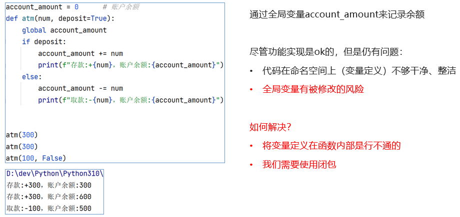

在函数嵌套的前提下，内部函数使用了外部函数的变量，并且外部函数返回了内部函数，我们把这个使用外部函数变量的内部函数称为闭包。

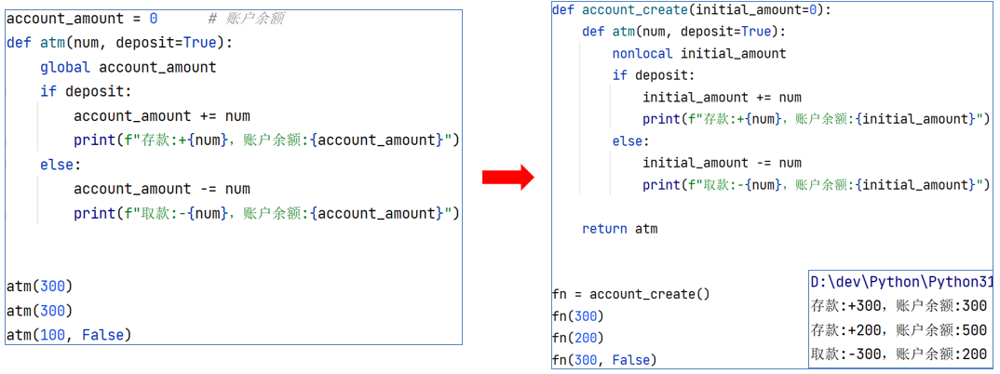

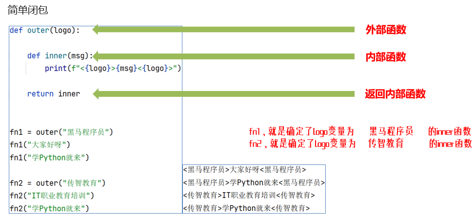

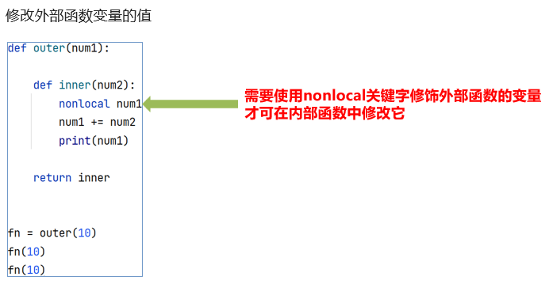

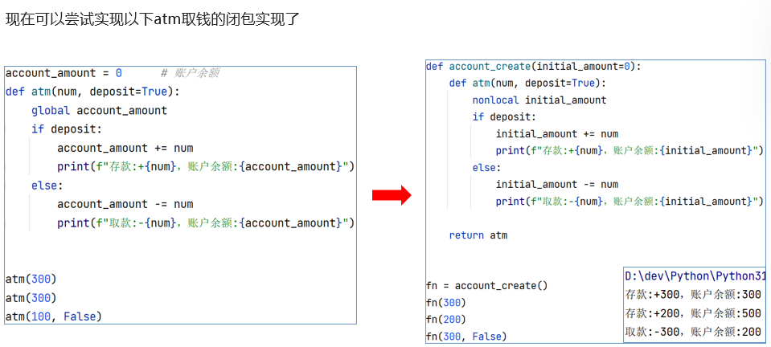

优点，使用闭包可以让我们得到：

- 无需定义全局变量即可实现通过函数，持续的访问、修改某个值
- 闭包使用的变量的所用于在函数内，难以被错误的调用修改

缺点：

- 由于内部函数持续引用外部函数的值，所以会导致这一部分内存空间不被释放，一直占用内存


## 六、Python数据容器

### 1. 数据容器入门

思考一个问题：如果我想要在程序中，记录5名学生的信息，如姓名。

如何做呢？

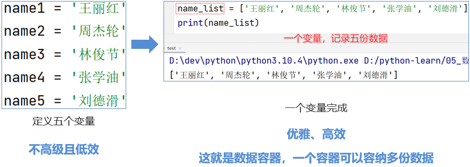

学习数据容器，就是为了批量存储或批量使用多份数据


**数据容器**

Python中的数据容器：

- 一种可以容纳多份数据的数据类型，容纳的每一份数据称之为1个元素
- 每一个元素，可以是任意类型的数据，如字符串、数字、布尔等。


数据容器根据特点的不同，如：

- 是否支持重复元素
- 是否可以修改
- 是否有序


分为5类，分别是：列表（list）、元组（tuple）、字符串（str）、集合（set）、字典（dict）


### 2. 数据容器：list(列表)

#### 2.1 列表的定义

**为什么需要列表**

**思考**：有一个人的姓名(TOM)怎么在程序中存储？
**答**：字符串变量

**思考**：如果一个班级100位学生，每个人的姓名都要存储，应该如何书写程序？声明100个变量吗？
**答**：No，我们使用列表就可以了， 列表一次可以存储多个数据

**基本语法**：

```python
# 字面量
[元素1, 元素2, 元素3, 元素4]

# 定义变量
变量名称 = [元素1, 元素2, 元素3, 元素4]

# 定义空列表
变量名称 = []
变量名称 = list()
```

列表内的每一个数据，称之为元素

- 以 [] 作为标识
- 列表内每一个元素之间用, 逗号隔开


**列表的定义方式：**

```python
name_list = ['轻音少女', 'k-on', 'python']
print(name_list) # ['轻音少女', 'k-on', 'python']
print(type(name_list)) # <class 'list'>


my_list = ['呆唯', 18, True]
print(my_list) # ['呆唯', 18, True]
print(type(my_list)) # <class 'list'>

# 嵌套列表的定义
nesting_list = [[1, 2, 3], [4, 5, 6]]
print(nesting_list) # [[1, 2, 3], [4, 5, 6]]
print(type(nesting_list)) # <class 'list'>
```

注意：列表可以一次存储多个数据，且可以为不同的数据类型，支持嵌套


#### 2.2 列表的下标索引

如何从列表中取出特定位置的数据呢？

我们可以使用：下标索引

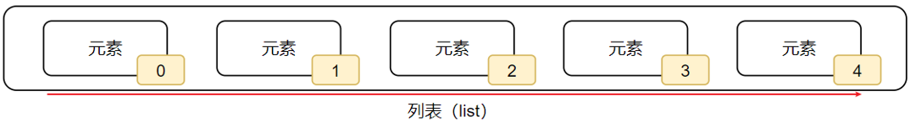

如图，列表中的每一个元素，都有其位置下标索引，从前向后的方向，从0开始，依次递增

我们只需要按照下标索引，即可取得对应位置的元素。

```python
name_list = ['轻音少女', 'k-on', 'python']
print(name_list) # ['轻音少女', 'k-on', 'python']
print(type(name_list)) # <class 'list'>

print(name_list[0]) # 结果：轻音少女
print(name_list[1]) # 结果：k-on
print(name_list[2]) # 结果：python
```


**列表的下标（索引） - 反向**

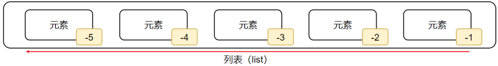

如图，从后向前，下标索引为：-1、-2、-3，依次递减。

```python
name_list = ['轻音少女', 'k-on', 'python']
print(name_list) # ['轻音少女', 'k-on', 'python']
print(type(name_list)) # <class 'list'>

print(name_list[-3]) # 结果：轻音少女
print(name_list[-2]) # 结果：k-on
print(name_list[-1]) # 结果：python
```


如果列表是嵌套的列表，同样支持下标索引

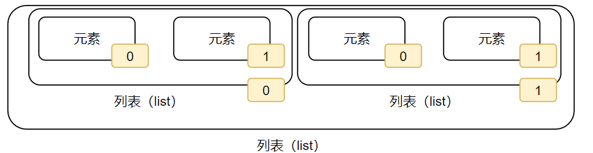


#### 2.3 列表的常用操作

- 查找某元素的下标

```python
# 功能：查找指定元素在列表的下标，如果找不到，报错ValueError
# 语法：列表.index(元素)
name_list = ['轻音少女', 'k-on', 'python']
print(name_list.index("k-on")) # 结果：1
```


- 修改特定位置（索引）的元素值


```python
# 语法：列表[下标] = 值
# 可以使用如上语法，直接对指定下标（正向、反向下标均可）的值进行：重新赋值（修改）
name_list = ['轻音少女', 'k-on', 'python']
name_list[0] = '空之境界'
print(name_list) # 结果：['空之境界', 'k-on', 'python']
```


- 插入元素


```python
# 语法：列表.insert(下标, 元素)，在指定的下标位置，插入指定的元素
my_list = [1, 3, 4]
my_list.insert(1, 2)
print(my_list) # 结果：[1, 2, 3, 4]
```


- 追加元素


```python
# 语法：列表.append(元素)，将指定元素，追加到列表的尾部
my_list = [1, 2, 3]
my_list.append(4)
print(my_list) # 结果：[1, 2, 3, 4]
```


- 追加元素方式2(批量追加)：


```python
# 语法：列表.extend(其它数据容器)，将其它数据容器的内容取出，依次追加到列表尾部
my_list = [1, 2, 3]
my_list.extend([4, 5, 6])
print(my_list) # 结果：[1, 2, 3, 4, 5, 6]
```


- 删除元素：


```python
my_list = [1, 2, 3]

# 语法1： del 列表[下标]
del my_list[0]
print(my_list) # 结果：[2, 3]

# 语法2：列表.pop(下标)
my_list.pop(0)
print(my_list) # 结果：[3]
```


- 删除某元素在列表中的第一个匹配项


```python
# 语法：列表.remove(元素)
my_list = [1, 2, 3, 4, 5, 6]
my_list.remove(2)
print(my_list) # 结果：[1, 3, 4, 5, 6]
```


- 清空列表内容


```python
# 语法：列表.clear()
my_list = [1, 2, 3, 4, 5, 6]
my_list.clear()
print(my_list) # 结果：[]
```


- 统计某元素在列表内的数量


```python
# 语法：列表.count(元素)
my_list = [1, 1, 1, 4, 5, 6]
print(my_list.count(1)) # 结果：3
```


- 统计列表内，有多少元素


```python
# 语法：len(列表)
# 可以得到一个int数字，表示列表内的元素数量
my_list = [1, 2, 3, 4, 5, 6]
print(len(my_list)) # 结果：6
```


**列表的方法 - 总览**

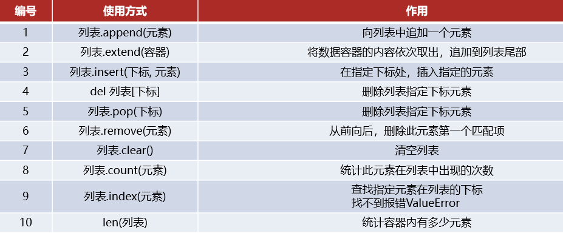


#### 2.4 列表的特点

- 可以容纳多个元素（上限为2**63-1、9223372036854775807个）
- 可以容纳不同类型的元素（混装）
- 数据是有序存储的（有下标序号）
- 允许重复数据存在
- 可以修改（增加或删除元素等）


### 3. list(列表)的遍历

#### 3.1 列表的遍历 - while循环

既然数据容器可以存储多个元素，那么，就会有需求从容器内依次取出元素进行操作。

将容器内的元素依次取出进行处理的行为，称之为：遍历、迭代。

```python
my_list = ["轻音少女", "星际牛仔", "物语系列", "空之境界"]
index = 0
while index < len(my_list): # 遍历列表的元素
    print(my_list[index]) # 取出列表的元素
    index += 1 # 控制循环条件
```


#### 3.2 列表的遍历 - for循环

除了while循环外，Python中还有另外一种循环形式：for循环。

对比while，for循环更加适合对列表等数据容器进行遍历。

```python
my_list = ["轻音少女", "星际牛仔", "物语系列", "空之境界"]
for i in my_list:
    print(i)
```

表示，从容器内，依次取出元素并赋值到临时变量上。

在每一次的循环中，我们可以对临时变量（元素）进行处理。


#### 3.3 while循环和for循环的对比

- 在循环控制上：
  - while循环**可以自定循环条件**，并自行控制
  - for循环**不可以自定循环条件**，只可以一个个从容器内取出数据
- 在无限循环上：
  - while循环**可以**通过条件控制做到无限循环
  - for循环理论上**不可以**，因为被遍历的容器容量不是无限的
- 在使用场景上：
  - while循环适用于任何想要循环的场景
  - for循环适用于，遍历数据容器的场景或简单的固定次数循环场景


### 4. 数据容器：tuple(元组)

思考：列表是**可以修改**的。

如果想要传递的信息，**不被篡改**，列表就不合适了。


元组同列表一样，都是可以封装多个、不同类型的元素在内。

但最大的不同点在于：**元组一旦定义完成，就不可修改**。


#### 4.1 元组的定义

元组定义：定义元组使用小括号，且使用逗号隔开各个数据，数据可以是不同的数据类型。

```python
my_tuple = ("轻音少女", "星际牛仔", "物语系列", "空之境界")
print(my_tuple)
print(type(my_tuple))
```


#### 4.2 元组的操作

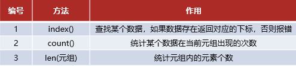

```python
my_tuple = ("轻音少女", "星际牛仔", "物语系列", "空之境界")

# 根据下标(索引)取出数据
print(my_tuple[1]) # 星际牛仔

# 根据index()，查找特定元素的第一个匹配项
print(my_tuple.index("物语系列")) # 2

# 统计某个数据在元组内出现的次数
print(my_tuple.count("轻音少女")) # 1

# 统计元组内的元素个数
print(len(my_tuple)) # 4
```


#### 4.3 元组的特点

- 可以容纳多个数据
- 可以容纳不同类型的数据(混装)
- 数据是有序存储的(下标索引)
- 允许重复数据存在
- 不可以修改(增加或删除元素等)
- 支持for循环


### 5. 数据容器：str(字符串)

尽管字符串看起来并不像：列表、元组那样，一看就是存放了许多数据的容器。

但不可否认的是，字符串同样也是数据容器的一员。

字符串是字符的容器，一个字符串可以存放任意数量的字符。

如，字符串："itheima"

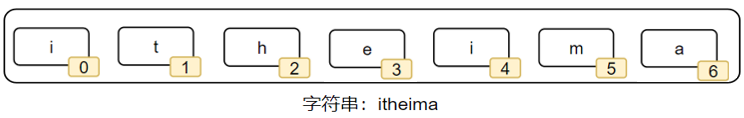


#### 5.1 字符串的下标(索引)

和其它容器如：列表、元组一样，字符串也可以通过下标进行访问

- 从前向后，下标从0开始
- 从后向前，下标从-1开始

```python
# 通过下标获取特定位置字符
name = "轻音少女"
print(name[0]) # 轻
print(name[-1]) # 女
```

同元组一样，字符串是一个：无法修改的数据容器。

均无法完成。如果必须要做，只能得到一个新的字符串，旧的字符串是无法修改


#### 5.2 字符串的常用操作

- 查找特定字符串的下标索引值


```python
name = "轻音少女"

# 语法：字符串.index(字符串)
print(name.index("少")) # 2
```


- 字符串的替换


```python
name = "轻音少女"

# 语法：字符串.replace(字符串1，字符串2）
# 功能：将字符串内的全部：字符串1，替换为字符串2
# 注意：不是修改字符串本身，而是得到了一个新字符串哦
new_name = name.replace("轻音", "放学后")

print(name) # 轻音少女
print(new_name) # 放学后少女
```


- 字符串的分割


```python
name = "轻音少女 星际牛仔 两杆大烟枪"

# 语法：字符串.split(分隔符字符串）
# 功能：按照指定的分隔符字符串，将字符串划分为多个字符串，并存入列表对象中
# 注意：字符串本身不变，而是得到了一个列表对象
name_list = name.split(" ")

print(name_list) # ['轻音少女', '星际牛仔', '两杆大烟枪']
print(type(name_list)) # <class 'list'>
```

可以看到，字符串按照给定的 <空格>进行了分割，变成多个子字符串，并存入一个列表对象中。


- 字符串的规整操作(去前后空格)


```python
name = "  轻音少女 星际牛仔 两杆大烟枪  "

# 语法：字符串.strip()
print(name.strip()) # "轻音少女 星际牛仔 两杆大烟枪"
```

- 字符串的规整操作(去前后指定字符串)


```python
name = "12轻音少女 星际12牛仔 两杆大烟枪21"

# 语法：字符串.strip(字符串)
print(name.strip("12")) # "轻音少女 星际12牛仔 两杆大烟枪"
```

注意，传入的是“12” 其实就是：”1”和”2”都会移除，是按照单个字符。


- 统计字符串中某字符串的出现次数


```python
name = "花物语 化物语 鬼物语"

# 语法：字符串.count(字符串)
print(name.count("物语")) # 3
```


- 统计字符串的长度


```python
name = "轻音少女"

# 语法：len(字符串)
print(len(name)) # 4
```


#### 5.3 字符串常用操作汇总

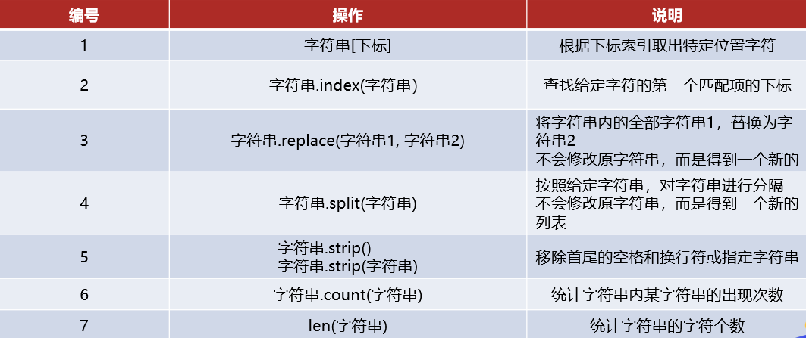


#### 5.4 字符串的特点

作为数据容器，字符串有如下特点：

- 只可以存储字符串
- 长度任意（取决于内存大小）
- 支持下标索引
- 允许重复字符串存在
- 不可以修改（增加或删除元素等）
- 支持for循环


### 6. 数据容器(序列)的切片

#### 6.1 序列

序列是指：内容连续、有序，可使用下标索引的一类数据容器

列表、元组、字符串，均可以可以视为序列。

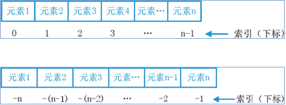

如图，序列的典型特征就是：有序并可用下标索引，字符串、元组、列表均满足这个要求


#### 6.2 序列的常用操作 - 切片

序列支持切片，即：列表、元组、字符串，均支持进行切片操作

切片：从一个序列中，取出一个子序列

> 语法：序列[起始下标:结束下标:步长]
>

表示从序列中，从指定位置开始，依次取出元素，到指定位置结束，得到一个新序列：

- 起始下标表示从何处开始，可以留空，留空视作从头开始
- 结束下标（不含）表示何处结束，可以留空，留空视作截取到结尾
- 步长表示，依次取元素的间隔
  - 步长1表示，一个个取元素
  - 步长2表示，每次跳过1个元素取
  - 步长N表示，每次跳过N-1个元素取
  - 步长为负数表示，反向取（注意，起始下标和结束下标也要反向标记）

注意，此操作不会影响序列本身，而是会得到一个新的序列（列表、元组、字符串）

```python
my_list = [1,2,3,4,5]
new_list = my_list[1:4] # 下标1开始，下标4（不含）结束，步长1
print(new_list) # 结果：[2,3,4]

my_tuple = (1,2,3,4,5)
new_tuple = my_tuple[:] # 从头开始，到最后结束，步长1
print(new_tuple) # 结果：[1,2,3,4,5]

my_list = [1,2,3,4,5]
new_list = my_list[::2] # 从头开始，到最后结束，步长2
print(new_list) # 结果 [1, 3, 5]

my_str = "12345"
new_str = my_str[:4:2] # 从头开始，到下标4（不含）结束，步长2
print(new_str) # 结果："13"
```

```python
my_str = "12345"
new_str = my_str[::-1] # 从头（最后）开始，到尾结束，步长-1（倒序）
print(new_str) # 结果："54321"

my_list = [1, 2, 3, 4, 5]
new_list = my_list[3:1:-1] # 从下标3开始，到下标1（不含）结束，步长-1（倒序）
print(new_list) # 结果：[4, 3]

my_tuple = (1, 2, 3, 4, 5)
new_tuple = my_tuple[:1:-2] # 从头（最后）开始，到下标1(不含)结束，步长-2（倒序）
print(new_tuple) # 结果：(5, 3)
```

可以看到，这个操作对列表、元组、字符串是通用的

同时非常灵活，根据需求，起始位置，结束位置，步长（正反序）都是可以自行控制的


### 7. 数据容器：set(集合)

**为什么使用集合**

我们目前接触到了列表、元组、字符串三个数据容器了。基本满足大多数的使用场景。

为何又需要学习新的集合类型呢？


通过特性来分析：

- 列表可修改、**支持重复元素且有序**
- 元组、字符串不可修改、**支持重复元素且有序**


局限就在于：它们都支持重复元素。

如果场景需要对内容做去重处理，列表、元组、字符串就不方便了。

而集合，最主要的特点就是：不支持元素的重复（自带去重功能）、并且内容无序


#### 7.1 集合的定义

```python
name = {"轻音少女", "星际牛仔", "两杆大烟枪"}
print(name) # 结果：{'星际牛仔', '两杆大烟枪', '轻音少女'}
print(type(name)) # 结果：<class 'set'>
```


#### 7.2 集合的常见操作

首先，因为集合是无序的，所以集合不支持：下标索引访问

但是集合和列表一样，是允许修改的，所以我们来看看集合的修改方法。

- 添加新元素

```python
my_set = {"轻音少女", "星际牛仔", "两杆大烟枪"}

# 语法：集合.add(元素)。将指定元素，添加到集合内
# 结果：集合本身被修改，添加了新元素
my_set.add("空之境界")
print(my_set) # {'星际牛仔', '空之境界', '两杆大烟枪', '轻音少女'}
```


- 移除元素

```python
my_set = {"轻音少女", "星际牛仔", "两杆大烟枪"}

# 语法：集合.remove(元素)，将指定元素，从集合内移除
# 结果：集合本身被修改，移除了元素
my_set.remove("轻音少女")
print(my_set) # 结果：{'星际牛仔', '两杆大烟枪'}
```


- 从集合中随机取出元素

```python
my_set = {"轻音少女", "星际牛仔", "两杆大烟枪"}

# 语法：集合.pop()，功能，从集合中随机取出一个元素
# 结果：会得到一个元素的结果。同时集合本身被修改，元素被移除

element = my_set.pop()
print(my_set) # {'轻音少女', '两杆大烟枪'}
print(element) # 星际牛仔
```


- 清空集合

```python
my_set = {"轻音少女", "星际牛仔", "两杆大烟枪"}

# 语法：集合.clear()，功能，清空集合
# 结果：集合本身被清空
my_set.clear()
print(my_set) # 结果：set()
```


- 取出2个集合的差集

```python
# 语法：集合1.difference(集合2)，功能：取出集合1和集合2的差集（集合1有而集合2没有的）
# 结果：得到一个新集合，集合1和集合2不变
set1 = {1, 2, 3}
set2 = {1, 5, 6}
set3 = set1.difference(set2)
set4 = set2.difference(set1)
print(set3) # 结果：[2, 3]
print(set4) # 结果：[5, 6]
```


- 消除2个集合的差集

```python
# 语法：集合1.difference_update(集合2)
# 功能：对比集合1和集合2，在集合1内，删除和集合2相同的元素。
# 结果：集合1被修改，集合2不变
set1 = {1, 2, 3}
set2 = {1, 5, 6}
set1.difference_update(set2)
set2.difference_update(set1)
print(set1) # 结果：[2, 3]
print(set2) # 结果：[1, 5, 6]
```


- 2个集合合并

```python
# 语法：集合1.union(集合2)
# 功能：将集合1和集合2组合成新集合
# 结果：得到新集合，集合1和集合2不变
set1 = {1, 2, 3}
set2 = {1, 5, 6}
set3 = set1.union(set2)
print(set3) # 结果：{1, 2, 3, 5, 6}
```


- 查看集合的元素数量

```python
my_set = {"轻音少女", "星际牛仔", "两杆大烟枪"}

# 语法：len(集合)
# 功能：统计集合内有多少元素
# 结果：得到一个整数结果
print(len(my_set)) # 结果：3
```


#### 7.3 集合常用功能总结

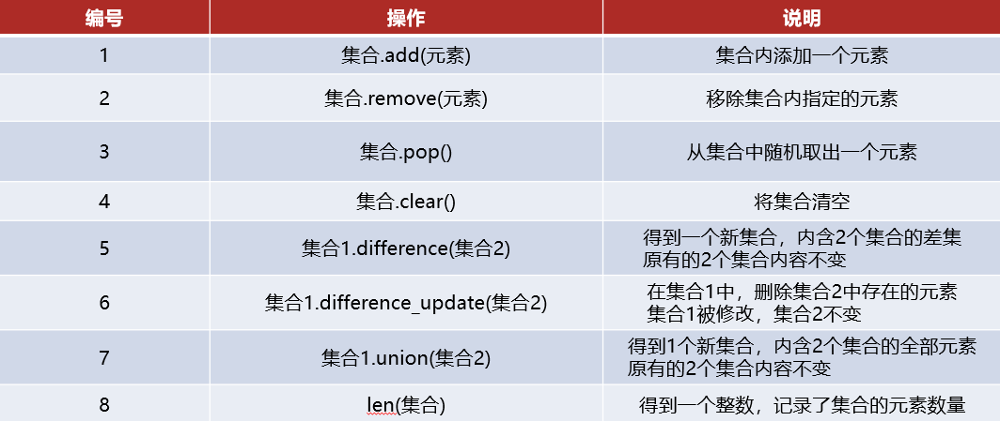


#### 7.4 集合的特点

- 可以容纳多个数据
- 可以容纳不同类型的数据(混装)
- 数据是无序存储的(不支持下标索引)
- 不允许重复数据存在
- 可以修改(增加或删除元素等)
- 支持for循环


### 8. 数据容器：dict(字典、映射)

**为什么需要字典**

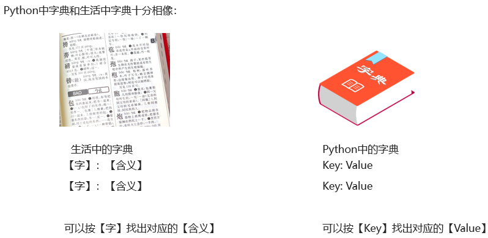


#### 8.1 字典的定义

字典的定义，同样使用{}，不过存储的元素是一个个的：键值对，如下语法：

```python
# 定义字典字面量
my_dict = {1: "轻音少女", 2: "星际牛仔", 3: "空之境界", 4: "碧蓝之海"}
print(my_dict)
print(type(my_dict))
```

- 使用{}存储原始，每一个元素是一个键值对
- 每一个键值对包含Key和Value（用冒号分隔）
- 键值对之间使用逗号分隔
- Key和Value可以是任意类型的数据（key不可为字典）
- Key不可重复，重复会对原有数据覆盖


- 字典数据的获取

字典同集合一样，不可以使用下标索引

但是字典可以通过Key值来取得对应的Value

```python
# 语法，字典[Key]可以取到对应的Value
my_dict = {1: "轻音少女", 2: "星际牛仔", 3: "空之境界", 4: "碧蓝之海"}
print(my_dict[1]) # 结果：轻音少女
print(my_dict[2]) # 结果：星际牛仔
print(my_dict[3]) # 结果：空之境界
```


- 字典的注意事项

1. 键值对的Key和Value可以是任意类型（Key不可为字典）
2. 字典内Key不允许重复，重复添加等同于覆盖原有数据
3. 字典不可用下标索引，而是通过Key检索Value


#### 8.2 字典的常用操作

- 新增元素


```python
my_dict = {
    1: "轻音少女",
    2: "星际牛仔",
    3: "空之境界",
    4: "碧蓝之海"}

# 语法：字典[Key] = Value，结果：字典被修改，新增了元素
my_dict[5] = "两杆大烟枪"
print(my_dict) # 结果：{1: '轻音少女', 2: '星际牛仔', 3: '空之境界', 4: '碧蓝之海', 5: '两杆大烟枪'}
```


- 更新元素


```python
my_dict = {
    1: "轻音少女",
    2: "星际牛仔",
    3: "空之境界",
    4: "碧蓝之海"}

# 语法：字典[Key] = Value，结果：字典被修改，元素被更新
# 注意：字典Key不可以重复，所以对已存在的Key执行上述操作，就是更新Value值
my_dict[4] = "花物语"
print(my_dict) # 结果：{1: '轻音少女', 2: '星际牛仔', 3: '空之境界', 4: '花物语'}
```


- 删除元素


```python
my_dict = {
    1: "轻音少女",
    2: "星际牛仔",
    3: "空之境界",
    4: "碧蓝之海"}

# 语法：字典.pop(Key)，结果：获得指定Key的Value，同时字典被修改，指定Key的数据被删除
value = my_dict.pop(4)
print(value) # 碧蓝之海
print(my_dict) # {1: '轻音少女', 2: '星际牛仔', 3: '空之境界'}
```


- 清空字典


```python
my_dict = {
    1: "轻音少女",
    2: "星际牛仔",
    3: "空之境界",
    4: "碧蓝之海"}

# 语法：字典.clear()，结果：字典被修改，元素被清空
my_dict.clear()
print(my_dict) # 结果：{}
```


- 获取全部的key


```python
my_dict = {
    1: "轻音少女",
    2: "星际牛仔",
    3: "空之境界",
    4: "碧蓝之海"}

# 语法：字典.keys()，结果：得到字典中的全部Key
keys = my_dict.keys()
print(keys) # 结果：dict_keys([1, 2, 3, 4])
print(type(keys)) # 结果：<class 'dict_keys'>
```


- 遍历字典


```python
my_dict = {
    1: "轻音少女",
    2: "星际牛仔",
    3: "空之境界",
    4: "碧蓝之海"}

# 语法：for key in 字典.keys()
keys = my_dict.keys()
for key in keys:
    print(f"id：{key}, 名字：{my_dict[key]}")

# 结果：
# id：1, 名字：轻音少女
# id：2, 名字：星际牛仔
# id：3, 名字：空之境界
# id：4, 名字：碧蓝之海
```


- 计算字典内的全部元素（键值对）数量


```python
my_dict = {
    1: "轻音少女",
    2: "星际牛仔",
    3: "空之境界",
    4: "碧蓝之海"}

# 语法：len(字典)
# 结果：得到一个整数，表示字典内元素（键值对）的数量
print(len(my_dict)) # 结果：4
```


#### 8.3 字典的常用操作总结

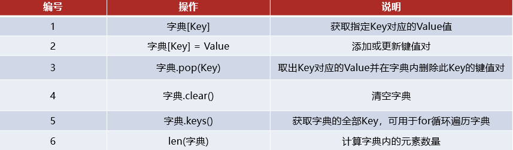


#### 8.4 字典的特点

- 可以容纳多个数据
- 可以容纳不同类型的数据
- 每一份数据是KeyValue键值对
- 可以通过Key获取到Value，Key不可重复（重复会覆盖）
- 不支持下标索引
- 可以修改（增加或删除更新元素等）
- 支持for循环，不支持while循环


### 9. 数据容器对比总结

**数据容器分类**

数据容器可以从以下视角进行简单的分类：

- 是否支持下标索引
  - 支持：列表、元组、字符串 - 序列类型
  - 不支持：集合、字典 - 非序列类型
- 是否支持重复元素：
  - 支持：列表、元组、字符串 - 序列类型
  - 不支持：集合、字典 - 非序列类型
- 是否可以修改
  - 支持：列表、集合、字典
  - 不支持：元组、字符串


**数据容器特点对比**

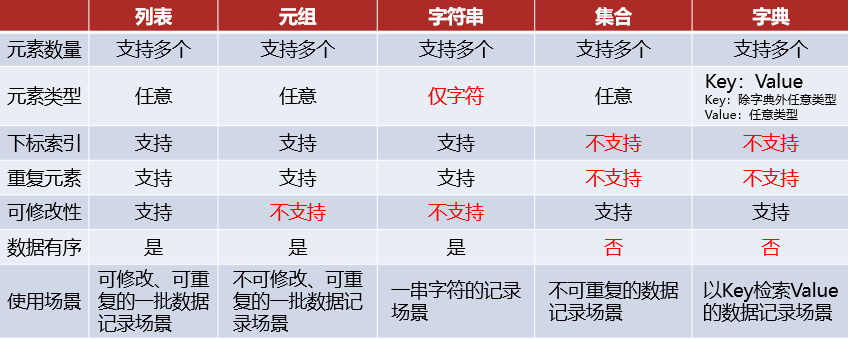


**总结**：

基于各类数据容器的特点，它们的应用场景如下：

- 列表：一批数据，可修改、可重复的存储场景
- 元组：一批数据，不可修改、可重复的存储场景
- 字符串：一串字符串的存储场景
- 集合：一批数据，去重存储场景
- 字典：一批数据，可用Key检索Value的存储场景


### 10. 数据容器的通用操作

**数据容器的通用操作** **-** **遍历**

首先，在遍历上：

- 5类数据容器都支持for循环遍历
- 列表、元组、字符串支持while循环，集合、字典不支持（无法下标索引）

尽管遍历的形式各有不同，但是，它们都支持遍历操作。


**数据容器的通用统计功能**

除了遍历这个共性外，数据容器可以通用非常多的功能方法

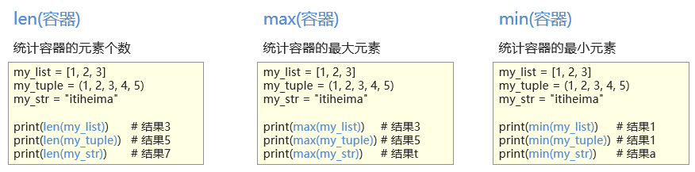


**容器的通用转换功能**

除了下标索引这个共性外，还可以通用类型转换

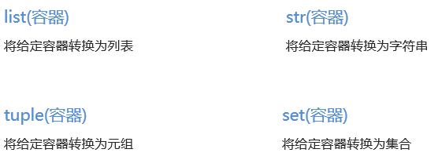


**容器通用排序功能**

通用排序功能

sorted(容器, [reverse=True])

将给定容器进行排序

注意，排序后都会得到列表（list）对象。


**容器通用功能总览**

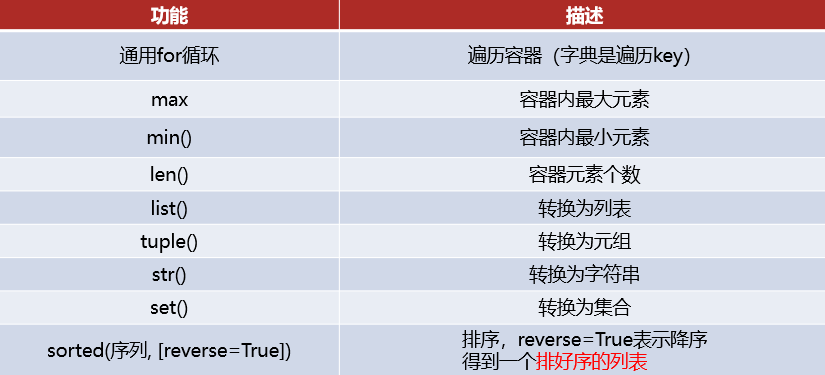


## 七、Python函数进阶

### 1. 函数多返回值

问: 如果一个函数如些两个return (如下所示)，程序如何执行？

```python
def return_num():
    return 1
	return 2
```

答：只执行了第一个return，原因是因为return可以退出当前函数，导致return下方的代码不执行


如果一个函数要有多个返回值，该如何书写代码？

```python
def test_return():
    return 1, 2

x, y = test_return()
print(x) # 结果：1
print(y) # 结果：2
```

按照返回值的顺序，写对应顺序的多个变量接收即可

变量之间用逗号隔开

支持不同类型的数据return


### 2. 函数多种传参方式

使用方式上的不同, 函数有4中常见参数使用方式:

- 位置参数
- 关键字参数
- 缺省参数
- 不定长参数


#### 2.1 位置参数

**位置参数**：调用函数时根据函数定义的参数位置来传递参数

```python
def user_info(name, age, gender):
    print(f"你的名字是{name}, 年龄是{age}, 性别是{gender}")
    
# 结果：你的名字是TOM, 年龄是20, 性别是男
user_info("TOM", 20, "男")
```

注意：传递的参数和定义的参数的顺序及个数必须一致


#### 2.2 关键字参数

**关键字参数**：函数调用时通过“键=值”形式传递参数.

**作用**：可以让函数更加清晰、容易使用，同时也清除了参数的顺序需求.

```python
def user_info(name, age, gender):
    print(f"你的名字是{name}, 年龄是{age}, 性别是{gender}")

# 关键字传参
user_info("小明", 20, "男")
# 可以不按照固定顺序
user_info(age=20, gender="男", name="小明")
# 可以和位置参数混用，位置参数必须在前，且匹配参数顺序
user_info("小明", age=20, gender="男")
```

注意：函数调用时，如果有位置参数时，位置参数必须在关键字参数的前面，但关键字参数之间不存在先后顺序


#### 2.3 缺省参数

**缺省参数：**缺省参数也叫默认参数，用于定义函数，为参数提供默认值，调用函数时可不传该默认参数的值（注意：所有位置参数必须出现在默认参数前，包括函数定义和调用）

**作用**: 当调用函数时没有传递参数, 就会使用默认是用缺省参数对应的值.

```python
def user_info(name, age, gender="男"):
    print(f"你的名字是{name}, 年龄是{age}, 性别是{gender}")

# 结果：你的名字是tom, 年龄是20, 性别是男
user_info("tom", 20)

# 结果：你的名字是rose, 年龄是18, 性别是女
user_info("rose", 18, "女")
```

注意：函数调用时，如果为缺省参数传值则修改默认参数值, 否则使用这个默认值


#### 2.4 不定长参数

**不定长参数**：不定长参数也叫可变参数. 用于不确定调用的时候会传递多少个参数(不传参也可以)的场景.

**作用**：当调用函数时不确定参数个数时, 可以使用不定长参数

不定长参数的类型:

1. 位置传递
2. 关键字传递


**位置传递**

```python
def user_info(*args):
    print(args)
    print(type(args)) # 结果：<class 'tuple'>

# 结果：('tom',)
user_info("tom")

# 结果：('tom', 18)
user_info("tom", 18)
```

注意：传进的所有参数都会被args变量收集，它会根据传进参数的位置合并为一个元组(tuple)，args是元组类型，这就是位置传递


**关键字传递**

```python
def user_info(**kwargs):
    print(kwargs)
    print(type(kwargs)) # 结果：<class 'dict'>
    
# 结果：{'name': 'tom', 'age': 18, 'id': 110}
user_info(name="tom", age=18, id=110)
```

注意：参数是“键=值”形式的形式的情况下, 所有的“键=值”都会被kwargs接受, 同时会根据“键=值”组成字典.


### 3. 匿名函数

#### 3.1 函数作为参数传递

在前面的函数学习中，我们一直使用的函数，都是接受数据作为参数传入：

- 数字
- 字符串
- 字典、列表、元组等

其实，我们学习的函数本身，也可以作为参数传入另一个函数内。

如下代码：

```python
def test_func(compute):
    result = compute(1, 2)
    print(result)

def compute(x, y):
    return x + y

test_func(compute) # 结果：3
```

函数compute，作为参数，传入了test_func函数中使用。

- test_func需要一个函数作为参数传入，这个函数需要接收2个数字进行计算，计算逻辑由这个被传入函数决定
- compute函数接收2个数字对其进行计算，compute函数作为参数，传递给了test_func函数使用
- 最终，在test_func函数内部，由传入的compute函数，完成了对数字的计算操作

所以，这是一种，计算逻辑的传递，而非数据的传递。

就像上述代码那样，不仅仅是相加，相见、相除、等任何逻辑都可以自行定义并作为函数传入。


#### 3.2 lambda匿名函数

函数的定义中

- def关键字，可以定义**带有名称**的函数
- lambda关键字，可以**定义匿名**函数（无名称）

有名称的函数，可以基于名称**重复使用**。

无名称的匿名函数，只可**临时使用一次**。


匿名函数定义语法：

```python
lambda 传入参数: 函数体(一行代码)
```

- lambda 是关键字，表示定义匿名函数
- 传入参数表示匿名函数的形式参数，如：x, y 表示接收2个形式参数
- 函数体，就是函数的执行逻辑，要注意：只能写一行，无法写多行代码


- 通过def关键字，定义一个函数，并传入，如下：


```python
def test_func(compute):
    result = compute(1, 2)
    print(result)

def compute(x, y):
    return x + y

test_func(compute) # 结果：3
```


- 也可以通过lambda关键字，传入一个一次性使用的lambda匿名函数

```python
def test_func(compute):
    result = compute(1, 2)
    print(result)

test_func(lambda x, y: x + y) # 结果：3
```

使用def和使用lambda，定义的函数功能完全一致，只是lambda关键字定义的函数是匿名的，无法二次使用

**注意事项：**

- 匿名函数用于临时构建一个函数，只用一次的场景
- 匿名函数的定义中，函数体只能写一行代码，如果函数体要写多行代码，不可用lambda匿名函数，应使用def定义带名函数


## 八、Python文件操作

### 1. 文件的编码

思考：计算机只能识别：0和1，那么我们丰富的文本文件是如何被计算机识别，并存储在硬盘中呢？

答案：使用编码技术（密码本）将内容翻译成0和1存入。


编码技术即：翻译的规则，记录了如何将内容翻译成二进制，以及如何将二进制翻译回可识别内容。

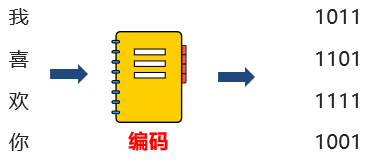

计算机中有许多可用编码：

- UTF-8
- GBK
- Big5

不同的编码，将内容翻译成二进制也是不同的。


编码有许多，所以要使用正确的编码， 才能对文件进行正确的读写操作呢。

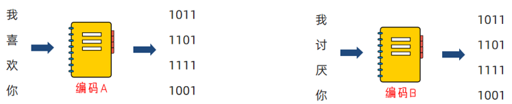

如上，如果你给喜欢的女孩发送文件，使用编码A进行编码（内容转二进制）。

女孩使用编码B打开文件进行解码（二进制反转回内容）


总结：

1. 什么是编码？
   编码就是一种规则集合，记录了内容和二进制间进行相互转换的逻辑。
   编码有许多中，我们最常用的是UTF-8编码
2. 为什么需要使用编码？
   计算机只认识0和1，所以需要将内容翻译成0和1才能保存在计算机中。
   同时也需要编码， 将计算机保存的0和1，反向翻译回可以识别的内容。


### 2. 文件的读取

什么是文件？

内存中存放的数据在计算机关机后就会消失。要长久保存数据，就要使用硬盘、光盘、U 盘等设备。为了便于数据的管理和检索，引入了“文件”的概念。

一篇文章、一段视频、一个可执行程序，都可以被保存为一个文件，并赋予一个文件名。操作系统以文件为单位管理磁盘中的数据。一般来说，文件可分为文本文件、视频文件、音频文件、图像文件、可执行文件等多种类别。


文件操作包含哪些内容呢？

在日常生活中，文件操作主要包括打开、关闭、读、写等操作。


想想我们平常对文件的基本操作，大概可以分为三个步骤（简称文件操作三步走）：

1. 打开文件
2. 读写文件
3. 关闭文件


#### 2.1 open()打开函数

在Python，使用open函数，可以打开一个已经存在的文件，或者创建一个新文件，语法如下

```python
open(name, mode, encoding)
```

- name：是要打开的目标文件名的字符串(可以包含文件所在的具体路径)。
- mode：设置打开文件的模式(访问模式)：只读、写入、追加等。
- encoding：编码格式（推荐使用UTF-8）

示例代码：

```python
# encoding的顺序不是第三位，所以不能用位置参数，用关键字参数直接指定
f = open("D:\html.html", "r", encoding="UTF-8")
print(f)
print(type(f))
```

注意事项：此时的`f`是`open`函数的文件对象，对象是Python中一种特殊的数据类型，拥有属性和方法，可以使用对象.属性或对象.方法对其进行访问，后续面向对象课程会给大家进行详细的介绍。


#### 2.2 mode常用的三种基础访问模式

| 模式 | 描述                                                         |
| ---- | ------------------------------------------------------------ |
| r    | 以只读方式打开文件。文件的指针将会放在文件的开头。这是默认模式。 |
| w    | 打开一个文件只用于写入。如果该文件已存在则打开文件，并从开头开始编辑，原有内容会被删除。如果该文件不存在，创建新文件。 |
| a    | 打开一个文件用于追加。如果该文件已存在，新的内容将会被写入到已有内容之后。如果该文件不存在，创建新文件进行写入。 |


#### 2.3 读操作相关方法

- read()方法：


```python
文件对象.read(num)
```

num表示要从文件中读取的数据的长度（单位是字节），如果没有传入num，那么就表示读取文件中所有的数据。


- readlines()方法：


readlines可以按照行的方式把整个文件中的内容进行一次性读取，并且返回的是一个列表，其中每一行的数据为一个元素。

```python
f = open("D:\html.html")
content = f.readlines()

print(content)
print(type(content)) # 结果：<class 'list'>

# 关闭文件
f.close()
```


- readline()方法：一次读取一行内容


```python
f = open("D:\html.html")

content = f.readline()
print(f"第一行：{content}")

content = f.readline()
print(f"第二行：{content}")

# 关闭文件
f.close()
```


- for循环读取文件行


```python
# 每一个line临时变量，就记录了文件的一行数据
for line in open("D:\html.html", "r"):
    print(line)
```


- close() 关闭文件对象


```python
f = open("D:\html.html", "r")

f.close()

# 最后通过close，关闭文件对象，也就是关闭对文件的占用
# 如果不调用close,同时程序没有停止运行，那么这个文件将一直被Python程序占用。
```


- with open 语法


```python
with open("D:\html.html", "r") as f:
    f.readlines()

# 通过在with open的语句块中对文件进行操作
# 可以在操作完成后自动关闭close文件，避免遗忘掉close方法
```


**操作汇总**

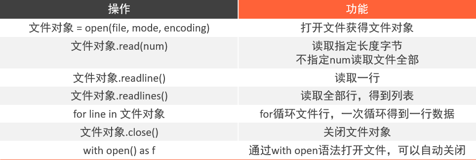


#### 2.4 文件的写入

案例演示：

```python
# 1.打开文件
f = open("test.txt", "w")

# 2.文件写入
f.write("hello world")

# 3.内容刷新
f.flush()
```

注意：

- 直接调用write，内容并未真正写入文件，而是会积攒在程序的内存中，称之为缓冲区
- 当调用flush的时候，内容会真正写入文件
- 这样做是避免频繁的操作硬盘，导致效率下降（攒一堆，一次性写磁盘）

> 文件如果不存在，使用”w”模式，会创建新文件
>
> 文件如果存在，使用”w”模式，会将原有内容清空


#### 2.5 文件的追加

案例演示：

```python
# 1.打开文件，通过a模式打开
f = open("test.txt", "a")

# 2.文件写入
f.write("hello world")

# 3.内容刷新
f.flush()
```

注意：

- a模式，文件不存在会创建文件
- a模式，文件存在会在最后，追加写入文件
- 可以使用”\n”来写出换行符


## 九、Python异常、模块与包

### 1. 了解异常

#### 1.1 什么是异常？

当检测到一个错误时，Python解释器就无法继续执行了，反而出现了一些错误的提示，这就是所谓的“异常”, 也就是我们常说的BUG


**异常演示**

例如：以`r`方式打开一个不存在的文件。

```python
f = open('linux.txt', 'r')
```

执行结果：

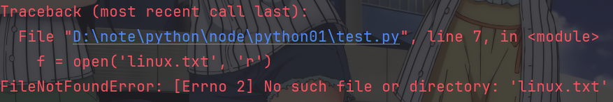


#### 1.2 为什么要捕获异常

世界上没有完美的程序，任何程序在运行的过程中，都有可能出现：异常，也就是出现bug导致程序无法完美运行下去。

我们要做的，不是力求程序完美运行。

而是在力所能及的范围内，对可能出现的bug，进行提前准备、提前处理。

这种行为我们称之为：异常处理（捕获异常）


当我们的程序遇到了BUG, 那么接下来有两种情况:

1. 整个程序因为一个BUG停止运行
2. 对BUG进行提醒, 整个程序继续运行

显然在之前的学习中, 我们所有的程序遇到BUG就会出现①的这种情况, 也就是整个程序直接奔溃.

但是在真实工作中, 我们肯定不能因为一个小的BUG就让整个程序全部奔溃, 也就是我们希望的是达到②的这种情况那这里我们就需要使用到**捕获异常**

**捕获异常的作用在于：提前假设某处会出现异常，做好提前准备，当真的出现异常的时候，可以有后续手段。**


### 2. 捕获异常的方法

#### 2.1 捕获常规异常

基本语法：

```python
try:
    可能发生错误的代码
except:
    如果出现异常执行的代码
```

需求：尝试以`r`模式打开文件，如果文件不存在，则以`w`方式打开。

```python
try:
    f = open('linux.txt', 'r')
except:
    f = open('linux.txt', 'w')
```


#### 2.2 捕获指定异常

基本语法：

```python
try:
    print(name)
except NameError as e:
    print('name变量名称未定义错误')
```

注意事项：

1. 如果尝试执行的代码的异常类型和要捕获的异常类型不一致，则无法捕获异常。
2. 一般try下方只放一行尝试执行的代码。


**捕获多个异常**

当捕获多个异常时，可以把要捕获的异常类型的名字，放到except 后，并使用元组的方式进行书写。

```python
try:
    print(1/0)
except (NameError, ZeroDivisionError):
    print('ZeroDivision错误...')
```


**捕获异常并输出描述信息**

基本语法：

```python
try:
    print(num)
except (NameError, ZeroDivisionError) as e:
    print(e)
```


**捕获所有异常**

基本语法：

```python
try:
    print(name)
except Exception as e:
    print(e)
```


#### 2.3 异常else

else表示的是如果没有异常要执行的代码。

```python
try:
    print(1)
except Exception as e:
    print(e)
else:
    print('我是else，是没有异常的时候执行的代码')
```


#### 2.4 异常finally

finally表示的是无论是否异常都要执行的代码，例如关闭文件。

```python
try:
    f = open('test.txt', 'r')
except Exception as e:
    f = open('test.txt', 'w')
else:
    print('没有异常，真开心')
finally:
    f.close()
```


### 3. 异常的传递

异常是具有传递性的

当函数func01中发生异常, 并且没有捕获处理这个异常的时候, 异常会传递到函数func02, 当func02也没有捕获处理这个异常的时候main函数会捕获这个异常, 这就是异常的传递性.

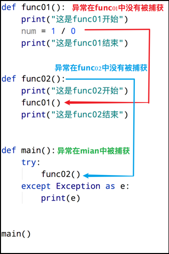

提示：当所有函数都没有捕获异常的时候, 程序就会报错

利用异常具有传递性的特点, 当我们想要保证程序不会因为异常崩溃的时候, 就可以在main函数中设置异常捕获, 由于无论在整个程序哪里发生异常, 最终都会传递到main函数中, 这样就可以确保所有的异常都会被捕获


### 4. Python模块

#### 4.1 什么是模块

Python 模块(Module)，是一个 Python 文件，以 .py 结尾. 模块能定义函数，类和变量，模块里也能包含可执行的代码.

**模块的作用**：python中有很多各种不同的模块, 每一个模块都可以帮助我们快速的实现一些功能, 比如实现和时间相关的功能就可以使用time模块我们可以认为一个模块就是一个工具包, 每一个工具包中都有各种不同的工具供我们使用进而实现各种不同的功能.

大白话：模块就是一个Python文件，里面有类、函数、变量等，我们可以拿过来用（导入模块去使用）


#### 4.2 模块的导入方式

模块在使用前需要先导入

导入的语法如下:

```python
[from 模块名] import [模块 | 类 | 变量 | 函数 | *] [as 别名]
```

常用的组合形式如：

- import 模块名
- from 模块名 import 类、变量、方法等
- from 模块名 import *
- import 模块名 as 别名
- from 模块名 import 功能名 as 别名


##### 4.2.1 import模块名

基本语法：

```python
import 模块名
import 模块名1，模块名2

模块名.功能名()
```

案例：导入time模块

```python
# 导入时间模块
import time

print("开始")
# 让程序睡眠1秒(阻塞)
time.sleep(1)
print("结束")
```


##### 4.2.2 from 模块名 import 功能名

基本语法：

```python
from 模块名 import 功能名

功能名
```

案例：导入time模块中的sleep方法

```python
# 导入时间模块中的sleep方法
from time import sleep

print("开始")
# 让程序睡眠一秒(阻塞)
sleep(1)
print("结束")
```


##### 4.2.3 from 模块名 import *

基本语法：

```python
from 模块名 import *

功能名
```

案例：导入time模块中所有的方法

```python
# 导入时间模块中所有的方法
from time import *

print("开始")
# 让程序睡眠一秒(阻塞)
sleep(1)
print("结束")
```


##### 4.2.4 as定义别名

基本语法：

```python
# 模块定义别名
import 模块名 as 别名

# 功能定义别名
from 模块名 import 功能 as 别名
```

案例：

```python
# 模块别名
import time as tt

tt.sleep(1)
print("hello world")
```

```python
# 功能别名
from time import sleep as sl

sl(1)
print("hello world")
```


#### 4.3 自定义模块

**制作自定义模块**

Python中已经帮我们实现了很多的模块. 不过有时候我们需要一些个性化的模块, 这里就可以通过自定义模块实现, 也就是自己制作一个模块


**案例**：新建一个Python文件，命名为my_module1.py，并定义test函数


注意事项：当导入多个模块的时候，且模块内有同名功能. 当调用这个同名功能的时候，调用到的是后面导入的模块的功能


##### 4.3.2 测试模块

在实际开发中，当一个开发人员编写完一个模块后，为了让模块能够在项目中达到想要的效果，这个开发人员会自行在py文件中添加一些测试信息，例如，在my_module1.py文件中添加测试代码test(1,1)

```python
def test(a, b):
    print(a + b)


test(1, 1)
```

**问题**：此时，无论是当前文件，还是其他已经导入了该模块的文件，在运行的时候都会自动执行`test`函数的调用

**解决方案：**

```python
def test(a, b):
    print(a + b)

# 只在当前文件中调用该函数，其他导入的文件内不符合该条件，则不执行test函数调用
if __name__ == '__main__':
    test (1, 1)
```


##### 4.3.1 __ all __

如果一个模块文件中有`__all__`变量，当使用`from xxx import *`导入时，只能导入这个列表中的元素


### 5. Python包

基于Python模块，我们可以在编写代码的时候，导入许多外部代码来丰富功能。

但是，如果Python的模块太多了，就可能造成一定的混乱，那么如何管理呢？

通过Python包的功能来管理。


#### 5.2 什么是Python包

从物理上看，包就是一个文件夹，在该文件夹下包含了一个 __init__.py 文件，该文件夹可用于包含多个模块文件

从逻辑上看，包的本质依然是模块


**包的作用**：当我们的模块文件越来越多时,包可以帮助我们管理这些模块, 包的作用就是包含多个模块，但包的本质依然是模块


#### 5.2 自定义包

步骤如下：

1. 新建包`my_package`
2. 新建包内模块：`my_module1` 和 `my_module2`
3. 模块内代码如下


**Pycharm中的基本步骤**：[New] -> [Python Package] -> 输入包名 -> [OK] -> 新建功能模块(有联系的模块)

注意：新建包后，包内部会自动创建`__init__.py`文件，这个文件控制着包的导入行为


##### 5.2.1 导入包

**方式一：**

```python
import 包名.模块名

包名.模块名.目标
```


**方式二：**

注意：必须在`__init__.py`文件中添加`__all__ = []`，控制允许导入的模块列表

```python
from 包名 import *

模块名.目标
```


总结：

1. `__init__.py`文件的作用？
   创建包会默认自动创建的文件，通过这个文件来表示一个文件夹是Python的包，而非普通的文件夹。
2. `__all__`变量的作用？
   同模块中学习到的是一个作用，控制 import * 能够导入的内容


#### 5.3 安装第三方包

我们知道，包可以包含一堆的Python模块，而每个模块又内含许多的功能。

所以，我们可以认为：一个包，就是一堆同类型功能的集合体。

在Python程序的生态中，有许多非常多的第三方包（非Python官方），可以极大的帮助我们提高开发效率，如：

- 科学计算中常用的：numpy包
- 数据分析中常用的：pandas包
- 大数据计算中常用的：pyspark、apache-flink包
- 图形可视化常用的：matplotlib、pyecharts
- 人工智能常用的：tensorflow

这些第三方的包，极大的丰富了Python的生态，提高了开发效率。

但是由于是第三方，所以Python没有内置，所以我们需要安装它们才可以导入使用哦。


##### 5.3.1 安装第三方包-pip

第三方包的安装非常简单，我们只需要使用Python内置的pip程序即可。

pip install 包名称

即可通过网络快速安装第三方包


##### 5.3.2 网络优化

由于pip是连接的国外的网站进行包的下载，所以有的时候会速度很慢。

我们可以通过如下命令，让其连接国内的网站进行包的安装：

pip install -i https://pypi.tuna.tsinghua.edu.cn/simple 包名称

https://pypi.tuna.tsinghua.edu.cn/simple 是清华大学提供的一个网站，可供pip程序下载第三方包


##### 5.3.3 安装第三方包 - PyCharm

PyCharm也提供了安装第三方包的功能：


## 十、数据可视化-折线图

**效果一：2020年印美日新冠累计确诊人数**

2020年是新冠疫情爆发的一年, 随着疫情的爆发, 国内外确诊人数成了大家关心的热点,相信大家都有看过类似的疫情报告. 本案例对印度美国日本三个国家确诊人数的进行了可视化处理, 形成了可视化的疫情确诊人数报告.


**效果二：全国疫情地图可视化**


**效果三：动态GDP增长图**


**数据来源**

- 本案例数据全部来自 <<百度疫情实时大数据报告>>，及公开的全球各国GDP数据


- 使用的技术
  Echarts 是个由百度开源的数据可视化，凭借着良好的交互性，精巧的图表设计，得到了众多开发者的认可. 而 Python 是门富有表达力的语言，很适合用于数据处理. 当数据分析遇上数据可视化时pyecharts 诞生了.


### 1. json数据格式

#### 1.1 什么是json

- JSON是一种轻量级的数据交互格式。可以按照JSON指定的格式去组织和封装数据
- JSON本质上是一个带有特定格式的字符串


- 主要功能：json就是一种在各个编程语言中流通的数据格式，负责不同编程语言中的数据传递和交互. 类似于：
  - 国际通用语言-英语
  - 中国56个民族不同地区的通用语言-普通话


#### 1.2 json有什么用

- 各种编程语言存储数据的容器不尽相同,在Python中有字典dict这样的数据类型, 而其它语言可能没有对应的字典。

为了让不同的语言都能够相互通用的互相传递数据，JSON就是一种非常良好的中转数据格式。如下图，以Python和C语言互传数据为例：


#### 1.3 json格式数据转化

- json格式的数据要求很严格, 下面我们看一下他的要求

```python
# json数据的格式可以是： 
{"name":"admin", "age":18}

# 也可以是：
[{"name":"admin","age":18}, {"name":"root","age":16}, {"name":"张三","age":20}]
```


- Python数据和Json数据的相互转化

```python
# 导入json模块
import json

# 准备符合json格式要求的python数据
data = [{"name":"老王","age":16}, {"name":"张三", "age":20}]

# 通过 json.dumps(data) 方法把python数据转化为了 json数据
data = json.dumps(data, ensure_ascii=False)
print(data)
print(type(data))

# 通过 json.loads(data) 方法把json数据转化为了 python数据
data = json.loads(data)
print(data)
print(type(data))
```

注意：如果有中文可以带上：ensure_ascii=False参数来确保中文正常转换


### 2. pyecharts模块

- 如果想要做出数据可视化效果图, 可以借助pyecharts模块来完成

**Echarts** 是个由百度开源的数据可视化，凭借着良好的交互性，精巧的图表设计，得到了众多开发者的认可. 而 **Python** 是门富有表达力的语言，很适合用于数据处理. 当数据分析遇上数据可视化时pyecharts 诞生了.


**pyecharts模块安装**

使用在前面学过的pip命令即可快速安装PyEcharts模块

pip install pyecharts


#### 2.1 pyecharts快速入门

- 基础折线图

```python
# 导包，导入Line功能构建折线图对象
from pyecharts.charts import Line

# 得到折线图对象
line = Line()
# 添加x轴数据
line.add_xaxis(["中国", "美国", "英国"])
# 添加y轴数据
line.add_yaxis("GDP", [30, 20, 10])
# 生成图表
line.render()
```


#### 2.2 pyecharts有哪些配置选项

pyecharts模块中有很多的配置选项, 常用到2个类别的选项:

- 全局配置选项
- 系列配置选项


#### 2.3 set_global_opts方法

- 这里全局配置选项可以通过set_global_opts方法来进行配置, 相应的选项和选项的功能如下:


```python
# 导包，导入Line功能构建折线图对象
from pyecharts.charts import Line
from pyecharts.options import TitleOpts, LegendOpts, ToolboxOpts, VisualMapOpts, TooltipOpts

# 得到折线图对象
line = Line()
# 添加x轴数据
line.add_xaxis(["中国", "美国", "英国"])
# 添加y轴数据
line.add_yaxis("GDP", [30, 20, 10])

line.set_global_opts(
    title_opts=TitleOpts("测试", pos_left="center", pos_bottom="1%"),
    legend_opts=LegendOpts(is_show=True),
    toolbox_opts=ToolboxOpts(is_show=True),
    visualmap_opts=VisualMapOpts(is_show=True),
    tooltip_opts=TooltipOpts(is_show=True),
)

# 生成图表
line.render()
```


全局配置项能做什么？

- 配置图表的标题
- 配置图例
- 配置鼠标移动效果
- 配置工具栏
- 等整体配置项


### 3. 案例

#### 3.1 数据处理

> 能够通过json模块对数据进行处理
>


- 导入模块:

```python
# 导入json模型
import json
```


- 对数据进行整理, 让数据符合json格式:


```python
# 导入json模型
import json

# 处理数据
f_us = open("美国.txt", "r", encoding="UTF-8")
us_data = f_us.read() # 美国的全部数据
# 去掉不符合JSON规范的开头
us_data = us_data.replace("jsonp_1629344292311_69436(", "")
# 去掉不符合JSON规范的结尾
us_data = us_data[:-2]
# JSON转Python字典
us_data = json.loads(us_data)
# 获取trend key
trend_data = us_data["data"][0]["trend"]
# 获取日期数据，用于x轴，取2020年(到315下标结束)
x_data = trend_data["updateDate"][:314]
# 获取确认数据，用于y轴，取2020年(到315下标结束)
y_data = trend_data["list"][0]["data"][:314]
# 生成图标
```


#### 3.2 创建折线图

- 导入模块

```python
# 导入折线图模块
from pyecharts.charts import Line
# 导入配置选项模块
import pyecharts.options as opts
```


-  折线图相关配置项

| 配置项     | 作用                   | 代码实例                                                |
| ---------- | ---------------------- | ------------------------------------------------------- |
| init_opts  | 对折线图初始化设置宽高 | init_opts=opts.InitOpts(width="1600px", height="800px") |
| .add_xaxis | 添加x轴数据            | .add_xaxis(列表)                                        |
| .add_yaxis | 添加y轴数据            | .add_yaxis(列表)                                        |


-   .add_yaxis相关配置选项: 

| **配置项**     | **作用**               | **代码实例**                               |
| -------------- | ---------------------- | ------------------------------------------ |
| series_name    | 设置图例名称           | series_name="美国确诊人数"                 |
| y_axis         | 输入y轴数据            | y_axis=["列表"]                            |
| symbol_size    | 设置点的大小           | symbol_size=10                             |
| label_opts     | 标签设置项：不显示标签 | label_opts=opts.LabelOpts(is_show=False)   |
| linestyle_opts | 线条宽度和样式         | linestyle_opts=opts.LineStyleOpts(width=2) |


-  .set_global_opts全局配置选项:

| **配置项**  | **作用**         | **代码实例**                                                |
| ----------- | ---------------- | ----------------------------------------------------------- |
| title_opts  | 设置图标题和位置 | title_opts=opts.TitleOpts(title="标题",  pos_left="center") |
| yaxis_opts  | y轴配置项        | yaxis_opts=opts.AxisOpts(name="累计确诊人数")               |
| xaxis_opts  | x轴配置项        | xaxis_opts=opts.AxisOpts(name="时间")                       |
| legend_opts | 图例配置项       | legend_opts=opts.LegendOpts(pos_left='70%')                 |


```python
# 导入json模型
import json

# 导入折线图模块
from pyecharts.charts import Line
# 导入配置选项模块
import pyecharts.options as opts
from pyecharts.options import TitleOpts, LabelOpts

# 处理数据
f_us = open("美国.txt", "r", encoding="UTF-8")
us_data = f_us.read()   # 美国的全部内容

f_jp = open("日本.txt", "r", encoding="UTF-8")
jp_data = f_jp.read()   # 日本的全部内容

f_in = open("印度.txt", "r", encoding="UTF-8")
in_data = f_in.read()   # 印度的全部内容

# 去掉不合JSON规范的开头
us_data = us_data.replace("jsonp_1629344292311_69436(", "")
jp_data = jp_data.replace("jsonp_1629350871167_29498(", "")
in_data = in_data.replace("jsonp_1629350745930_63180(", "")

# 去掉不合JSON规范的结尾
us_data = us_data[:-2]
jp_data = jp_data[:-2]
in_data = in_data[:-2]

# JSON转Python字典
us_dict = json.loads(us_data)
jp_dict = json.loads(jp_data)
in_dict = json.loads(in_data)

# 获取trend key
us_trend_data = us_dict['data'][0]['trend']
jp_trend_data = jp_dict['data'][0]['trend']
in_trend_data = in_dict['data'][0]['trend']

# 获取日期数据，用于x轴，取2020年（到314下标结束）
us_x_data = us_trend_data['updateDate'][:314]
jp_x_data = jp_trend_data['updateDate'][:314]
in_x_data = in_trend_data['updateDate'][:314]

# 获取确认数据，用于y轴，取2020年（到314下标结束）
us_y_data = us_trend_data['list'][0]['data'][:314]
jp_y_data = jp_trend_data['list'][0]['data'][:314]
in_y_data = in_trend_data['list'][0]['data'][:314]


# 生成图标
line = Line() # 构建折线图对象

# 添加x轴数据
line.add_xaxis(us_x_data) # x轴是公用的，所以使用一个国家的数据即可
# 添加y轴数据
line.add_yaxis("美国确诊人数", us_y_data, label_opts=LabelOpts(is_show=False)) # 添加美国的y轴数据
line.add_yaxis("日本确诊人数", jp_y_data, label_opts=LabelOpts(is_show=False)) # 添加日本的y轴数据
line.add_yaxis("印度确诊人数", in_y_data, label_opts=LabelOpts(is_show=False)) # 添加印度的y轴数据

# 设置全局选项
line.set_global_opts(
    # 标题设置
    title_opts=TitleOpts(title="2020年美日印三国确诊人数对比折线图", pos_left="center", pos_bottom="1%")
)

# 调用render方法，生成图标
line.render()

# 关闭文件对象
f_us.close()
f_jp.close()
f_in.close()
```


## 十一、数据可视化 - 地图

### 1. 基础地图使用

```python
"""
演示地图可视化的基本使用
"""
from pyecharts.charts import Map
from pyecharts.options import VisualMapOpts

# 准备地图对象
map = Map()
# 准备数据
data = [
    ("北京", 99),
    ("上海", 199),
    ("湖南", 299),
    ("台湾", 399),
    ("广东", 499)
]

# 添加数据
map.add("测试地图", data, "china")

# 设置全局选项
map.set_global_opts(
    visualmap_opts=VisualMapOpts(
        is_show=True,
        is_piecewise=True,
        pieces=[
            {"min": 1, "max": 9, "label": "1-9", "color": "#CCFFFF"},
            {"min": 10, "max": 99, "label": "10-99", "color": "#FF6666"},
            {"min": 100, "max": 500, "label": "100-500", "color": "#990033"},
        ]
    )
)

# 绘图
map.render()
```


### 2. 疫情地图-国内疫情地图


不学了~~~


## 十二、面向对象

### 1. 初识对象

在程序中是可以做到和生活中那样，设计表格、生产表格、填写表格的组织形式的。

```python
# 1. 在程序中设计表格，我们称之为：设计类(class)
class Student:
    name = None # 记录学生姓名

# 2. 在程序中打印生产表格，我们称之为：创建对象
stu_1 = Student() # 基于类创建对象

# 在程序中填写表格，我们称之为：对象属性赋值
stu_1.name = "周杰伦" # 为学生1对象赋予名称属性值
```


### 2. 成员方法

在上一节中，我们简单了解到可以使用类去封装属性，并基于类创建出一个个的对象来使用。

现在我们来看看类的使用语法：

```python
class 类名称:
    
    类的属性
    
    类的行为
```

- class是关键字，表示要定义类了
- 类的属性，即定义在类中的变量（成员变量）
- 类的行为，即定义在类中的函数（成员方法）


```python
class Student:
    name = None # 学生的姓名
    age = None # 学生的年龄

    def say_hi(self):
        print(f"Hello, my name is {self.name}")

stu = Student()
stu.name = "周杰伦"
stu.say_hi() # Hello, my name is 周杰伦
```

- 类中定义的属性（变量），我们称之为：成员变量
- 类中定义的行为（函数），我们称之为：成员方法


#### 2.1 定义语法

在类中定义成员方法和定义函数基本一致，但仍有细微区别：

```python
def 方法名(self, 形参1, ....., 形参N):
    方法体
```

可以看到，在方法定义的参数列表中，有一个：self关键字

self关键字是成员方法定义的时候，必须填写的。

- 它用来表示类对象自身的意思
- 当我们使用类对象调用方法的是，self会自动被python传入
- 在方法内部，想要访问类的成员变量，必须使用self


**注意事项**：self关键字，尽管在参数列表中，但是传参的时候可以忽略它。

如：

```python
class Student:
    name = None # 学生的姓名

    def say_hi(self):
        print("Hello, 米娜桑")

    def say_hi2(self, msg):
        print(f"Hello, 大家好, {msg}")

stu = Student()
stu.say_hi() # Hello, 米娜桑
stu.say_hi2("我是sb") # Hello, 大家好, 我是sb
```

可以看到，在传入参数的时候，self是透明的，可以不用理会它。


### 3. 类和对象

基于类创建对象的语法：

```python
class Student:
    name = None 

stu = Student()
```


### 4. 构造方法

Python类可以使用：__ init __()方法，称之为构造方法。

可以实现：

- 在创建类对象（构造类）的时候，会自动执行。
- 在创建类对象（构造类）的时候，将传入参数自动传递给__ init __方法使用。

```python
class Student:
    name = None
    age = None
    tel = None

    def __init__(self, name, age, tel):
        self.name = name
        self.age = age
        self.tel = tel
        print("Student类创建了一个对象")
        
stu = Student("呆唯", 18, "18371317825")
```


### 5. 其它内置方法


#### 5.1 __ str __ 字符串方法

```python
class Student:
    name = None
    age = None

    def __init__(self, name, age):
        self.name = name
        self.age = age


stu = Student("呆唯", 18)
print(stu) # <__main__.Student object at 0x0000022B81B09750>
print(str(stu)) # <__main__.Student object at 0x0000022B81B09750>
```

当类对象需要被转换为字符串之时，会输出如上结果（内存地址）


内存地址没有多大作用，我们可以通过__ str __方法，控制类转换为字符串的行为。

```python
class Student:
    name = None
    age = None

    def __init__(self, name, age):
        self.name = name
        self.age = age

    def __str__(self):
        return f"Student类对象，name={self.name}，age={self.age}"

stu = Student("呆唯", 18)
print(stu) # Student类对象，name=呆唯，age=18
```


#### 5.2 __ lt __ 小于符号比较方法

直接对2个对象进行比较是不可以的，但是在类中实现__ lt __方法，即可同时完成：小于符号 和 大于符号 2种比较

```python
class Student:
    name = None
    age = None

    def __init__(self, name, age):
        self.name = name
        self.age = age

    def __lt__(self, other):
        return self.age < other.age


stu1 = Student("呆唯", 18)
stu2 = Student("mio酱", 19)
print(stu1 < stu2) # 结果：True
```

注意：比较大于符号的魔术方法是：__ gt __ ，不过，实现了 __ lt __ ， __ gt __就没必要实现了


#### 5.3 __ le __ 小于等于比较符号方法

魔术方法：__ le __可用于：<=、>=两种比较运算符上。

```python
class Student:
    name = None
    age = None

    def __init__(self, name, age):
        self.name = name
        self.age = age

    def __le__(self, other):
        return self.age <= other.age


stu1 = Student("呆唯", 18)
stu2 = Student("mio酱", 18)
print(stu1 <= stu2) # 结果：True
```

注意：>=符号实现的魔术方法是：__ ge __ ，不过，实现了 __ le __ ， __ ge __就没必要实现了


#### 5.4 __ eq __，比较运算符实现方法

```python
class Student:
    name = None
    age = None

    def __init__(self, name, age):
        self.name = name
        self.age = age

    def __eq__(self, other):
        return self.age == other.age


stu1 = Student("呆唯", 18)
stu2 = Student("mio酱", 18)
print(stu1 == stu2) # 结果：True
```

- 不实现 __ eq __ 方法，对象之间可以比较，但是是比较内存地址，也即是：不同对象==比较一定是False结果。
- 实现了 __ eq __ 方法，就可以按照自己的想法来决定2个对象是否相等了。


### 6. 封装

面向对象编程，是许多编程语言都支持的一种编程思想。

简单理解是：基于模板（类）去创建实体（对象），使用对象完成功能开发。


封装表示的是，将现实世界事物的：

- 属性
- 行为


封装到类中，描述为：

- 成员变量
- 成员方法


从而完成程序对现实世界事物的描述


#### 6.1 私有成员

既然现实事物有不公开的属性和行为，那么作为现实事物在程序中映射的类，也应该支持。

类中提供了私有成员的形式来支持。

- 私有成员变量
- 私有成员方法

定义私有成员的方式非常简单，只需要：

- 私有成员变量：变量名以__开头（2个下划线）
- 私有成员方法：方法名以__开头（2个下划线）

即可完成私有成员的设置

```python
class Student:
    name = None
    __age = None # 私有成员变量

    def __init__(self, name, age):
        self.name = name
        self.age = age

    def __hello(self): # 私有成员方法
        print("hello")


stu = Student("呆唯", 18)
stu.__age = 10 # 不报错，但是无效
print(stu.__age) # 报错

stu.__hello() # 报错
```

- 私有方法无法直接被类对象使用
- 私有变量无法赋值，也无法获取值
- 私有成员无法被类对象使用，只能在类内使用。


### 7. 继承

继承表示：将从父类那里继承（复制）来成员变量和成员方法（不含私有）


#### 7.1 单继承

```python
class Phone:
    IMEI = 11 # 序列号
    producer = None # 厂商

    def call_by_4g(self):
        print("4g通信")

class Phone2022(Phone):
    face_id = True # 面部识别

    def call_by_4g(self):
        print("2022最新5g通话")

phone = Phone2022()
print(phone.IMEI)
```


#### 7.2 多继承

Python的类之间也支持多继承，即一个类，可以继承多个父类


```python
class 类名(父类1, 父类2, ....., 父类N):
    类内容体
```

**注意事项**

- 多个父类中，如果有同名的成员，那么默认以继承顺序（从左到右）为优先级。
  即：先继承的保留，后继承的被覆盖


#### 7.3 pass

**pass关键字的作用是什么**

pass是占位语句，用来保证函数（方法）或类定义的完整性，表示无内容，空的意思

```python
class MyPhone(Phone):
    pass
```


#### 7.4 复写

子类继承父类的成员属性和成员方法后，如果对其“不满意”，那么可以进行复写。

即：在子类中重新定义同名的属性或方法即可。

```python
class Phone:
    IMEI = None # 序列号
    producer = None # 厂商

    def call_by_5g(self):
        print("父类的5g通话")

class Phone2022(Phone):
    producer = "xiaomi" # 复写父类属性

    def call_by_5g(self): # 复写父类方法
        print("子类的5g通话")

phone = Phone2022()
phone.call_by_5g()
```


#### 7.5 调用父类同名成员

一旦复写父类成员，那么类对象调用成员的时候，就会调用复写后的新成员

如果需要使用被复写的父类的成员，需要特殊的调用方式:

方式1：

- 调用父类成员
  使用成员变量：父类名.成员变量
  使用成员方法：父类名.成员方法(self)


方式2：

- 使用super()调用父类成员
  使用成员变量：super().成员变量
  使用成员方法：super().成员方法()

```python
class Phone:
    IMEI = None # 序列号
    producer = "apple" # 厂商

    def call_by_5g(self):
        print("父类的5g通话")

class Phone2022(Phone):
    producer = "xiaomi" # 复写父类属性

    def call_by_5g(self):
        # 方法1调用父类方法
        print(f"父类的品牌是：{Phone.producer}")
        Phone.call_by_5g(self)

        # 方法2调用父类成员
        print(f"父类的品牌是：{super().producer}")
        super().call_by_5g()

        print("子类的5g通信")


phone = Phone2022()
phone.call_by_5g()
```

注意：只可以在子类内部调用父类的同名成员，子类的实体类对象调用默认是调用子类复写的


### 8. 类型注解

**为什么需要类型注解**

在PyCharm中编写代码，我们经常能够见到如下提示：


自动提示可用方法

为什么PyCharm工具能够做到这一点？它是如何知道这个对象有append方法？

因为：PyCharm确定这个对象，是list类型


又或者当我们调用方法，进行传参的时候（快捷键ctrl + p弹出提示）：


为什么内置模块random的方法可以提示类型，自己定义的就不可以？

因为PyCharm无法通过代码确定应传入什么类型，我们需要使用类型注解


#### 8.1 语法

> 基础语法： 变量: 类型
>

```python
# 基础数据类型注解
var_1: int = 10
var_2: float = 3.14
var_3: bool = True
var_4: str = "轻音少女"

# 类对象类型注解
class Student:
    pass
stu: Student = Student()

# 基础容器类型注解
my_list: list = [1, 2, 3]
my_tuple: tuple = (1, 2, 3)
my_set: set = {1, 2, 3}
my_dict: dict = {"轻音少女": 666}
my_str: str = "轻音少女"

# 容器类型详细注解
my_list: list[int] = [1, 2, 3]
my_tuple: tuple[str, int, bool] = ("轻音少女", 666, True)
my_set: set[int] = {1, 2, 3}
my_dict: dict[str, int] = {"轻音少女": 666}
```

注意：

- 元组类型设置类型详细注解，需要将每一个元素都标记出来
- 字典类型设置类型详细注解，需要2个类型，第一个是key第二个是value


除了使用 变量: 类型， 这种语法做注解外，也可以在注释中进行类型注解。

> 语法：# type: 类型

```python
import json
import random

var_1 = random.randint(1, 10) # type: int
var_2 = json.loads("date") # type: dict[str, int]
```


类型注解主要功能在于：

- 帮助第三方IDE工具（如PyCharm）对代码进行类型推断，协助做代码提示
- 帮助开发者自身对变量进行类型注释（备注）

并不会真正的对类型做验证和判断。也就是，类型注解仅仅是提示性的，不是决定性的

```python
var_1: int = "轻音少女"
var_2: str = 123
print(var_1)
print(var_2)
```

如图代码，是不会报错的哦。


#### 8.2 形参注解


如图所示：

- 在编写函数（方法），使用形参data的时候，工具没有任何提示
- 在调用函数（方法），传入参数的时候，工具无法提示参数类型

这些都是因为，我们在定义函数（方法）的时候，没有给形参进行注解


函数和方法的形参类型注解语法：

```python
def 函数方法名(形参名: 类型, 形参名: 类型, .....):
	pass
```

```python
def add(x: int, y: int):
    return x + y

def func(data: list):
    pass
```


#### 8.3 返回值注解

同时，函数（方法）的返回值也是可以添加类型注解的。

语法如下：

```python
def 函数方法名(形参: 类型, ......, 形参: 类型) -> 返回值类型:
    pass
```

```python
def add(x: int, y: int) -> int:
    return x + y

def func(data: list[int]) -> list[int]:
    pass
```


#### 8.4 Union类型

Union的使用方式

- 导包：from typing import Union
- 使用：Union[类型, ......, 类型]


```python
from typing import Union

my_list: list[Union[str, int]] = [1, 2, "轻音少女", "星际牛仔"]

my_dict: dict[str, Union[str, int]] = {"name": "呆唯", "age": 18}

def func(data: Union[int, str]) -> Union[int, str]:
    pass
```

使用Union[类型, ...., 类型]，可以定义联合类型注解

Union联合类型注解，在变量注解、函数（方法）形参和返回值注解中，均可使用。


### 9. 多态

多态，指的是：多种状态，即完成某个行为时，使用不同的对象会得到不同的状态。

如何理解？


多态常作用在继承关系上.

比如：

- 函数(方法)形参声明接收父类对象
- 实际传入父类的子类对象进行工作

即：

- 以父类做定义声明
- 以子类做实际工作
- 用以获得同一行为, 不同状态


#### 9.1 抽象类(接口)

细心的同学可能发现了，父类Animal的speak方法，是空实现


这种设计的含义是：

- 父类用来确定有哪些方法
- 具体的方法实现，由子类自行决定

这种写法，就叫做抽象类（也可以称之为接口）

抽象类：含有抽象方法的类称之为抽象类

抽象方法：方法体是空实现的（pass）称之为抽象方法


