# 时序图

**核心价值**：从代码视角讲清「一个请求进来，各层之间是怎么调用的」，直接对应代码结构，新人改功能、排 bug 能快速定位到对应层级和类。

流程图讲「做什么」，时序图讲「谁按什么顺序做」，是衔接业务设计和代码实现的关键。


## 一、核心元素

1. **参与者(Actor)**： Java 类实例、微服务、中间件或外部系统(如前端、MySQL、Redis)。

2. **生命线(Lifeline)**：代表对象的生命周期。

3. **激活框（Activation）**：生命线上的矩形块，代表对象正在执行方法的时间段，对应方法的调用栈周期。

4. 消息（Message）：对象之间的交互

   - 同步消息：实线箭头，对应 Java 普通方法调用，调用方阻塞等待返回，例如 Service 调用 Mapper 方法。
   - 异步消息：虚线箭头，方法执行完成后的返回结果。
   - 返回消息：虚线箭头，对应`@Async`异步方法、MQ 消息投递等，调用方不等待返回。

5. **组合片段**：表示条件、循环等逻辑

   - `alt`：对应 `if-else` 条件分支

   - `loop`：对应 `for/while` 循环

   - `opt`：对应单分支 `if`（可选逻辑）

   - `par`：对应多线程并发执行

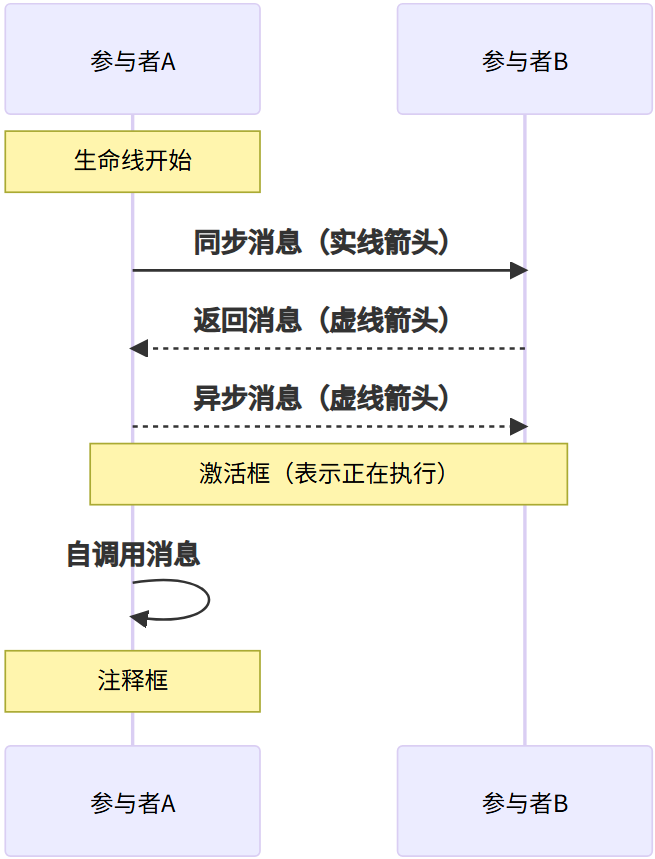


## 二、时序图基础结构

### 1. 最小化示例

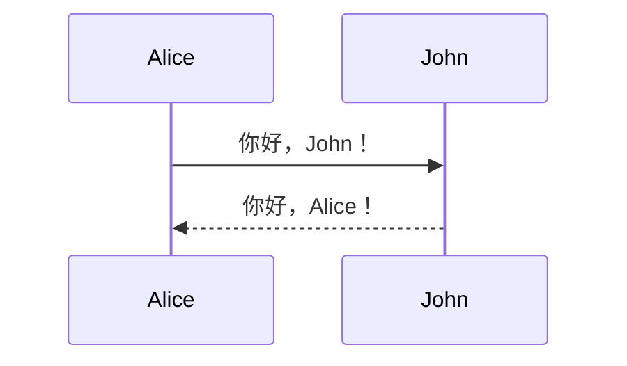

```
sequenceDiagram
    Alice->>John: 你好，John！
    John-->>Alice: 你好，Alice！
```

**语法解析：**

- `sequenceDiagram`：声明时序图开始
- `participant`：可选，显式定义参与者（会自动按出现顺序创建）
- `->>`：实线箭头，表示同步消息
- `-->>`：虚线箭头，表示异步消息


### 2. 完整参与者定义

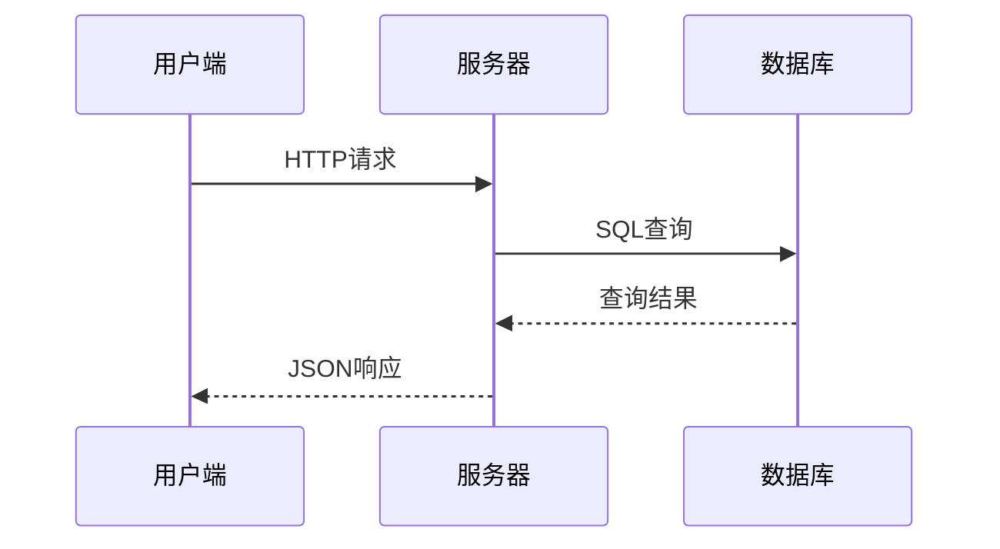

```
sequenceDiagram
    participant A as 用户端
    participant B as 服务器
    participant C as 数据库
    
    A->>B: HTTP请求
    B->>C: SQL查询
    C-->>B: 查询结果
    B-->>A: JSON响应
```

**语法解析：**

- `participant 别名 as 显示名称`：定义参与者并指定显示名称
- 参与者默认按代码中出现顺序排列，也可用`participant`语句控制顺序


## 三、消息类型详解

### 1. 六种基本消息箭头

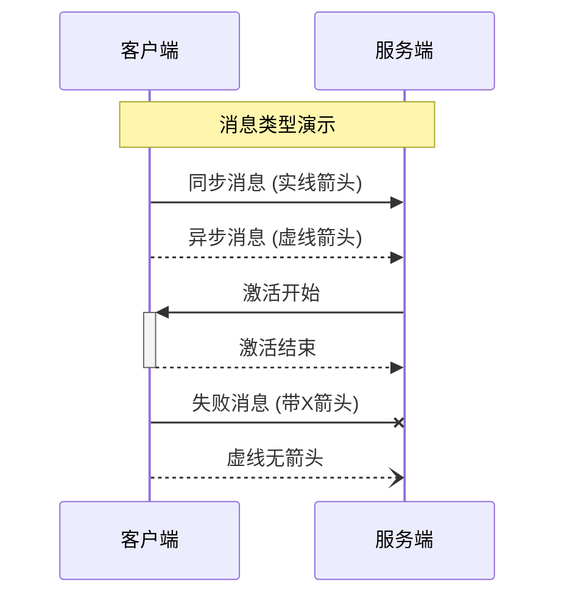

```
sequenceDiagram
    participant A as 客户端
    participant B as 服务端
    
    Note over A,B: 消息类型演示
    
    A->>B: 同步消息 (实线箭头)
    A-->>B: 异步消息 (虚线箭头)
    B->>+A: 激活开始
    A-->>-B: 激活结束
    A-xB: 失败消息 (带X箭头)
    A--)B: 虚线无箭头

```

**语法对照表：**

| 语法    | 显示效果      | 含义          |
| :------ | :------------ | :------------ |
| `->>`   | 实线箭头      | 同步调用/消息 |
| `-->>`  | 虚线箭头      | 异步消息      |
| `->>+`  | 实线箭头+激活 | 开始激活      |
| `-->>-` | 虚线箭头+结束 | 结束激活      |
| `-x`    | 带X箭头       | 失败/取消     |
| `--)`   | 虚线无箭头    | 返回/响应     |


### 2. 消息标签样式

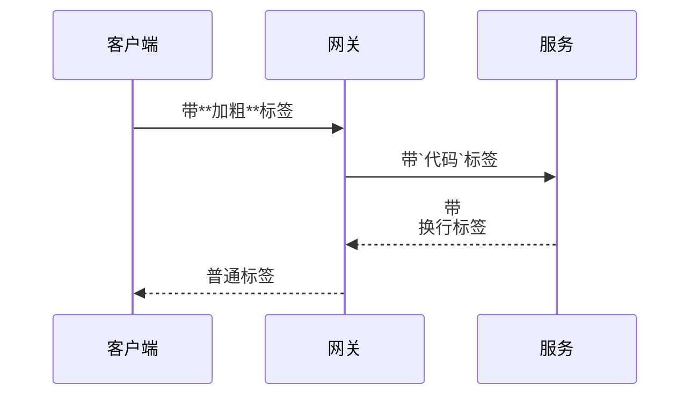

```
sequenceDiagram
    participant C as 客户端
    participant G as 网关
    participant S as 服务
    
    C->>G: 带**加粗**标签
    G->>S: 带`代码`标签
    S-->>G: 带<br>换行标签
    G-->>C: 普通标签

```

**语法要点：**

- 支持Markdown格式：`**加粗**`、`*斜体*`、``代码``
- 支持HTML标签：`<br>`换行、`<b>`加粗等
- 标签过长会自动换行


## 四、控制流程结构

### 1. 条件分支 (alt/else)

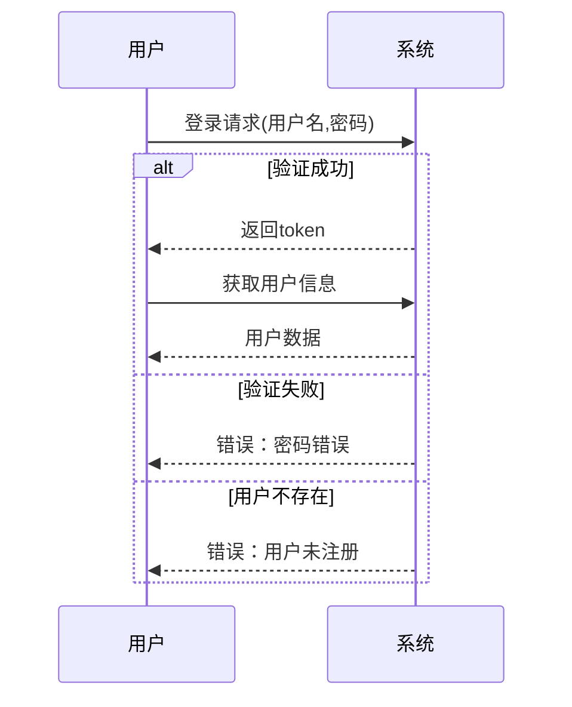

```
sequenceDiagram
    participant U as 用户
    participant S as 系统
    
    U->>S: 登录请求(用户名,密码)
    
    alt 验证成功
        S-->>U: 返回token
        U->>S: 获取用户信息
        S-->>U: 用户数据
    else 验证失败
        S-->>U: 错误：密码错误
    else 用户不存在
        S-->>U: 错误：用户未注册
    end

```


### 2. 可选分支 (opt)

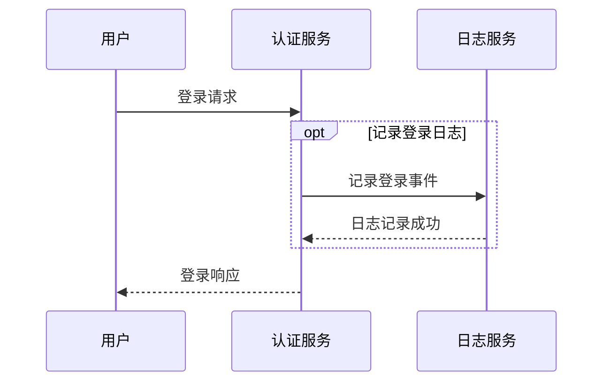

```
sequenceDiagram
    participant U as 用户
    participant A as 认证服务
    participant L as 日志服务
    
    U->>A: 登录请求
    
    opt 记录登录日志
        A->>L: 记录登录事件
        L-->>A: 日志记录成功
    end
    
    A-->>U: 登录响应

```


### 3. 循环结构 (loop)

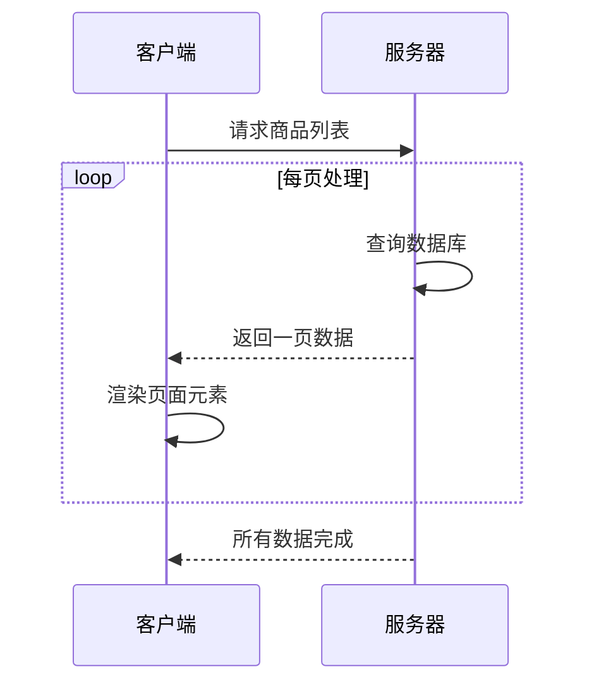

```
sequenceDiagram
    participant C as 客户端
    participant S as 服务器
    
    C->>S: 请求商品列表
    
    loop 每页处理
        S->>S: 查询数据库
        S-->>C: 返回一页数据
        C->>C: 渲染页面元素
    end
    
    S-->>C: 所有数据完成

```


### 4. 并行处理 (par)

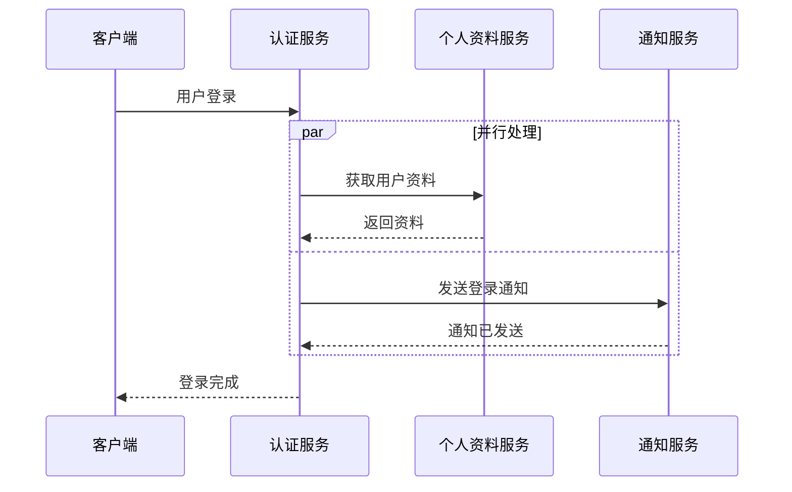

```
sequenceDiagram
    participant C as 客户端
    participant AS as 认证服务
    participant PS as 个人资料服务
    participant NS as 通知服务
    
    C->>AS: 用户登录
    
    par 并行处理
        AS->>PS: 获取用户资料
        PS-->>AS: 返回资料
    and
        AS->>NS: 发送登录通知
        NS-->>AS: 通知已发送
    end
    
    AS-->>C: 登录完成

```


### 5. 关键区域 (critical)

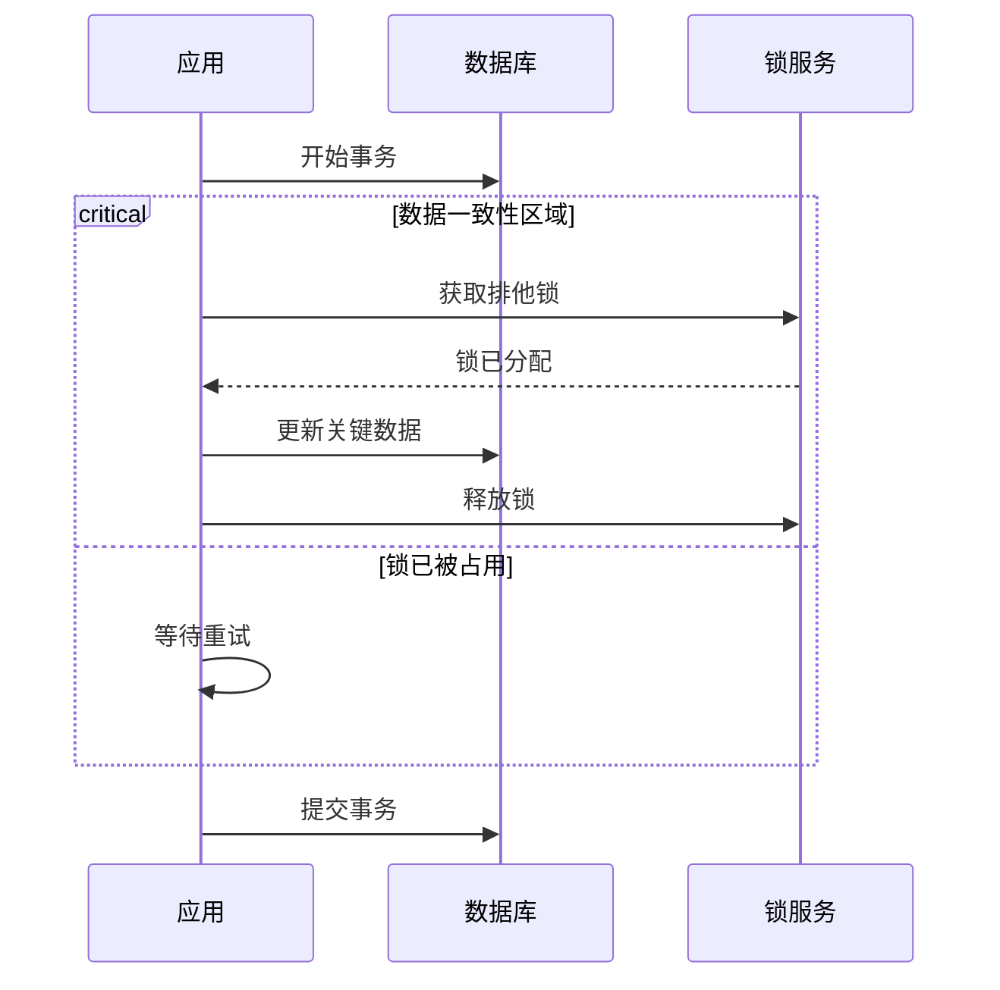

```
sequenceDiagram
    participant A as 应用
    participant D as 数据库
    participant L as 锁服务
    
    A->>D: 开始事务
    
    critical 数据一致性区域
        A->>L: 获取排他锁
        L-->>A: 锁已分配
        A->>D: 更新关键数据
        A->>L: 释放锁
    option 锁已被占用
        A->>A: 等待重试
    end
    
    A->>D: 提交事务

```


## 五、注释和标注系统

### 1. 位置注释

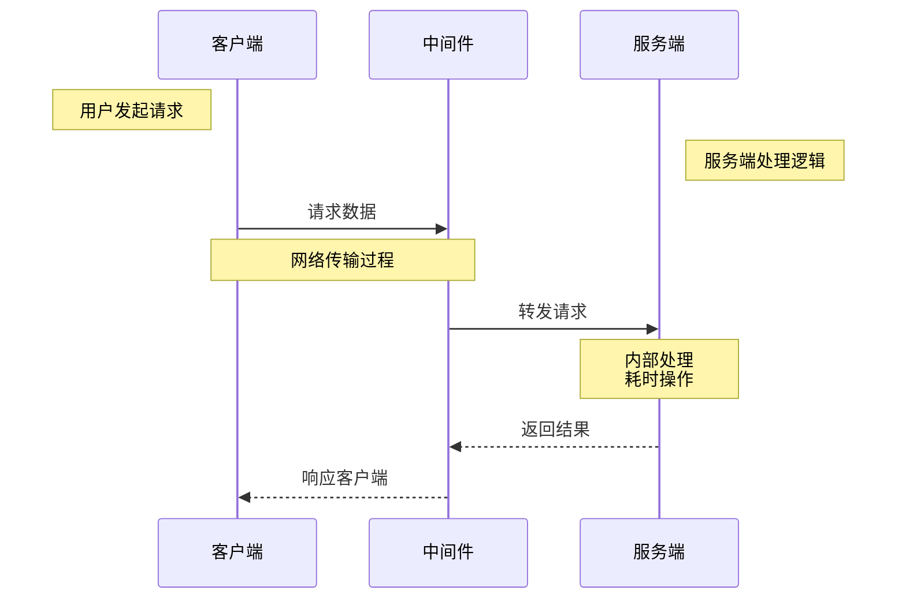

```
sequenceDiagram
    participant C as 客户端
    participant M as 中间件
    participant S as 服务端
    
    Note left of C: 用户发起请求
    Note right of S: 服务端处理逻辑
    
    C->>M: 请求数据
    Note over C,M: 网络传输过程
    M->>S: 转发请求
    Note over S: 内部处理<br>耗时操作
    S-->>M: 返回结果
    M-->>C: 响应客户端

```


### 2. 跨参与者注释

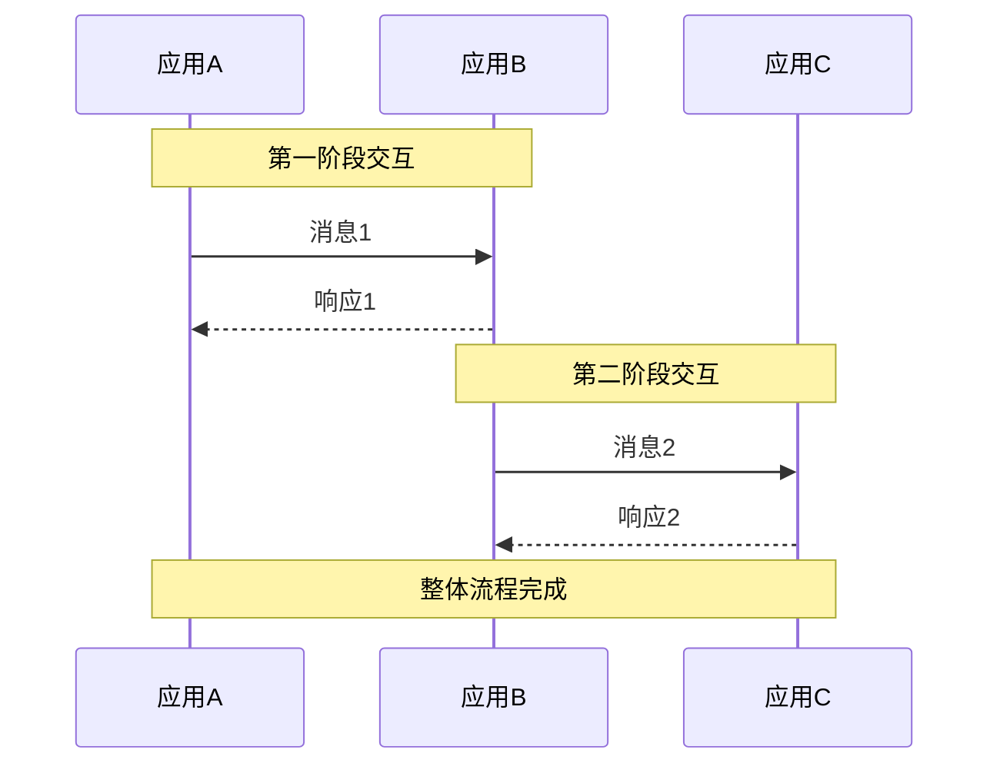

```
sequenceDiagram
    participant A as 应用A
    participant B as 应用B
    participant C as 应用C
    
    Note over A,B: 第一阶段交互
    A->>B: 消息1
    B-->>A: 响应1
    
    Note over B,C: 第二阶段交互
    B->>C: 消息2
    C-->>B: 响应2
    
    Note over A,C: 整体流程完成
```


### 3. 激活区间

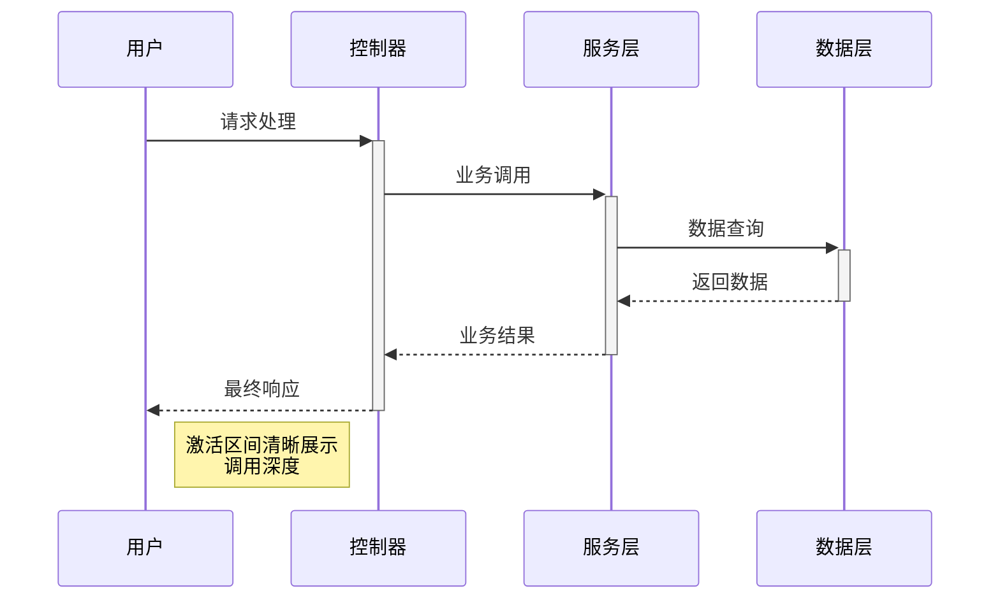

```
sequenceDiagram
    participant U as 用户
    participant C as 控制器
    participant S as 服务层
    participant D as 数据层
    
    U->>+C: 请求处理
    C->>+S: 业务调用
    S->>+D: 数据查询
    D-->>-S: 返回数据
    S-->>-C: 业务结果
    C-->>-U: 最终响应
    
    Note right of U: 激活区间清晰展示<br>调用深度

```


## 六、高级特性应用

### 1. 自动编号

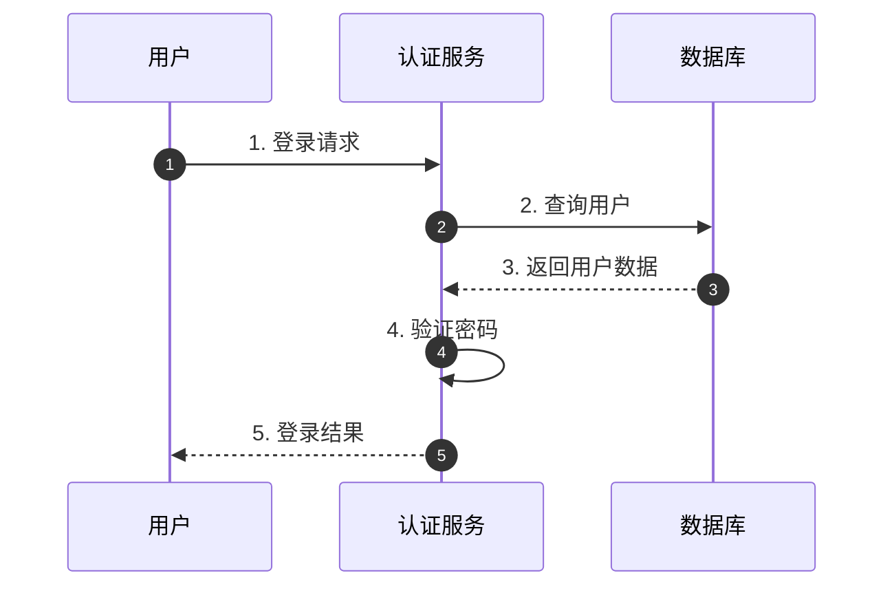

```
sequenceDiagram
    autonumber
    participant U as 用户
    participant A as 认证服务
    participant D as 数据库
    
    U->>A: 1. 登录请求
    A->>D: 2. 查询用户
    D-->>A: 3. 返回用户数据
    A->>A: 4. 验证密码
    A-->>U: 5. 登录结果

```


### 2. 背景色和区域分组

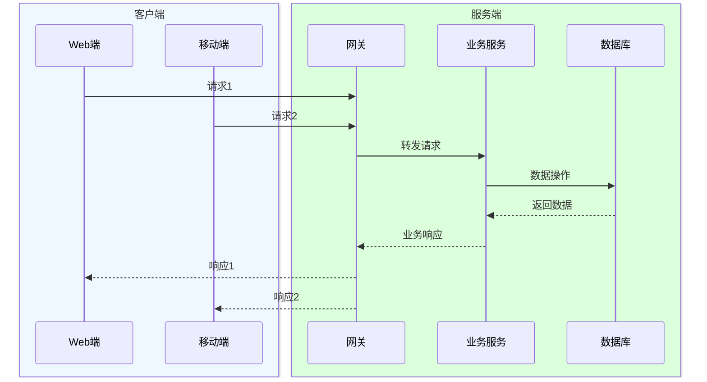

```
sequenceDiagram
    box rgb(240, 248, 255) 客户端
    participant W as Web端
    participant M as 移动端
    end
    
    box rgb(220, 255, 220) 服务端
    participant G as 网关
    participant S as 业务服务
    participant DB as 数据库
    end
    
    W->>G: 请求1
    M->>G: 请求2
    G->>S: 转发请求
    S->>DB: 数据操作
    DB-->>S: 返回数据
    S-->>G: 业务响应
    G-->>W: 响应1
    G-->>M: 响应2

```


  


```mermaid

```


