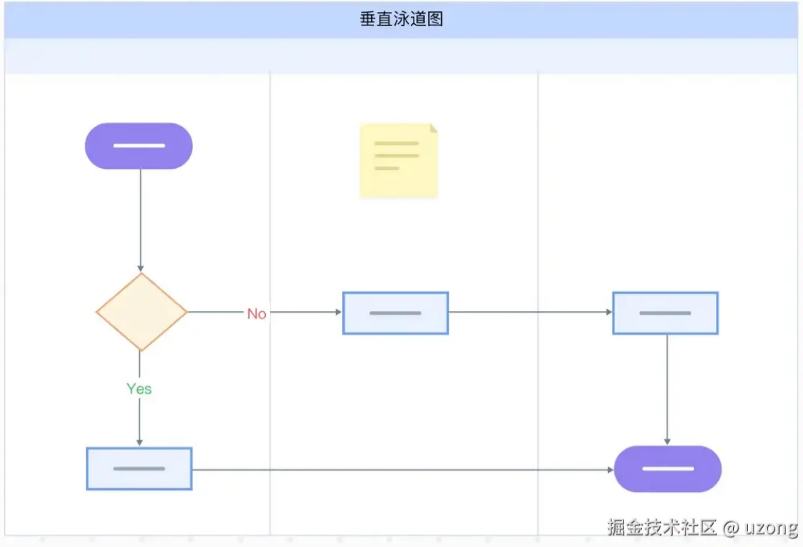
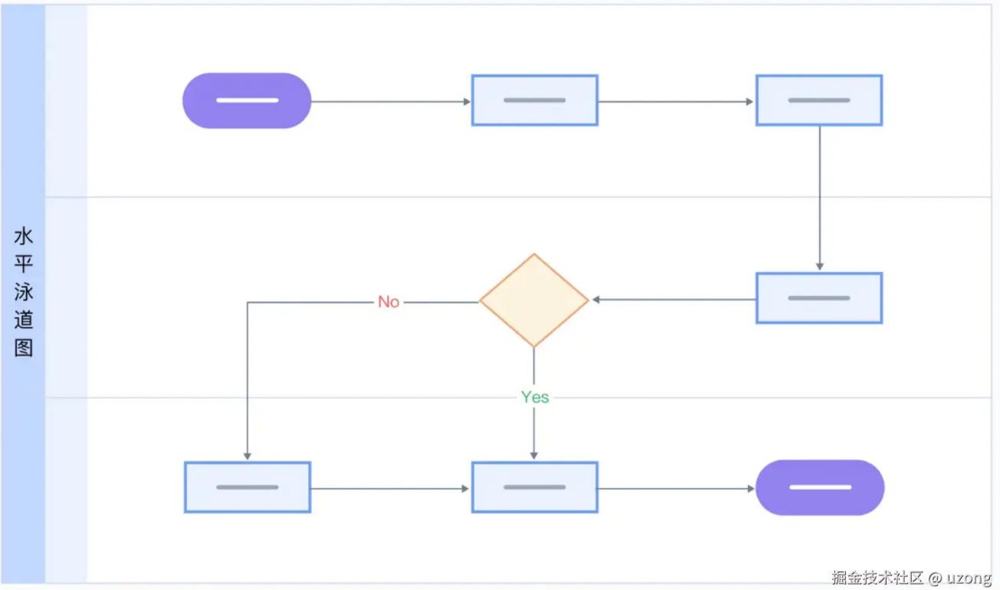

# 泳道流程图

**核心价值**：讲清楚项目最核心的业务链路是怎么跑通的，以及每个环节由谁（哪个模块 / 系统 / 角色）负责。

纯文字讲不清业务流转，一张泳道图能直观展示跨模块、跨系统的协作逻辑，比普通活动图实用 10 倍。


## 一、图形含义

就像编程有语法规则一样，流程图也有其通用符号体系。这些图形虽小，却是保证可读性和专业性的关键。

| **图形**     | **名称**  | **含义**                                                     |
| ------------ | --------- | ------------------------------------------------------------ |
| ○ 椭圆形     | 开始/结束 | 每个流程至少有一个开始节点，可以有多个结束点（如“成功提交”、“取消操作”） |
| ▭ 矩形       | 处理步骤  | 表示具体动作，如“生成订单”、“发送短信验证码”                 |
| ◇ 菱形       | 判断条件  | 必须有两个或以上出口，常见为“是/否”、“通过/拒绝”             |
| ▱ 平行四边形 | 输入/输出 | 用户输入信息或系统输出结果，如“上传身份证照片”、“显示支付成功提示” |
| → 带箭头连线 | 流程方向  | 表示执行流向，不可随意折返或交叉                             |


## 二、基本结构

再复杂的系统，本质上都是由三种基础逻辑构成的。掌握它们，你就掌握了流程建模的底层能力。


### 1. 顺序结构：最简单的线性流程

所有步骤依次执行，没有分支也没有回环。

```
[开始] → [输入手机号] → [获取验证码] → [填写验证码] → [完成注册] → [结束]

```

✅ 适用场景：注册、引导流程、单向提交类功能。
💡 绘制建议：保持横向或纵向排列，避免折线绕来绕去，破坏阅读节奏。


### 2. 选择结构：根据条件决定路径

这是流程图中最常见的分支模式，用于处理“如果…那么…”的逻辑。

```
          ┌──────────────┐
          ↓ 是           ↓ 否
[余额充足?] → [直接扣款]   [跳转充值页]
          └──────────────┘
```

📌 实践中常见误区：多层嵌套导致“菱形迷宫”。比如在一个判断里又套一个判断，层层叠叠，最终连自己都看不懂。
✅ 解法：将深层逻辑封装成子流程，主图只保留关键决策点。


### 3. 循环结构：重复执行直到满足条件

适用于需要重试、轮询或批量处理的场景。

#### 3.1 当型循环（While）

先判断，再执行。

```
     ←─────────────┐
     ↓             │
[尝试次数 < 3?] —否—→ [结束]
   是↓
   [执行登录]
     ↓
     └─────────────┘
```


#### 3.2 直到型循环（Until）

先执行一次，再判断是否继续。

```
   [执行登录]
     ↓
[登录成功?] —否—→ [等待1秒] → [重试]
   是↓
  [进入首页]

```


## 三、什么是泳道图？

泳道图的核心思想很简单：把流程中的每个步骤，按执行者（人、系统、模块）分组排列，就像游泳池里的泳道一样，各走各道，互不干扰又彼此关联。


每一列就是一个“泳道”，代表一个责任主体。流程从左到右、从上到下流动，谁在什么时候做了什么，一目了然

一眼就能看出：**谁干了什么，谁依赖谁，边界是什么。**

**与流程的差异点：**

- 流程图聚焦：“步骤顺序”，侧重 “先做什么、再做什么”，适合梳理线性业务流程；
- 泳道图聚焦： “流转通道”，侧重 “什么东西在什么约束下通过什么路径流转”，适合拆解复杂、多路径、有规则约束的流转场景（如分布式系统数据同步、供应链物料流转、微服务请求链路等）


## 四、泳道图组成元素

- **泳池：** 泳池是泳道图的外部框架，泳道、流程都包含于泳池内。
- **泳道：** 泳池里可以创建多个泳道。
- **流程：** 实际的业务流程。
- **部门：** 通过部门或者责任来区分，明确每个部门/人/信息系统负责完成的任务环节。
- **阶段：** 通过任务阶段来区分，明确每个阶段需要处理的任务环节。


## 五、泳道图分类

### 1.  垂直泳道图

垂直泳道图采取上下布局结构，‌主要强调职能群体。**这种布局方式更适合于展示跨职能任务和流程中，‌各职能部门或角色之间的垂直关系和职能分工。**




### 2. 水平泳道图

水平泳道图则采用左右布局结构，‌重点在于事件进程的展示。**这种布局方式更适合于强调事件或过程的水平流动，‌以及不同阶段或部门在流程中的水平参与**




