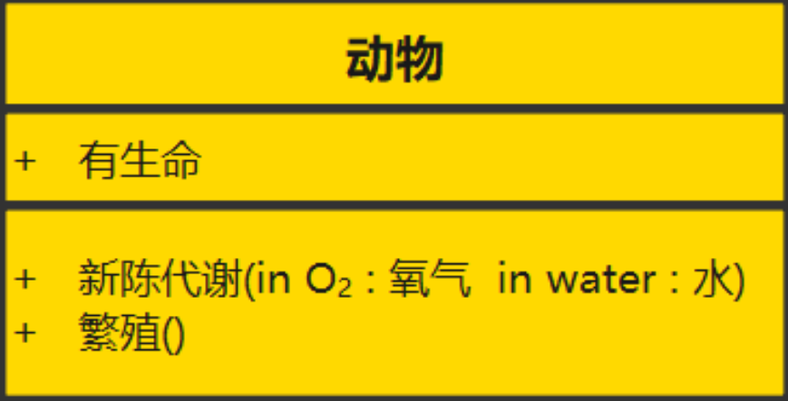
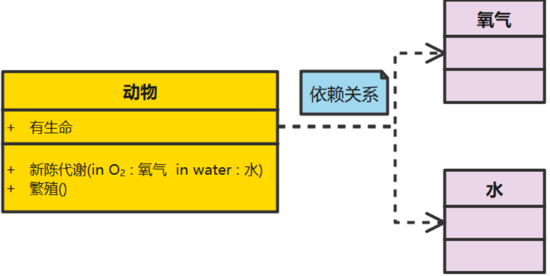
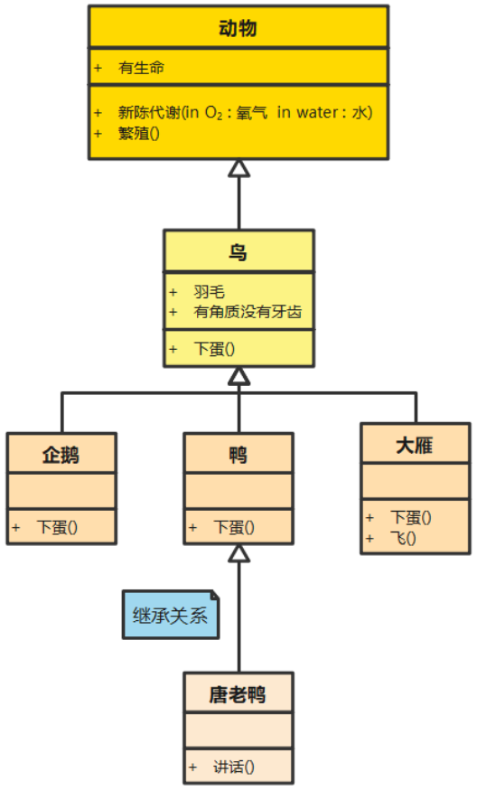
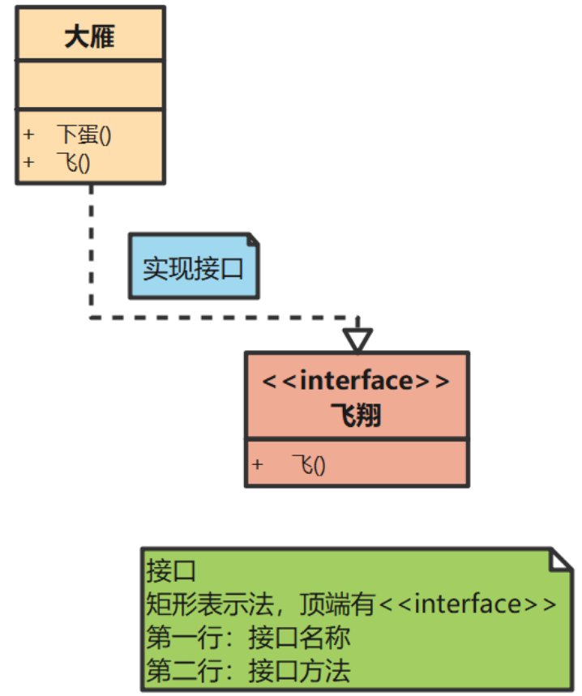
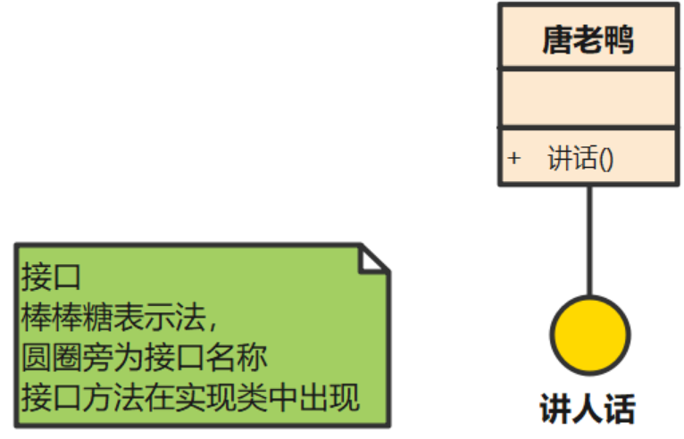
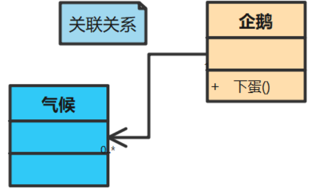
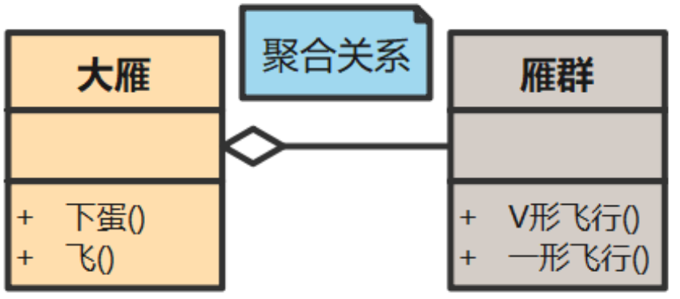
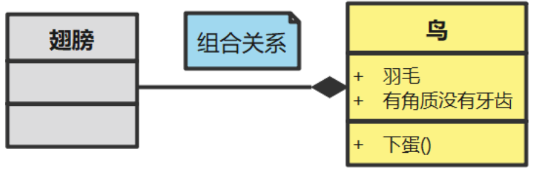

# 类图

**核心价值**：沉淀代码的设计思路，尤其是用到设计模式、领域模型复杂的模块。

注意：**绝对不要画全量类图**—— 不仅维护成本极高，而且密密麻麻没人看。

## 一、UML类图怎么画？

类图是 UML（统一建模语言）中最核心的结构图，用于描述 Java 项目中类、接口、枚举的结构，以及它们之间的继承、实现、关联、依赖等关系，是架构设计、代码梳理、文档编写的核心工具。

它由两部分组成，类，类之间的关系

## 二、元素的表示

Java 中常见类型在类图中有标准画法：

- 普通类：三层矩形，从上到下依次是「类名」「属性」「方法」
  - 属性格式：`访问修饰符 属性名: 类型`
  - 方法格式：`访问修饰符 方法名(参数列表): 返回值类型`
  - 访问修饰符符号：`+` public、`-` private、`#` protected、`~` 包级私有
- **接口**：类名上方标注 `<<interface>>`，或用「棒棒糖」简化表示
- **抽象类**：类名斜体显示，或标注 `<<abstract>>`
- **枚举**：类名上方标注 `<<enum>>`

## 二、类

**类是具有相似结构、行为和关系的一组对象的描述符，是面向对象系统中最重要的构造块。**

如下图所示，就表示一个类：

三个格子从上至下分别表示：

- 类名称（如果是接口，就使用斜体表示）
- 类的特性（一般是类的字段和属性，可以没有）
- 类的操作（一般是类的方法或行为）

它们前边的符号有以下几类：

- “+”表示public
- “-”表示private
- “#”表示protected

## 三、类的关系

**除了类，类图中还有一个重要元素，即类之间的关系。**

根据类的关系的不同，具体可分为6种：

### 1. 依赖关系

> 虚线箭头，指向被依赖类
>
> 方法参数、局部变量、静态方法调用
>
> 最弱的临时使用关系，一个类的方法运行时需要另一个类协助

所谓依赖关系，就是构造这个类的时候，需要依赖其他的类，比如：动物依赖水和氧气。如下图所以：

### 2. 继承、泛化关系

> 空心三角 + 实线，三角指向父类。
>
> `extends` 关键字。
>
> 子类继承父类的属性和方法，是 "is-a" 关系。

继承（泛化）关系，它指定了子类如何特化父类的所有特征和行为。例如：鸟是动物的一种，企鹅、鸭、大雁是鸟的一种。

### 3. 实现关系

> 空心三角 + 虚线，三角指向接口。
>
> `implements` 关键字。
>
> 类实现接口的所有方法。

一种类与接口的关系，表示类是接口所有特征和行为的实现。它有两种表示方法：

1. 第一种：矩形表示法

- 顶端有<<interface>>
- 第一行：接口名称
- 第二行：接口方法

2. 第二种：棒棒糖表示法

- 圆圈旁为接口名称
- 接口方法在实现类中出现

### 4. 关联关系

> 实线箭头，指向被引用类
>
> 成员变量
>
> 类之间的强引用关系，单向 / 双向均可

所谓关联关系，就是这个类有一个属性是其他类。

#### 4.1 聚合关系

> 空心菱形 + 实线，菱形指向整体
>
> 成员变量，部分对象可独立存在
>
> 弱整体 - 部分关系，部分可脱离整体存在（如「班级」和「学生」）

聚合关系是关联关系的一种，是强的关联关系 ；

特点： 部分对象的生命周期并不由整体对象来管理。也就是说，当整体对象已经不存在的时候，部分的对象还是可能继续存在的。比如：一只大雁脱离了雁群，依然是可以继续存活的。

#### 4.2 组合关系

> 实心菱形 + 实线，菱形指向整体。
>
> 成员变量，整体对象负责部分对象的生命周期。
>
> 强整体 - 部分关系，部分不能脱离整体独立存在（如「人」和「心脏」）。

组合关系同样是关联关系的一种，是比聚合关系还要强的关系。

特点：在组合中，部分与整体生命期一致，部分与组合同时创建并同时消亡 。比如：鸟与翅膀的关系。

#### 4.3 如何区分

一个是私有属性，一个是共享属性

