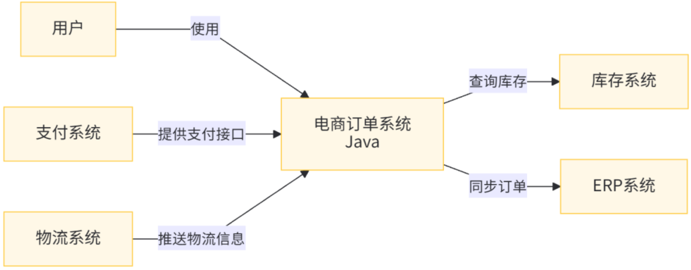
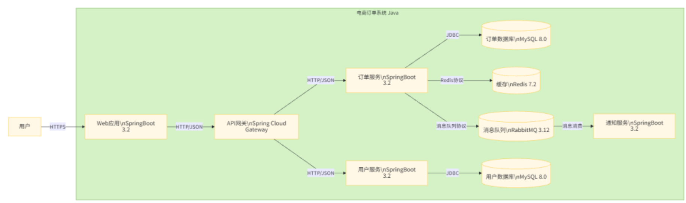
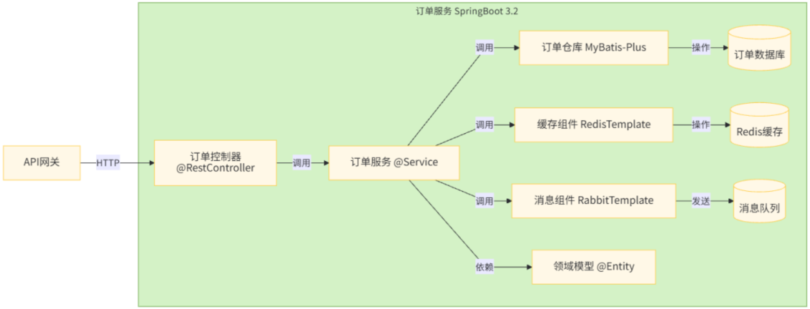
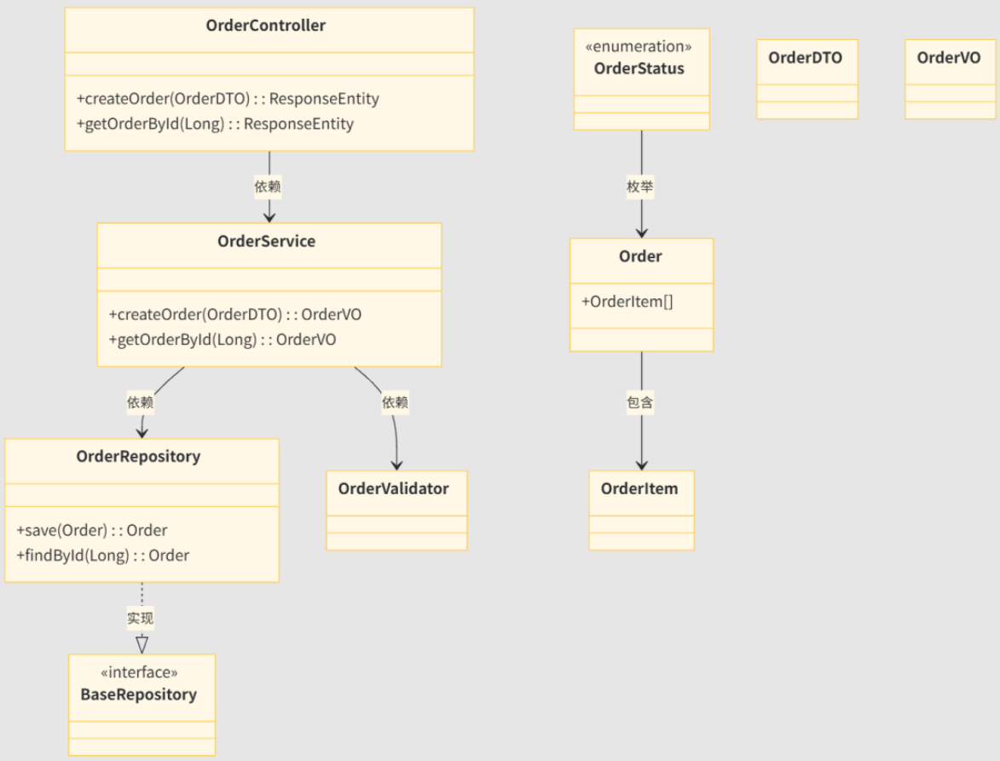

# 系统架构图

给项目画一张「全局地图」，1 分钟让新人看懂项目的技术分层、模块划分、技术选型，建立整体认知。

这是所有沉淀文档的开篇，没有它，新人直接扎进代码会完全迷路。


## 一、架构图分类

### 1. 业务架构图

> 上下文图（Context Diagram）

- **受众**：产品、业务方、管理层
- **核心内容**：业务领域划分、模块边界、核心业务流程、上下游业务依赖
- **价值**：对齐业务认知，讲清系统 “能做什么”


### 2. 应用架构图（最常用）

- **受众**：前后端开发、测试、项目负责人
- **核心内容**：系统分层结构、模块拆分、服务间调用关系、核心链路
- **价值**：指导开发协作，帮助新人快速掌握系统全貌


### 3. 技术架构图

- **受众**：技术负责人、架构师、运维
- **核心内容**：技术栈选型、中间件组件、核心技术能力、框架依赖
- **价值**：明确技术方案，评估技术风险与落地成本


### 4. 部署架构图

- **受众**：运维、SRE、运维开发
- **核心内容**：服务器节点、集群拓扑、网络分区、部署环境、容灾方案
- **价值**：指导部署上线、容量规划与故障排查


### 5. 数据架构图

- **受众**：DBA、后端开发、数据团队
- **核心内容**：数据存储方案、数据流转链路、分库分表策略、数据同步机制
- **价值**：规范数据治理，保障数据一致性与可靠性


## 二、绘制步骤

以 Java 后端应用架构图为例


### 1. 明确边界，梳理核心实体

先划定系统边界：区分内部系统、外部依赖、用户角色三类实体。例如 Java 电商系统的核心实体包括：用户端、管理后台、第三方支付、物流系统，以及内部的用户 / 商品 / 订单 / 支付核心模块。


### 2. 搭建分层框架

Java 后端系统通用自上而下分层结构，先搭好大框架再填充内容：

- **接入层**：Nginx、CDN、API 网关（Spring Cloud Gateway）
- **应用服务层**：各业务模块 / 微服务（用户服务、订单服务等）
- **中间件层**：缓存（Redis）、消息队列（RocketMQ/Kafka）、注册配置中心（Nacos）
- **数据存储层**：MySQL、Elasticsearch、对象存储、分库分表中间件
- **基础设施层**：监控、日志、链路追踪（SkyWalking）、容器环境


### 3. 填充模块，标注关系

按分层填入核心模块，用箭头标注调用方向，在线上标注通信协议（HTTP/Dubbo RPC / 消息）。

- 同步调用用实线箭头，异步消息用虚线箭头
- 强依赖、弱依赖可用颜色或线条粗细区分
- 数据流向与服务调用流向分开标注


### 4. 补充技术栈与关键标注

在对应模块旁标注核心技术选型，例如：

- 服务层标注 Spring Boot + Spring Cloud
- 持久层标注 MyBatis-Plus
- 数据库标注 MySQL 8.0 + ShardingSphere


### 5. 添加图例与说明

自定义的符号、颜色、线条样式必须补充图例；核心链路、特殊设计可增加文字注解。


### 6. 校验优化

检查逻辑是否闭环、是否存在层级混乱、是否信息冗余，可找目标受众验证可读性。


## 三、Java 后端典型架构参考

### 1. 单体架构经典分层

```
接入层：Nginx 负载均衡
    ↓
表现层：Controller、拦截器、参数校验（Spring MVC）
    ↓
业务层：Service 业务逻辑、事务控制、领域服务
    ↓
持久层：DAO、ORM 映射（MyBatis/JPA）
    ↓
数据层：MySQL、Redis、本地文件存储
```


### 2. 微服务架构经典分层

```
终端层：APP / Web / 小程序 / 开放平台
    ↓
接入层：Nginx + API网关（鉴权、限流、路由）
    ↓
业务服务层：用户服务、商品服务、订单服务、支付服务...
    ↓
中间件层：Nacos、Redis、RocketMQ、分布式锁、分布式事务
    ↓
数据存储层：各服务独立库 + ES + 对象存储 + 数据同步组件
    ↓
基础设施层：Prometheus监控、ELK日志、SkyWalking链路追踪、K8s
```


## 四、优秀架构图标准

- **准确性**：架构图必须真实反映系统的实际设计，不能为了 "好看" 而偏离实际。
- **简洁性**：只包含必要的信息，去掉所有无关细节，避免信息过载。
- **一致性**：在整套架构图中使用统一的符号、颜色和风格，保持抽象层次的连贯性。
- **针对性**：根据目标受众调整架构图的细节程度和侧重点，给管理层看的和给开发看的架构图应该不同。


## 五、C4视图绘制方案

Java 系统的架构图不是单一的图，而是一组从不同视角、不同抽象层次描述系统的图的集合。根据 C4 模型（一种流行的软件架构描述方法），我们可以将 Java 架构图分为四个层次。


### 1. 四个层次

#### 1.1 上下文图（Context Diagram）

**目标受众**：所有相关人员（开发、测试、产品、管理层等）

**抽象层次**：最高，关注系统与外部环境的关系

**核心内容**：系统本身、用户、其他系统以及它们之间的交互



**绘制要点**：

- 系统名称要清晰，最好注明技术栈（如 Java）
- 外部系统和用户要明确
- 交互关系要简单明了，标注关键交互内容


#### 1.2 容器图（Container Diagram）

**目标受众**：技术负责人、开发经理、资深开发

**抽象层次**：中高，关注系统由哪些可部署的容器组成

**核心内容**：系统中的容器（应用、数据库、缓存等）以及它们之间的通信方式



**绘制要点**：

- 容器类型要明确（应用、数据库、缓存等）
- 标注关键技术选型（如 Spring Boot、MySQL 等）
- 通信方式和协议要清晰（如 HTTP、JDBC 等）


#### 1.3 组件图（Component Diagram）

**目标受众**：开发团队、测试团队

**抽象层次**：中，关注单个容器内部的组件构成

**核心内容**：容器内的核心组件、组件之间的关系以及它们与外部的交互



**绘制要点**：

- 组件职责要明确（可通过注解提示，如 @Service）
- 组件之间的依赖关系要清晰
- 外部交互点要突出显示


#### 1.4 类图（Class Diagram）

**目标受众**：开发人员

**抽象层次**：最低，关注具体的类设计

**核心内容**：关键类、类的属性和方法、类之间的关系（继承、实现、关联等）



**绘制要点**：

- 只展示核心类，避免包含所有类
- 突出关键方法和属性，不必列出所有细节
- 明确标注类之间的关系类型（依赖、继承、实现等）


