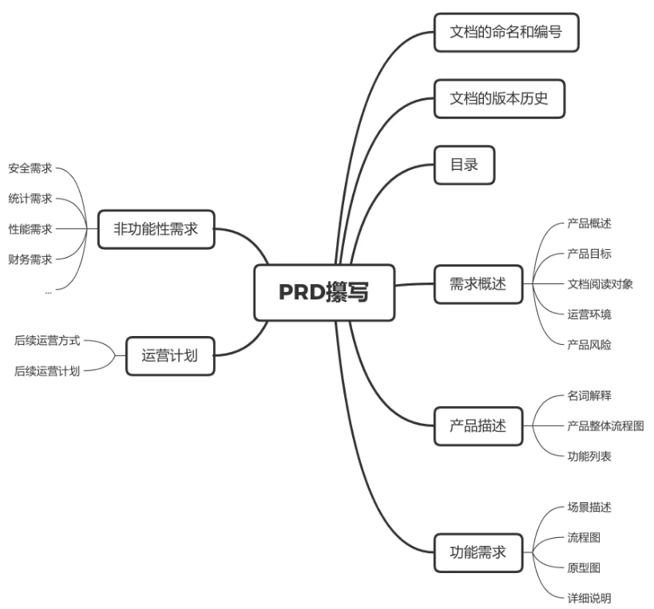
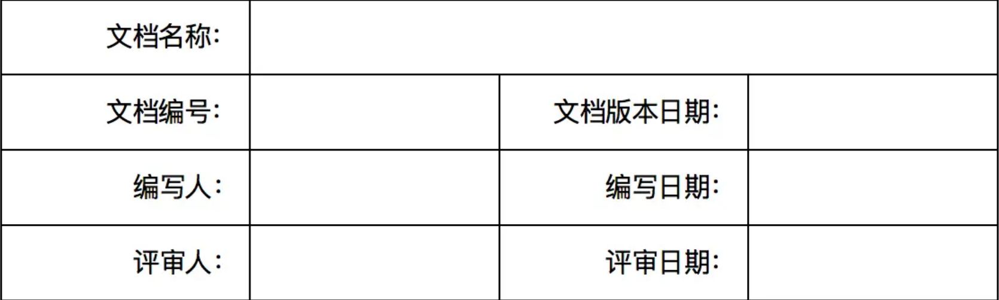
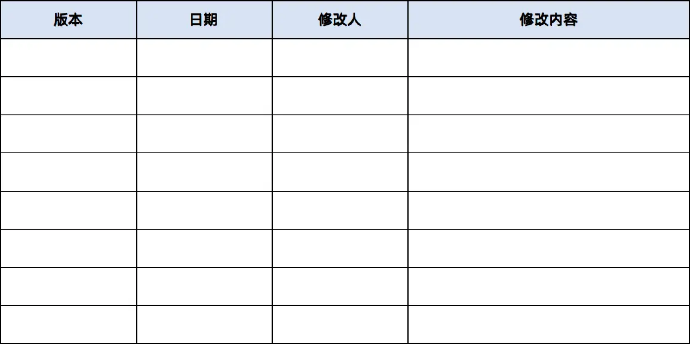

# PRD文档

> 产品从开发到结束，过程中会经历很多阶段，为了确保需求可以满足提出者的诉求，且过程中的所有人都可以达成一致理解，PRD的存在就至关重要了。


## 一、什么是PRD？

PRD是产品需求文档。

简单来说就是一份用来介绍产品是什么，以及怎么实现的文档。

- “产品”：介绍产品
- “需求”：阐述需求
- “文档”：以文档的形式呈现

在整个软件产品的开发，一定是不同部门、不同角色、不同岗位，协同工作的成果；因此在过程中，也就需要大家各自在自己的职责范围内，完成相应的工作。

- 研发可以根据PRD获知整个产品的逻辑，作为编码的依据；
- 测试可以根据PRD编写测试用例，为正式测试做准备；
- 交互设计师可以根据PRD设计交互细节；
- 业务人员可以通过PRD提前了解产品，为运营和推广做准备；


## 二、为什么要有PRD？

> 在说PRD之前，首先讲述一下产品开发的流程中，核心的几个节点：需求分析——需求确认——功能拆解——流程绘制——原型绘制——PRD书写——PRD讲解——产品开发——测试验收…
>
> - 需求来源：产品接收业务需求；
> - 需求分析：产品分析需求是否合理，需求价值点；
> - 需求确认：同业务方确认需求；
> - 功能拆解：产品基于业务需求，拆解产品需求；
> - 流程绘制：产品基于需求，明确系统实现流程；
> - 原型绘制：产品绘制原型图，原型相当于产品的一个最初的demo演示；
> - PRD书写：产品撰写PRD，需书说明PRD中详尽的写了需求的背景、来源、价值；以及包括的功能范围、功能说明；
> - PRD评审：产品同业务方、开发团队、UI设计等相关部门，基于PRD文档召开需求评审；
> - 产品开发：研发人员基于PRD文档开发代码；UI人员基于PRD设计页面；测试人员基于PRD写测试用例；产品配合各个部门推进需求开发；
> - ……

需求从开始到结束，期间经过了不同的阶段，需求的提出者、需求的实现者并不会一直同时跟进需求的进度。所以要确保开发出来的需求，满足提出者的诉求，且参与其中的所有人可以理解一致，这个时候就需要PRD把这些需求描述清楚。

开发可以根据PRD获知整个产品的逻辑；测试可以根据PRD建用例；项目经理可以根据PRD拆分工作包，并分配开发人员；交互设计师可以通过PRD来设计交互细节。

PRD是项目启动之前，必须要通过评审确定的最重要文档：

- 保证一致的需求理解；
- 提高协同的效率；
- 版本的记录和留存。


## 三、动手前，先思考

**解决什么问题？**
解决用户什么问题？发现问题比解决方案更重要。
给公司能否带来收益？
相关干系人的需求是什么？
是不是老板说这样做的？
是不是“他们”说这样做的？他们是谁？
真正的问题是他们说的那样吗？

**怎么衡量？**
不同的干系人，通过什么指标去衡量问题是否已解决？有没有埋点？有没有业务数据？谁来运营？

**需要多少资源？**
为了实现这个解决方案，需要多少资源、多少人？能大致评估吗?

**会不会太复杂？**
这个解决方案会不会太复杂？复杂是产品的坟墓。有没有性价比更高的解决方案？会不会影响现有的业务？会不会影响历史数据？

**有风险吗？**
这个方案会有风险吗?有没有违法？相关政策是什么？尤其是金融、游戏领域，国家监管比较严，有可能上不了应用市场，有可能三方服务商不会提供服务。

**有创新吗？**
有更创新的解决方案吗?竞品怎么做的，有没有调研3个以上的竞品方案。

**用户怎么说？**
需求真的是提交人说的那样吗?有亲身体验过场景吗？有跟用户面对面交流吗？熟悉相关领域的基本知识吗？有看不懂的名词吗？动手写文档或做设计方案之前，一定要问问自己以上几个问题，想清楚了在动手，任何一个问题没想清楚，都不要进行下一步。


## 四、PRD文档的撰写

产品经理作为一直参与其中的角色，也作为PRD文档的输出者，需要负责PRD的撰写、文档更新、文档版本记录。PRD文档侧重的是对产品功能和性能的说明，相对于业务需求中的同样内容，要更加详细，并进行量化。

不同的公司、不同的项目对需求实现的流程都不太一样，有的可能是通过MRD进行沟通、有的是依据于BRD、更多的需求可能是一句话的事情，无论是哪一种形式，最好还是通过一个正式的方式，将业务需求确认下来，可以避免很多研发过程中的风险，像是拉扯、甩锅……

同样，不同的公司对PRD文档的形式要求也不一样，有的是word文档形式、有的是原型备注说明，需要根据具体的需求场景、紧迫程度来衡量，无论什么形式，PRD的核心的目的，依旧是把事情说明白。

```
举例：
# [产品/功能名称] PRD

## 1. 文档信息
- 版本：v1.0
- 作者：xxx
- 日期：2025-xx-xx
- 修订记录：...

## 2. 项目背景
### 2.1 背景描述
### 2.2 产品目标
### 2.3 目标用户

## 3. 需求概述
### 3.1 用户故事
### 3.2 功能清单（含优先级）

## 4. 功能详细设计
### 4.1 功能模块A
  - 功能描述
  - 页面原型
  - 交互说明
  - 业务规则
  - 异常处理
### 4.2 功能模块B
  - ...

## 5. 非功能需求
### 5.1 性能要求
### 5.2 兼容性要求
### 5.3 安全要求
### 5.4 数据埋点需求

## 6. 上线计划
- 预计开发周期
- 里程碑节点

## 7. 开放问题 & 风险
```


### 1. PRD的框架

在我们进入一家新的公司之后，写PRD之前，通常都会向同事询问：“我们这里的PRD模版什么样子，发一份给我看看吧。”每个公司都有自己的PRD模版，有标准的页眉、页脚以及内容框架，包括但不限于：



- 文档的命名和编号
- 文档的版本历史
- 目录
- 需求概述
- 产品描述
- 功能需求
- 非功能需求
- 运营计划

当然以上内容是按需自取，任何事情都要讲究因地制宜。实在没有必要为了套模版，一句话换不同角度去描述，长篇大论，反倒影响到需求的传达。以自己的工作为例，经常用到的模块像是概述、产品描述、功能需求、非功能需求；像是一些大型项目，验收标准、运营计划都会有单独的文档说明。


### 2. PRD的攥写

#### 2.1 文档的命名和编号

- 主标题：“XXXX需求文档”，主标题直接明了的说明，这是个什么产品、什么需求。讲究排版的童鞋，也自定义可以写一串“Product Requirements Document”上去；
- 副标题：当主标题无法说明清楚的情况下，可以通过副标题，更清楚的表达需求的范围；
- 编号：根据公司的要求书写即可。


#### 2.2 文档的版本历史

文档信息：形式可参考如下。



版本更新历史：形式参考如下，用来记录文档版本的更新，以及更新内容，方便协作以及回溯。




#### 2.3 目录

一方面目录展示了整个PRD的逻辑，以及PRD的需求概览；另一方面也起到了快速检索、快速定位的作用。


#### 2.4 项目背景与目标

说明 **为什么要做这个产品/功能**，包括：

- **背景**：当前存在什么问题？市场环境如何？
- **目标**：希望达成什么业务目标？（例如：提升下单转化率20%）
- **目标用户**：这个功能是给谁用的？


#### 2.5 需求概述

用 **用户故事（User Story）** 的形式描述需求，帮助团队站在用户角度理解功能：

> 作为一个 [用户角色]， 
>
> 我希望 [完成某个操作]， 
>
> 以便 [达到某个目的]。

**示例**：

- 作为一个 **已登录用户**，我希望 **一键使用上次的收货地址下单**，以便 **快速完成购买**。
- 作为一个 **新用户**，我希望 **在结算时直接新增收货地址**，以便 **不用跳到个人中心设置**。


#### 2.6 功能需求

##### 2.6.1 功能清单

| 功能编号 | 功能名称       | 优先级     | 说明               |
| -------- | -------------- | ---------- | ------------------ |
| F001     | 快捷结算       | P0（必须） | 支持一键下单       |
| F002     | 地址选择       | P0（必须） | 支持切换/新增地址  |
| F003     | 优惠券自动匹配 | P1（重要） | 自动选择最优优惠券 |
| F004     | 订单备注       | P2（一般） | 用户可添加备注信息 |


##### 2.6.2 功能设计

针对每个功能，需要说明：

- 功能描述
- 页面原型
- 交互说明
- 业务规则
- 异常处理


##### 2.6.5 开放问题与风险

记录当前尚未确定的问题和潜在风险：

- 第三方支付接口的审批时间是否影响上线？
- 大促期间并发量是否需要额外考虑？


#### 2.7 非功能需求

除了"做什么"，还需要说明一些技术和体验层面的要求：

- **性能要求**：页面加载时间不超过2秒
- **兼容性要求**：支持iOS 13+、Android 9+
- **安全要求**：支付信息需加密传输
- **数据埋点**：需要在哪些位置埋点，统计哪些数据


#### 2.8 交互以及UI设计


#### 2.9 上线计划


#### 2.10 运营计划


